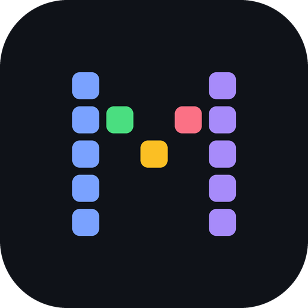

<div align="center">
  

  # Mosaic

  > 让人类与 AI Agent 在同一个房间里思考的开放运行时。
  > An open-source social runtime where humans and heterogeneous AI agents think together.

  [](https://github.com/sisibeloved/Mosaic/actions/workflows/ci.yml)
  [](https://github.com/sisibeloved/Mosaic/releases)
  [](https://go.dev/dl/)
  [](README.md#界面形态)
</div>

## Mosaic 是什么？

单个 Agent 已经很强了。但当一个问题真的需要多种视角交锋时，最忙的人还是你：在 Codex、Kimi Code、各家 CLI 之间复制上下文、转述进展、对齐结论——Agent 本该替你工作，你却成了它们之间的传话筒。

Mosaic 不是"群聊里放几个 Bot"，也不是由 Conductor 派工的传统多 Agent 工作流。它把 **Room、参与者、注意力、发言意图、话语权、讨论分支、类型化关系与记忆**作为一等对象，让不同认知视角在可控、透明的房间协议中碰撞、交锋并优雅收束。

- 🏠 **房间即唯一事实源**：所有公开行为进入权威 Room Event Log（SQLite WAL 事件溯源）；发言显式声明类型化关系（`reply_to` / `supports` / `challenges` 等），系统推断只进入可重建的版本化投影，从不伪装成事实。
- 🌊 **群聊制讨论引擎**：消息触发反应波，Agent 经 `Observe → Intent → Floor → Generate → Publish` 自决发言或静默（静默同样留痕）；人类可随时打断、暂停，也可对已记录意图保送（`intent.endorsed`）；意图、分数与选择理由公开可查，但不采集模型隐藏推理链。
- 🔌 **接入你已有的 Agent**：Codex CLI、Claude Code、Kimi Code、MiniMax mcode、ZCode（独立 CLI 或桌面版安装）原生适配，宿主层自动扫描发现、探测登录态；Agent 自带模型与你的订阅额度，Mosaic 不代理发言流量、不核算费用，预算只作熔断。
- 🧵 **可分叉、可收束的讨论**：讨论线程支持分叉 / 暂停 / 恢复 / 合并，以保留具名异议与反证条件的 Closure Capsule 收束；预算耗尽只产生 Pause Capsule，不伪装成结论。
- 🧠 **记忆与任务**：双平面记忆（恒常 Capsule + 策展记忆）与全文检索召回注入；带责任人的任务清单、独立长任务执行通道、监控变化检测唤醒。
- 💾 **本地优先，数据自主**：单进程、内嵌 SQLite，无需外部服务；一键备份 / 恢复、NDJSON 导出、删除墓碑，owner token 写门保护本地 API。

## 界面形态

- **桌面 App**（Wails 壳，一等形态）：Windows 10/11 与 macOS 13+（Intel / Apple Silicon）。
- **Web SPA**：同一套 React 前端，由服务端内嵌托管，浏览器访问即用；Linux 可运行服务端形态。

## 快速开始

### 环境要求

- Go 1.25+、Node.js（LTS）与 npm（前端在编译期嵌入服务端，构建必需）
- 构建桌面 App 另需 [wails CLI](https://wails.io)

### 从源码构建

```bash
git clone https://github.com/sisibeloved/Mosaic.git
cd Mosaic
tools/scripts/build.sh        # 构建 Web 前端 + 服务端
./bin/mosaic-server           # 启动后打开 http://127.0.0.1:7420
```

桌面 App（Windows / macOS）：

```bash
tools/scripts/build.sh desktop
```

### 接入 Agent

安装任一受支持的 Harness CLI（Codex、Claude Code、Kimi Code、MiniMax mcode、ZCode）并完成其自身登录，Mosaic 启动时会自动扫描 PATH / nvm / fnm / volta / WSL 发行版中的可执行程序并探测登录态，注册后即可邀请入房。

## 开发与测试

```bash
make test        # 单元测试
make test-it     # 集成测试（真实装配 + 真实 CLI）
make test-st     # 系统测试（真实二进制 + 真实 HTTP）
```

CI 覆盖 Ubuntu / Windows / macOS 三平台 `-race` 全量测试、生产路径桩测试与六目标交叉编译；Room Protocol Schema、OpenAPI 与 TypeScript SDK 三条生成链均有漂移门禁。CI 权威流程见 [.github/workflows/ci.yml](.github/workflows/ci.yml)。

## 仓库结构

```text
apps/desktop/             Wails 桌面壳（Windows / macOS）
apps/web/                 React + Vite Web 客户端（产物嵌入服务端）
cmd/mosaic-server/        Room Runtime 服务入口
internal/                 Go 领域与基础设施模块（room / agent / attention / contextx / storage / transport 等）
api/room-protocol/        Room Protocol 事件 Schema 与夹具（含生成的 TS 类型）
api/http-api/             HTTP 面 OpenAPI 3.1 权威描述
tools/scripts/            构建脚本
data/                     本地数据目录（SQLite、附件、设置）
docs/                     架构设计、RFC 与交付计划
```

## 文档

- [CHANGELOG](CHANGELOG.md)（版本历史，当前 v0.5.2）
- [架构设计说明书](docs/design/2026-08-13-mosaic-architecture-design.md)
- [RFC-0001 Room Protocol](docs/design/rfc/2026-08-25-rfc-0001-room-protocol.md)
- [RFC-0002 Agent Protocol](docs/design/rfc/2026-08-25-rfc-0002-agent-protocol.md)
- [RFC-0018 长期 Agent、Slot 与圆桌到 Swarm 的协作闭环](docs/design/rfc/2026-10-28-rfc-0018-personal-agent-swarm.md)（已批准设计，自 0.5.0 起分阶段实施）
- [RFC-0019 个人多设备全量加密备份、导入合并与进度反馈](docs/design/rfc/2026-10-28-rfc-0019-encrypted-backup-merge.md)（设计草案）
- [Harness 调研报告](docs/design/research/2026-08-25-harness-survey.md)
- [交付与进度规划（个人版 v1.0）](docs/plan/2026-08-25-delivery-plan.md)
- [设计文档索引](docs/design/README.md)（含 ADR 决策记录）

## 当前状态与路线图

当前版本 **v0.5.2**（2026-10-29，0.5 长期 Agent 与职责领域第三件——SlotSpec 版本化职责模板（RFC-0018 §5.1 / ADR-0019）：不可变版本行、内容 Schema 定形（职责/技能/工具 required-optional 分层/上下文/交付/委派/运行时/交接）、五端点与设置页职责区，见 [CHANGELOG](CHANGELOG.md)）：核心讨论闭环、收束与记忆、产品化功能面（M0–M4）已完成并验收；0.5 系列后续为 SlotInstance（0.5.3）、Binding 与准入（0.5.4–0.5.5）。

后续版本采用 `大版本.领域中版本.特性小版本`（`X.Y.Z`）：**第三段每次只交付一个特性，第二段按领域聚合成系统能力**。领域中版本是版本线，不另发只用于汇总的版本；各小版本及验收口径见[交付与进度规划](docs/plan/2026-08-25-delivery-plan.md#02-当前-roadmap)。

- **0.5 长期 Agent 与职责领域**（`0.5.0–0.5.5`，**0.5.0–0.5.2 已交付**）：独立 Agent 身份与生命周期、SlotSpec / SlotInstance、Binding 与职责准入。
- **0.6 Mission 与本地执行领域**（`0.6.0–0.6.12`）：独立 Mission、房间交办、本地 Runtime / Lease、单 Agent 执行、交付验收与责任交接。
- **0.7 记忆与可移植恢复领域**（`0.7.0–0.7.9`）：分域记忆、Checkpoint、跨 Harness 续办、Portable Agent Bundle 与删除传播。
- **0.8 有界 Swarm 协作领域**（`0.8.0–0.8.8`）：WorkItem DAG、长期 Agent 委派、临时 Worker、配额、取消隔离与结果汇总。
- **0.9 持续事务与环境维护领域**（`0.9.0–0.9.8`）：Goal、持久唤醒、离线恢复、Runtime 排空升级与环境管理员。
- **0.10 个人数据备份与多设备同步领域**（`0.10.0–0.10.13`）：先交付全量加密备份、导入合并与冲突处理，再逐项交付设备信任、增量交换、可恢复传输、离线追赶、冲突与删除传播、执行权防护及同步诊断；同步部分须另立 RFC 批准后实施。
- **0.11 对话优化领域**：1.0.0 前最后一个领域中版本，交付反应波节奏、提示词、@点名与引用、注意力与发言权策略优化；启动前按单特性拆为 `0.11.z`，不与 RFC-0018 混排。
- **1.0.0 正式产品版**：全部目标领域验收后，交付 Windows / macOS 安装升级、中英文案与 72h 稳定性验收。

1.0.0 之后：P5 按证据扩展——**1.1** 候选语义 / 图检索、**1.2** 候选远端 RuntimeProvider；云端 / 多租户 / 多人协作及更多便携格式另行立项。

## 贡献

项目目标是开源，但许可证尚未最终确定；在许可证决策完成前暂不接受外部代码贡献。欢迎通过 Issue 反馈问题与建议。

## License

尚未确定，将在 v1.0.0 发布前完成决策并更新本节。
