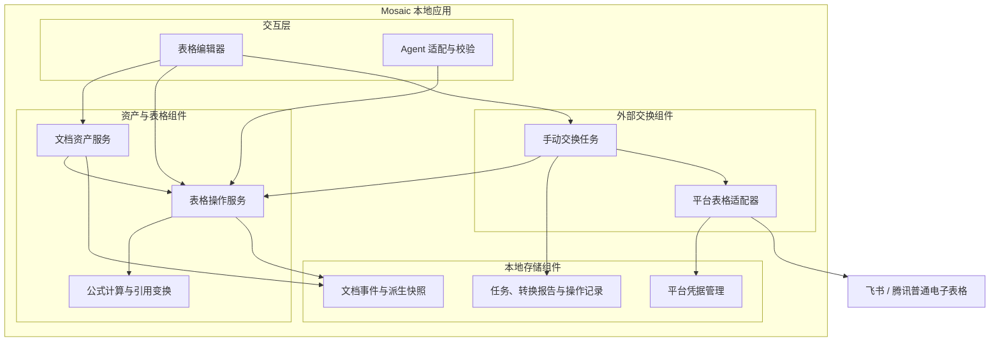
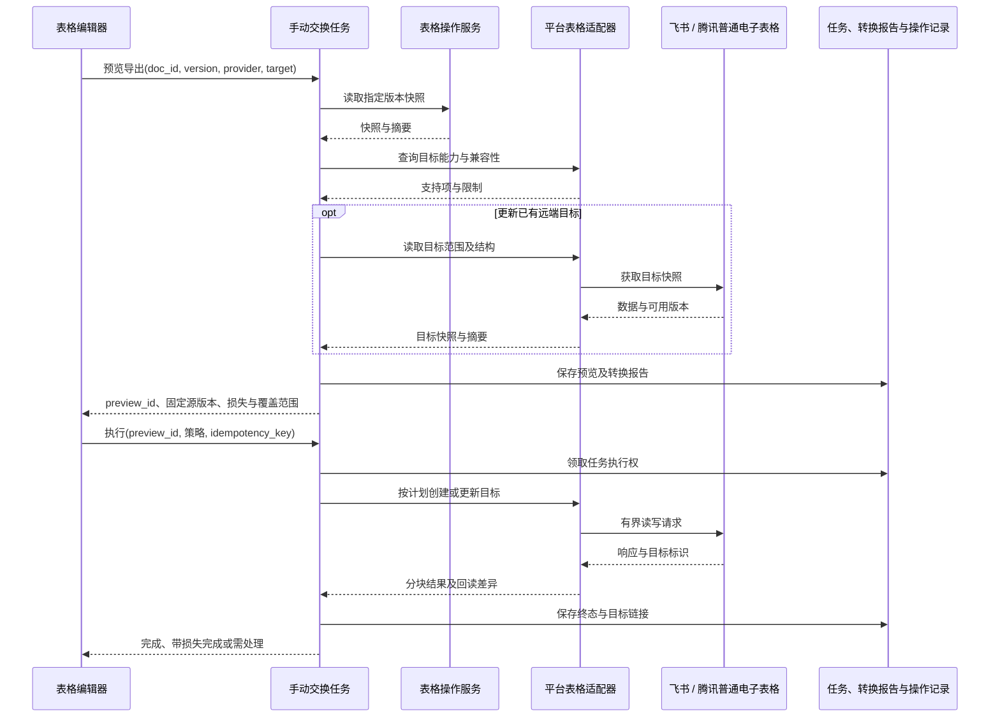

# 特性设计说明书（RFC 提案）：RFC-0017 协作表格与飞书 / 腾讯文档手动双向交换

**状态 (Status):** M1+M2+M3 Implemented（2026-09-28 本地协作表格与双平台 M0 冒烟；2026-09-29 M2 手动副本交换与 M3 原位回写/任务恢复落地，见 §9/§11/§12；同日补登飞书多维表格只读导入 §13）

**作者 (Authors):** Mosaic 项目组 / Codex

**创建日期 (Created):** 2026-09-28

**相关 Issue/PR:** 尚未建立

# 0. 文档控制

| 项目 | 内容 |
|---|---|
| RFC 编号 | 0017 |
| 系列位置 | 承接 [RFC-0014](2026-09-16-rfc-0014-documents.md) 的表格后续项，扩展 [RFC-0016](2026-09-26-rfc-0016-feishu-extdocs.md) 的外部资产接入能力 |
| 上游输入 | 负责人要求协作表格双向兼容飞书和腾讯文档；2026-09-28 明确“当前版本不需要做自动同步，把设计落到 RFC 文档中” |
| 适用形态 | 个人本地版；一个人类用户与多个 Agent 共同操作本地表格 |
| 双向兼容定义 | 用户主动从两家导入、向两家导出，以及手动更新选定目标；兼容范围逐项声明，不承诺所有公式、格式和平台特性无损 |
| 下游 | 表格领域模型、文档事件流、HTTP / Agent 契约、表格编辑器、extdocs 表格适配器、转换报告与操作历史 |
| 证据状态 | 现有代码与两家公开文档已核查；腾讯（2026-09-28）与飞书（2026-09-29）两侧均已完成真实账号 M0 冒烟（§8.2/§10）。平台能力按 §7 的门槛与 §8 的证据验收 |

# 1. 动机与范围

## 1.1 动机

Mosaic 的文档资产已能被人类和 Agent 共同编辑、引用和继续加工，但结构化数据仍需要放进 Markdown 表格或外部文件。协作表格提供单元格编辑、区域读写和基础公式，使讨论中的计划、清单和统计数据能成为本地可持续维护的资产。

用户也需要把已有飞书或腾讯表格带入 Mosaic，编辑后再交付到原平台。当前需求是每次由用户明确发起的内容交换，不要求持续保持多个副本一致。外部事件订阅和后台同步因此不构成当前版本的前置条件。

## 1.2 目标

- 提供 Excel 式普通电子表格：工作簿、多个工作表、单元格类型、基础样式、基础公式和行列操作。
- 人类通过编辑器操作，Agent 通过受校验的区域查询和操作批次操作；共用本地版本与审计机制。
- 支持飞书电子表格、腾讯普通在线表格的手动导入与导出；每个方向均需验收，不能把“外链卡片”计为导入。
- 默认导入为本地新副本、导出为远端新副本；提供显式更新已有目标的流程与边界。
- 任何精度、类型、公式或格式损失都进入转换报告，不静默降级。

## 1.3 非目标

- **自动同步**：不订阅远端编辑事件，不按定时器轮询远端内容，不在本地编辑后自动推送，不做启动时后台追平。
- 三端同时编辑的自动合并、跨平台 OT / CRDT、远端光标与在线成员状态。
- 多人云端协作、多租户和新的成员权限体系。
- 飞书多维表格、腾讯智能表格、富文本文档内嵌表格；它们的字段 / 记录模型与普通电子表格接口不能混用。
- 完整 Excel 兼容、宏 / 脚本、外部数据连接、自动化流程、图表 / 透视表编辑、评论与权限双向复制。
- 当前 RFC 不扩展普通文字文档的正文双向编辑。

用户发起操作后的任务进度查询、上游导入任务状态轮询以及本次任务内的有界重试属于单次操作的执行过程，不属于自动同步；任务结束或取消后停止。本地文档 SSE、保存防抖和 Agent 编辑继续存在，它们不触发外部交换。

# 2. 用例与交互

| 用例 | 用户动作 | 结果与边界 |
|---|---|---|
| 本地协作 | 新建表格，手动填写或让 Agent 修改指定区域 | 生成本地修订；聊天中的资产卡片更新 |
| 从平台导入 | 选择平台、粘贴链接、选工作表 / 范围、查看转换报告、执行导入 | 默认创建本地新资产，保留来源地址与获取时间 |
| 导出到平台 | 选择平台、导出范围、标题及转换策略 | 固定本地版本后创建远端新副本，记录目标 URL |
| 手动重新导入 | 在操作历史中选择来源，再次获取内容 | 默认创建新副本；选择替换本地内容时校验本地预览版本 |
| 手动回写 | 选择既有远端目标与覆盖范围，查看将被替换的内容后执行 | 执行一次更新；不建立后续自动更新关系 |
| 遇到不兼容功能 | 查看具体工作表、坐标、原始特性与处理方式 | 保留、明确转值、选择较小范围，或取消；无法可靠转换的项阻止该操作 |

成功页给出打开目标、查看转换报告和操作历史入口。界面使用“导入副本”“导出副本”“更新此目标”等动作名称，不显示“已同步”等暗示持续一致的状态。

导入 / 导出无需为无损的普通数据重复增加确认步骤；有损转换或覆盖已有目标时，确认范围和处理策略是该动作的一部分。

# 3. 方案设计

## 3.1 总体结构

表格继续作为全局文档资产，复用资产 ID、生命周期、房间引用和 per-doc 事件流；内容模型与 Markdown 块模型分离。手动交换是独立任务，仅通过表格快照和操作端口访问本地内容。

模块与接口职责如下；表中聚合接口在 §3.5、§4 中进一步定义。

| 模块 | 聚合接口 / 职责 | 拟落点与交付 |
|---|---|---|
| 表格编辑器 | 资产打开、区域读写、手动交换 | `apps/web/src`；前端构建进入既有桌面应用 |
| Agent 适配与校验 | 表格查询、结构化修改、公开说明 | `internal/agent` 与既有引擎代写路径；不持有平台凭据 |
| 文档资产服务 | 创建、重命名、归档、删除、引用、历史 | `internal/doc`；延续现有本地进程 |
| 表格操作服务 | 快照、版本校验、整批修改、导入落库 | 拟新增 `internal/sheet`；由资产服务装配 |
| 公式计算与引用变换 | 有界计算、结构修改后的公式改写 | 表格服务内的可替换端口；实现与许可在 ADR 中确定 |
| 手动交换任务 | 预览、确认、执行、恢复、操作历史 | `internal/extdocs` 的表格交换能力 |
| 平台表格适配器 | 能力声明、读快照、新建、更新区域 | 飞书 REST、腾讯 Open API；与 Markdown 分享接口并存 |
| 文档事件与派生快照 | 权威日志、原子提交、可重建缓存 | `internal/storage/sqlite`；仍使用现有 SQLite 库 |
| 任务、报告与凭据管理 | 操作状态、转换依据、凭据生命周期 | SQLite 操作记录及既有 extdocs 凭据设施 |

无新增云端部署服务。若公式组件需要额外运行时，其打包体积、桌面平台支持与离线运行能力必须在选型阶段验收。

## 3.2 资产与数据模型

沿用 `doc_id` 和文档生命周期，为 `doc.created.format` 增加 `spreadsheet`，存量 `markdown` 语义不变。按 format 分派读取、编辑器、导出和内容校验，禁止把表格数据序列化成 Markdown 后作为权威内容。

| 对象 | 主要字段与语义 |
|---|---|
| 工作簿 | `doc_id`、title、version、format、status、工作表顺序、公式规则版本、日期 / 地区设置 |
| 工作表 | 稳定 `sheet_id`、名称、顺序、行列尺寸、稀疏单元格集合、已支持的布局信息 |
| 单元格 | 坐标、带类型的 literal 或 formula 二选一、style；公式计算值为派生结果 |
| 来源描述 | provider、远端文档 / 工作表 ID、URL、获取时间、可用的远端版本、快照摘要、能力与精度声明 |
| 交换记录 | transfer_id、方向、源 / 目标、固定的本地版本、转换策略、报告、执行状态与各分块结果 |

基础 literal 区分空值、文本、数值、布尔值、日期 / 时间和错误值。空字符串与空单元格、文本“00123”与数值 123 不能混为一类。超过可靠数值精度的编号必须保留为文本；日期必须保留类型和转换所需的日期系统 / 时区信息，不能仅依赖格式化字符串猜测。

公式保存表达式原文；外部计算结果若被保留，应标记来源与观察时间。无法取得公式原文的导入只能标记为“数据快照”，不能宣称保留公式。原始平台元数据可作辅助保存，但不代表重新导出时能够恢复平台特性。

首版坐标以工作表内 A1 / 行列索引表达，并始终绑定本地 `base_version`。本地暂不引入单元格 CRDT 或行列全局 ID；结构操作后旧版本坐标批次整体拒绝，不能在新结构上直接重放。

## 3.3 本地编辑、公式与并发

人类与 Agent 的表格修改都经表格操作服务校验。采用工作簿级 CAS：只有当前版本等于提交的 `base_version` 才能追加修订；任何操作校验失败则整批不提交。版本冲突返回 409 和当前版本，保留草稿；首版不自动重放失效坐标上的操作。

候选操作集：

| 操作 | 语义 |
|---|---|
| `set_cells` / `clear_range` | 类型化区域写入；明确清值是否保留样式 |
| `set_style` | 只修改指定样式字段，不改值与公式 |
| `add_sheet` / `rename_sheet` / `delete_sheet` | 工作表生命周期与稳定 ID |
| `insert_rows` / `delete_rows` / `insert_columns` / `delete_columns` | 结构修改，连同受影响公式引用在同一修订中提交 |

行列插删、跨工作表引用、绝对 / 相对引用需要解析公式后改写，不能用字符串替换。提交事件保存归一化操作及必要的公式改写结果，使历史重放不依赖将来解析器的行为。无法安全改写的不支持公式应阻止相关结构修改，允许先明确转值或取消。

基础公式范围拟包含算术、比较、范围引用，以及 SUM、AVERAGE、MIN、MAX、COUNT、COUNTA、IF、ROUND。实际支持列表必须由选型后的用例集固定，不能把“支持 Excel 公式”作为笼统承诺。首版不执行宏、网络函数、跨文件取数或 NOW / RAND 等易变函数。

公式计算通过统一端口执行，编辑器预演不成为权威；同一工作簿版本使用同一公式规则版本。循环引用、依赖规模与计算时间均需有界。不支持的公式保留原文并标注不可计算；其外部缓存值不得伪装成本地重新计算的结果，依赖变化后标记过期。

编辑器按完成一次输入、粘贴或结构操作形成批次，不把每次键击写进事件流。回滚和撤销以新修订表达，并校验当前版本，避免撤销覆盖期间的 Agent 修改。

## 3.4 事件、引用与性能边界

- 继续使用 [ADR-0014](../adr/ADR-0014-document-event-stream.md) 的 `doc_events` 和 `doc:{id}` SSE 频道；表格修订不推进房间版本。
- 新增 `doc.sheet_revision_committed`，载荷含 doc_id、base_version、version、ops、actor、source、note；source 包含 human_editor、agent、import、restore。原 `doc.revision_committed` 只处理 Markdown 块。
- 文档当前态按 format 分派投影；文档卡片、附着列表和标题检索仍复用既有资产入口。表格引用可增加 sheet_id 与范围锚点，锚点失效时打开工作簿并提示。
- 表格编辑不自动触发 Agent 反应波。Agent 修改与公开说明、资产引用同波发布，沿用文档透明纪律。
- 不直接复用 Markdown 的 256 KiB 正文与 64 个块操作限制。单次表格命令仍受现有 HTTP 请求体上限约束，另外按单元格数、序列化体积、公式依赖规模设限；具体数值由 M0 基准定稿。
- 表格当前态使用可重建的物化快照与增量折叠，区域查询与编辑器可视区按需加载；避免每次读写完整回放所有修订。
- 大导入先在受限暂存区完成拉取、转换和校验，再在本地事务中提交有界事件批次及最终资产状态；失败不暴露半张新表，也不替换旧表。暂存内容、事件和快照均纳入容量限制与清理。
- 性能基准至少覆盖 1 万个已填单元格、1000 个基础公式、1000 格粘贴、500 次历史修订；记录机器、冷 / 热打开、区域读取、提交、重算和内存。可接受上限与耗时目标须在实现前记录，平台限制与本地容量限制分别展示。

## 3.5 手动交换语义

一次交换按“读取 / 固定源 → 生成转换预览 → 用户执行 → 落地 / 回读校验 → 记录结果”完成。普通编辑、重新打开文档和应用重启均不发起新交换。

### 导入到本地

默认创建本地新副本；重复导入是新用户动作，可以产生多个副本。只有用户选择“替换本地内容”才更新现有资产，执行时使用预览中的本地版本做 CAS，不匹配则重新预览。

读取多页 / 多范围时，若平台提供可靠版本标识，应校验读取前后一致，变化则有界重试或失败。没有快照版本保证时，明确这是按读取时间段获得的数据快照，不能宣称与远端某一瞬间完全一致。

预览中的源快照不可在执行时被悄悄重新拉取替代；过期、源范围变化或需要重取时生成新预览。导入落库前统一验证坐标、类型、公式和容量。

### 导出为远端新副本

默认行为。源固定为某个本地 doc_version，后续本地编辑不改变正在导出的内容，也不追加新任务。只在远端写入完成并通过已支持内容的回读校验后显示成功。

重复点击同一任务通过本地幂等键返回已有结果。新一次主动导出可以生成新的远端副本，不把已有分享映射误当成必须覆盖的目标。

### 手动更新已有远端目标

仅在适配器已经验证所需覆盖能力时开放。预览必须显示目标文档、工作表、具体范围、源版本、转换损失和将被替换的内容；默认只更新选定数据范围，不删除其他工作表或重建整个远端文件。

执行前再次读取目标的相关内容与结构，并与预览摘要 / 可靠版本比较；已变化则拒绝并重新预览。为本次覆盖保存目标前态供比较与人工恢复；它不构成远端原子回滚保证。

**读取检查与写入之间仍存在竞争窗口。** 平台没有条件写入时，不承诺与远端同时编辑安全合并；覆盖流程明确提示执行期间暂停目标区域编辑，不能接受该边界时选择导出新副本。Mosaic 自身对同一目标串行执行任务，不能据此声称锁住了平台用户。

远端结构修改（插删行列、重命名 / 删除工作表）首版不通过回写任务传播。结构不匹配则要求重新选择范围或导出新副本，不根据旧坐标推断新位置。

## 3.6 转换报告与兼容分级

每个方向独立声明能力：read / create / update、公式原文读写、可读取的计算结果、基础样式、行列结构、批量限制、版本可见性、条件写入与创建幂等性。未知能力按未验证处理；接口存在不等于目标账号已获授权。

| 功能 | 本地目标 | 飞书交换 | 腾讯交换 |
|---|---|---|---|
| 文本、数值、空值、链接 | 基础必需 | 基础读写方向均验收 | V3 已有文档化读写类型，账号与往返仍需验收 |
| 布尔、日期、数字格式 | 保留类型与显示语义 | 检查日期系统与格式选项 | 读取模型与写入支持不对称，逐项验证后开放 |
| 公式原文 | 保存；基础集合可计算 | 有公式读写说明，按样表验证 | 公开 V3 写入定义未明确公式能力，默认关闭保公式写回 |
| 公式计算结果 | 与公式分离 | 范围读取存在跨表引用、数组公式结果限制 | 不能从普通文本 / 数值返回推断原始公式可恢复 |
| 基础样式、行列尺寸 | 选择有限集合 | 仅保留已验证项 | 仅保留已验证项 |
| 合并、筛选、条件格式等 | 首版不作为编辑必需项 | 遇到时报告；不承诺完整往返 | 同左 |
| 图表、透视表、图片、批注、权限、自动化 | 不进入首版交换保证 | 报告未包含的特性 | 同左 |

转换项至少记录 `sheet_id / range / feature / severity / action / reason`。处理方式为保留、明确转值、忽略某项样式或阻止操作；不能只给“部分格式可能丢失”的总提示。

默认保留公式。无法读取原文或目标不支持公式时，必须明确选择“仅导出数值”；且每个被转值的公式都必须有有效计算结果。结果缺失、过期或错误时阻止转值，不能写空白或旧缓存。普通文本若以“=”等字符开头，应保持文本语义，避免平台自动解析为公式。

对未知复杂特性的整表覆盖应拒绝；支持的局部更新也必须验证未涉及的值、公式和样式不会被平台请求隐式清空。原始数据备份和原平台链接用于回溯，不替代兼容保证。

## 3.7 平台接入与执行可靠性

飞书复用已有用户 OAuth 与 token 刷新设施，新增 Sheets 读写适配；权限按实际操作申请，不因不做自动同步申请事件订阅权限。

腾讯经 2026-09-28 M0 冒烟裁定 **MCP-first**：表格读写复用现有 MCP token 走 `sheet.*` 工具（类型化覆盖写、公式原文往返、结构改写均已在真实账号实证，§8.2/§10）；Open API 应用申请（Client ID / Secret、Open ID、用户 OAuth）降级为能力缺口出现时的备选路径，不再是用户侧前置门槛。MCP token 与 Open API token 仍不互换；若启用备选路径，设置页分别展示授权状态。

任务持久化状态拟为 `preview_ready → running → succeeded / succeeded_with_warnings / failed / partial / unknown / canceled`。状态定义：

- `failed`：未产生目标修改或已明确验证无修改；`partial`：已知部分远端操作成功；`unknown`：请求已发出但不能确认结果。
- 每个任务记录固定源版本、目标、请求摘要、分块执行结果、远端文件 ID、回读校验和错误，不存凭据。
- 分块依据平台与本地限制；腾讯公开 V3 批量更新最多 5 个操作，按序执行并在错误时停止，不能假设整批原子提交。
- 只对已证明可重试的失败做有界退避；创建、追加、结构修改或超时后的未知结果不能盲目重放，先核对目标。
- 远端创建成功后立即记录 ID。若网络超时导致 ID 未知，标记 unknown；本地幂等键不能保证远端不会重复创建。
- 部分失败保留目标链接与受影响范围，用户可查看、重新预览后续写，或导出新副本。应用不自动删除远端文件，也不声称能自动回滚。
- 取消不撤销已经发生的远端写入；重启后将未结束任务恢复为待核对状态，由用户决定恢复，不自动发起新一轮交换。
- 解除来源 / 目标关联只影响本地记录，不删除任一平台资产。

# 4. 接口与 Agent 集成

## 4.1 Provider 与交换接口

现有 `Provider.ShareMarkdown / ResolveLink` 保持原义。新增可选表格能力端口，不要求文字文档 provider 实现表格操作：

| 逻辑端口 | 输入 | 输出 |
|---|---|---|
| `Capabilities` | 身份与目标类型 | 支持项、限制、验证状态 |
| `ReadSnapshot` | 远端标识、工作表 / 范围 | 类型化快照、结构、来源信息、精度说明 |
| `CreateWorkbook` | 固定快照、标题、转换策略 | 目标标识、分块结果 |
| `UpdateRanges` | 目标、写入计划、预览基线 | 执行结果与回读差异 |

转换、幂等任务、确认范围和恢复逻辑归手动交换任务；适配器负责各家 API 语义。需要多次请求的调用通过持久化检查点记录远端 ID 和进度。

## 4.2 HTTP 契约草案

沿用现有 `/v1/docs` 资产管理与命令通道，增加 format 分派和表格命令，不开放旁路直接写存储。

| 端点 / 命令 | 语义 |
|---|---|
| `GET /v1/docs/{doc_id}/sheets` | 工作表元信息与本地版本 |
| `GET /v1/docs/{doc_id}/sheets/{sheet_id}/range` | 有界区域读取，返回类型、公式、派生值及版本 |
| `commit_sheet_revision` | 经既有文档命令入口提交 base_version 与操作批次 |
| `POST /v1/extdocs/sheet-transfers/preview` | 方向、源、目标、范围；准备快照与转换报告 |
| `POST /v1/extdocs/sheet-transfers` | preview_id、转换策略、幂等键；显式执行 |
| `GET /v1/extdocs/sheet-transfers/{transfer_id}` | 查看进度、报告、目标及失败范围 |
| `POST /v1/extdocs/sheet-transfers/{transfer_id}/cancel` | 取消未执行部分 |
| `POST /v1/extdocs/sheet-transfers/{transfer_id}/resume` | 用户发起核对 / 恢复；目标变化或策略变化须重新预览 |
| `GET /v1/extdocs/sheet-transfers?doc_id=...` | 查看该资产的历史操作 |

执行时验证预览属于当前用户、未过期，且源版本 / 目标 / 范围 / 策略摘要未被替换。固定源快照不能因为后来本地版本变化而静默切换。

错误分类至少覆盖：本地版本冲突、预览失效、目标已变化、不支持的特性、无有效公式结果、超限、未授权 / 需重新授权、部分写入和结果未知。任务失败不转换为聊天发送失败。

新增契约需同步 OpenAPI、事件 JSON Schema、Go 协议类型、TS 生成物与 fixtures；本 RFC 中端点与操作名为草案，不表示已实现。

## 4.3 Agent 面

新增有界 `sheet_query` 与 `sheet_ops`，沿用引擎校验代写方式。查询返回 doc_id、sheet_id、range、version 和截断信息；修改必须携带所依据的版本与明确坐标。

Agent 可创建与编辑本地表格，操作结果与公开说明同波发布。默认不把整个工作簿灌入上下文，也不把平台 token 或原始授权响应提供给模型。当前外部交换由用户在产品界面发起，Agent 修改不会触发导出或远端写入。

开发手册随实现补充：区域坐标与类型、公式支持表、冲突处理、两家授权、转换报告、失败恢复，以及完整的手动往返样例。

# 5. 安全、兼容与迁移

- 本地写操作沿用 Origin、Content-Type、owner token 校验；预览、任务详情和目标前态可能包含正文，应按本地资产访问边界保护。
- API 只向固定平台端点请求。分享 URL 仅用于解析 provider 与资源 ID，不直接作为任意下载地址；平台返回的下载地址及重定向另做 HTTPS、域名和私网地址校验。
- 公式解析与计算不执行脚本、网络请求和系统命令；导入内容作为不可信数据，进入 Agent 上下文时沿用现有秘密剔除与容量约束。
- 凭据与正文分开保存，日志和转换报告不含 token。工作簿与操作快照遵循本地备份、导出、删除及容量策略，删除资产时清除暂存正文和目标前态，只留不含正文的必要状态。
- `markdown` 资产、旧 doc 事件、Markdown 导出和现有分享映射保持语义不变；共享 UI 按 format 选择对应能力。
- 表格操作记录新增存储，不把来源 / 目标历史塞进现有以 doc_id + provider 唯一的快照分享记录；同一资产可有多个目标与多次操作。
- 备份恢复必须覆盖表格事件及任务记录；表格快照是可重建缓存。数据库迁移沿用既有迁移机制；不支持新格式的旧客户端明确拒绝打开或降级为只读提示，不能当 Markdown 覆写。
- RFC 通过后的契约实现须同步修订 RFC-0014 的 format / 内容投影说明与相关 API；历史裁定保留，通过新 RFC 表达扩展。

# 6. 备选方案、风险与取舍

| 方案 / 风险 | 判断与处理 |
|---|---|
| 继续使用 Markdown 表格 | 不能表达类型、公式和区域操作，不作为权威模型 |
| 首版实现跨平台自动同步 | 与已确认范围不符；事件、轮询、合并与自动追平都不进入当前实现 |
| 只做平台链接卡片 | 不能满足内容双向交换 |
| 只依赖腾讯现有 MCP | 2026-09-28 M0 冒烟实证 `sheet.*` 具备类型化覆盖写、公式原文读写与结构改写（§8.2/§10）——腾讯侧裁定 MCP-first，Open API 降为缺口备选；样式交换等已证缺陷走转换报告显式降级，不再以公开指南过时为由整体否决 |
| 采用成熟表格组件 | 优先做集成验证；领域数据与事件不绑定组件私有格式 |
| 自绘完整编辑器 / 自研公式引擎 | 首版维护与正确性成本高，仅在组件验证不满足约束时重新评估 |
| 公式、样式与复杂特性不对称 | 按方向建立支持矩阵；显式转值或阻止，不以“无自动同步”掩盖转换损失 |
| 无远端条件写入 | 默认新副本；覆盖前检查仍不能消除竞争窗口，明确暂停远端编辑的使用边界 |
| 大表导致内存、重算或事件回放膨胀 | 稀疏模型、虚拟化、区域查询、派生快照和计算预算同时验收 |
| 组件许可与桌面运行时约束 | 选型 ADR 核实所需编辑、公式、导入导出功能的许可与离线交付方式；本 RFC 不预先认定某组件全免费 |

# 7. 实施里程碑与验收

| 阶段 | 交付 | 完成门槛 |
|---|---|---|
| M0 能力与选型验证 | 两家测试账号与样表、读写 / 创建能力记录、公式往返报告、编辑器和公式端口 ADR、容量与性能目标 | 区分已证实、未支持和未知；腾讯公式未知不能算通过（2026-09-28 已实证通过并定 MCP-first，见 §10；飞书侧仍待样表） |
| M1 本地表格 | 类型化模型、公式子集、版本化操作、编辑器、事件与快照、资产卡片、Agent 区域读写 | 本地冲突、结构引用变换、回放与性能用例通过 |
| M2 手动导入 / 导出副本 | 两家适配器、转换报告、授权状态、持久化任务与回读校验 | 两家分别完成双向样表验证；每项损失可定位（2026-09-29 已实现，见 §11；能力依据 §10 双平台实测） |
| M3 手动更新目标与恢复 | 预览基线、覆盖范围、目标前态、部分失败与未知结果处理 | stale preview 拒绝、网络中断、重试不盲目重复创建；未验证能力保持关闭（2026-09-29 已实现，见 §12） |

M0 可与不依赖平台的 M1 工作并行推进。前端新建 / 编辑不以平台接入成功为条件。M2 完成前不得宣称两家双向兼容已交付；M3 不通过时不得开放对应的原位回写能力。当前版本的任何阶段都不包含自动同步。

验收用例至少包含：

1. **类型往返**：空值、空字符串、“00123”、超精度编号、中文、布尔、日期时间与百分比；两家每个方向分别比对语义与显示。
2. **公式往返**：普通公式、绝对 / 相对引用、跨工作表引用、数组公式、不支持函数与循环引用；核查原文、结果及明确降级，不只比较屏幕上的数值。
3. **结构与并发**：人类和 Agent 同时修改、不同区域提交冲突、插删行列后的公式引用、失效坐标批次拒绝、撤销与回滚。
4. **手动范围**：本地编辑、远端编辑、重新打开文档和应用重启均不自动发起平台内容读写；只有用户发起任务及其执行过程才调用平台。
5. **副本与覆盖**：默认创建新副本；覆盖仅作用于确认范围；目标在预览后变化时拒绝。竞争窗口作为已知边界，不把该用例误写成远端 CAS 保证。
6. **损失可见**：合并、样式、图片 / 图表等支持范围外内容逐项报告；没有有效结果的公式不能转成空值。
7. **失败恢复**：401 / 403、限流、读分页期间远端变动、分块中途失败、创建响应丢失、应用退出、取消与恢复；任务终态准确且保留已知目标。
8. **存量兼容**：旧 Markdown 文档、现有两家分享、旧事件回放、备份恢复与删除清理不回退。
9. **越界与资源**：无效坐标、超大区域、公式计算预算耗尽、恶意 URL、文本被误解释为公式、凭据不进入日志或 Agent 上下文。

# 8. 开放问题与证据

## 8.1 待定项

- **OQ-1 编辑器与公式实现**：在 React / Go / 本地桌面形态下验证组件、计算权威、离线运行和许可证，形成 ADR；本 RFC 固定领域边界，不提前指定库。
- **OQ-2 腾讯真实能力**：2026-09-28 MCP 冒烟已实证公式原文读回 / 写回、类型化覆盖写、远端新建与删除、插行后的服务端公式改写（§8.2/§10）；剩余未知收窄为样式写入（实测静默失效）、易变函数语义与产品化的免登 token 获取封装。Open API 应用路径降级为备选，不再作为门槛。
- **OQ-3 基础兼容集合**：确定首版函数与样式清单、容量限额和性能目标；导入能力、导出能力与原位更新能力分别定级。
- **OQ-4 原位更新范围**：在保留未修改内容的验证通过前，保持新副本路径可用；不能用重建整张远端表代替安全的区域更新。
- **OQ-5 文件交换**：XLSX / CSV 文件中转是否作为后续补充另行确定；当前不以文件导入导出替代两家平台接口方向的验收。

“不做自动同步”已由负责人确定，不是待评审问题。远端事件订阅能力不足不再作为当前版本阻塞项。

## 8.2 官方接口证据

以下为 2026-09-28 整理的公开文档核查，部分平台页面更新时间早于核查日期；均不替代真实账号验证。

| 来源 | 已核查事实 | 对本设计的影响 |
|---|---|---|
| [飞书电子表格概述](https://open.feishu.cn/document/server-docs/docs/sheets-v3/overview) | 提供表格、工作表及范围读写能力，接口与文档权限均有约束 | 新增 Sheets 适配，不复用 Markdown 内容转换 |
| [飞书读取单个范围](https://open.feishu.cn/document/ukTMukTMukTM/ugTMzUjL4EzM14COxMTN) | 可选择 Formula 等返回形式；不支持获取跨表引用和数组公式的计算结果 | 分开保存公式与结果，转值必须验证结果可用 |
| [飞书写入单个范围](https://open.feishu.cn/document/ukTMukTMukTM/uAjMzUjLwIzM14CMyMTN) | 写入会覆盖指定数据；返回 revision，但该接口未文档化预期版本写入条件 | revision 不作为远端 CAS 承诺 |
| [飞书文件编辑事件](https://open.feishu.cn/document/ukTMukTMukTM/uUDN04SN0QjL1QDN/event/file-edited) | 存在文件编辑通知，载荷不含单元格修改明细 | 修正 RFC-0016 的“两家均无推送”表述；当前不接入事件 |
| [腾讯 V3 更新请求](https://docs.qq.com/open/document/app/openapi/v3/sheet/batchupdate/request.html) | UpdateRangeRequest 文档列出的 CellValue 写入类型为 text、link、number | 公式与其他类型必须实测，不从网页编辑器能力推导 API 能力 |
| [腾讯 V3 批量更新](https://docs.qq.com/open/document/app/openapi/v3/sheet/batchupdate/update.html) | 最多 5 个操作、依次执行、遇错停止；其他编辑可能改变最终结果 | 记录分块与部分成功，不假设远端原子提交 |
| [腾讯范围查询](https://docs.qq.com/open/document/app/openapi/v3/sheet/get/get_range.html) | 文档限制为单次最多 1000 行、200 列且总单元格不超过 10000 | 适配器分块，不把整表大小与单次请求上限混淆 |
| [腾讯 OAuth 授权](https://docs.qq.com/open/document/app/oauth2/) | 需要应用、审核与用户授权；Open API 使用 Client ID、Open ID、Access Token | 新增 Open API 授权，不能复用现有 MCP token |
| [腾讯 MCP 官方指南](https://developer.cloud.tencent.com/mcp/server/11803) | 指南描述普通表格工具为末尾追加，并要求以实际 tools/list 为准 | MCP 指南不足以作为覆盖更新与公式兼容的证据 |
| [腾讯事件列表](https://docs.qq.com/open/document/app/openapi/v3/subscription/event.html) | 公开列表未列出普通表格内容修改事件 | 当前无自动同步，无需以事件能力作为交付门槛 |
| 腾讯 MCP tools/list（2026-09-28 实测，个人 token） | 主网关 `openapi/mcp` 返回 225 个工具含全套 `sheet.*`；独立服务 `api/v6/sheet/mcp` 工具名无前缀，且注册面与主网关**不一致**（`set_range_value_by_csv`、`get_cell_style`、`find`、`validate_file_data` 仅独立端点注册，主网关报 -32601） | M2 适配器按工具维护端点路由表并在启动时探测注册面，不假设两端点等价 |
| 腾讯 MCP M0 冒烟（2026-09-28，真实账号建表-写入-读回-导出-删除，即测即删） | 类型化往返保真（STRING 保前导零/不强转布尔、BOOL/NUMBER 保真）；NUMBER 为 float64（9007199254740993 读回 …992、xlsx 导出 …990，两通道互不一致）；`get_cell_data(include_formula=true)` 一次返回计算值+公式原文（含跨表与错误公式）；插行后公式服务端自动改写且符合 Excel 语义；CSV 读取错误码有细分而结构化读取仅 ERROR；`set_range_value_by_csv` 自动类型检测吞前导零；`set_cell_style` 返回成功但读回与导出均无效果（静默降级） | 腾讯导入/导出主路径定型：类型化写入 + include_formula 读回 + CSV 补错误码；>15 位数值必须 STRING；样式交换不开放（报告降级）；结构改写以远端读回为准，客户端不自行改写 |
| 飞书在线文档核查 + 真实账号 M0 冒烟（2026-09-29，建表-写入-读回-插行-删除，即测即删） | 公式写入为类型化对象 `{"type":"formula","text":"=A1"}`；字符串 `"TRUE"` 被强转布尔（腾讯不转）、JSON 布尔裸写被拒（90204），布尔唯一路径 `=TRUE()`；`=` 开头文本须 `{"type":"text"}` 对象转义（`'` 前缀不是转义符、字面入库）；日期两步写（style formatter + 1899-12-30 纪元序列浮点）实测全通；读取 `Formula` 回公式原文（默认模式实测也回计算值，与文档表述不符）、`UnformattedValue` 回计算值且错误值为字符串 `#DIV/0!`/`#NAME?`；插行（0-based 半开区间）后公式服务端改写与 Excel/腾讯完全同构（`=$A$2+A3`→`=$A$3+A4`、跨表按表名并自动规范加引号 `='数据B'!A1*2`）；样式写入真实生效但 sheets v2 无读样式接口；单格 range 须 `A1:B1` 全形；>15 位数值同样 float64 有损；revision 只递增无条件写入语义 | 飞书导入 = 双 valueRenderOption 读回 + FormattedString 补日期 + `#` 前缀识别错误；导出 = 类型化写入（文本对象防强转/转义）+ 可选 style 批量；布尔/样式读回/精度为已证缺口进转换报告；revision 不作远端 CAS（既有结论维持） |

## 8.3 仓内依据

- [文档块投影与当前上限](../../../internal/doc/projection.go)：现有六种块类型不含电子表格。
- [文档提交服务](../../../internal/doc/service.go)：本地版本冲突与事件追加机制可复用；领域操作需新增。
- [外部文档 Provider 与分享记录](../../../internal/extdocs/extdocs.go)：当前是 Markdown 快照分享和外链解析，不是表格导入或原位更新。
- [README 路线图](../../../README.md)：协作表格包含单元格操作、公式引擎与 Agent 整区域读写。

# 9. 实现增补（2026-09-28，M1 本地协作表格）

M1 全量落地（负责人裁定范围：本轮只做不依赖平台的本地部分）：

- **领域与引擎**：`internal/sheet`（模型/坐标/限额/归一化校验/公式引擎/结构改写/摘录）——公式服务端权威求值、结构插删的公式改写以归一化 ops 定稿进事件（历史回放纯机械应用）；容量限额与函数封闭集按 OQ-3 定稿，全文见 [ADR-0015](../adr/ADR-0015-spreadsheet-editor-and-formula.md)（OQ-1 同步定案：自绘编辑器 + 自研封闭子集；基准：万格千公式求值 0.61ms、500 修订回放 38ms——物化快照首版不做）。
- **资产与事件**：`doc.created.format` 枚举 +`spreadsheet`；新事件 `doc.sheet_revision_committed`（载荷/Schema/fixtures 四处同步，schema gate 覆盖）；`doc.revision_committed` 语义不变（仅 markdown）；投影按 format 分派（`DocState.Workbook`），默认表 ID 由 doc_id 确定性派生；副本重放源事件流（默认表 ID 重映射）；表格摘录按 format 分派进 agent 语境（每表首个非空 ≤10 行 ×8 列 TSV，公式格显派生值——sheet_query 块名按 doc_query 先例预留不接线）。
- **HTTP 契约**：`commit_sheet_revision` 命令（CAS/幂等/整批原子与 markdown 路径同构）；`GET /v1/docs/{id}/sheets`、`GET /v1/docs/{id}/sheets/{sid}/range?range=A1:B2`（≤10000 格/次，公式格携服务端派生值；used-range 缺省读取截断如实标记）；export 按 format 分派（spreadsheet → 指定工作表 CSV，公式格写派生值）；快照不整簿出网（sheets 元信息 + range 有界读取）。
- **编辑器**（自绘，`SheetEditorPage`）：窗口化网格（行 ×列双向视口）、公式栏、工作表页签（增/重命名/删）、样式与行列结构工具条、键盘导航与即输即编；提交模型复用 DocEditor 工作台纪律（动作即 op、1.2s 防抖、409 重定基重放未提交 ops）。新建入口：文档主页新建对话框（文档/表格分段选择）与房间 DocsTab（新建表格并附着）。
- **Agent 面**：`sheet_ops` 块 + public_draft 侧车（≤8 ops/波；编辑类 op 强制 `base_version` + 显式坐标；端口校验 → 引擎逐 op 代写，失配 409 逐 op 降级不翻波；refs 与 docops 同形）；四家适配器指令段与投影同步；conformance fixtures 补齐；读面走语境摘录（默认不灌整个工作簿）。
- **M2/M3 后置原因**：交付门槛依赖两家真实账号样表验收与腾讯 Open API 应用审核（负责人侧前置，§7）；当前版本 UI 不留外部交换入口。

本 RFC 通过后，接口与模型变化回填相关契约及 ADR；平台能力和兼容列表随可复现的样表证据更新，不能只凭文档或工具名称提升支持等级。

# 10. M0 冒烟增补（2026-09-28，腾讯侧 MCP 实测）

负责人提供官方 Skill 文档包（含 `sheet/api/mcp-api.md` 全量参数与 `references/manage_references.md`）并授权以其个人 token 实测。在真实账号创建「Mosaic-M0-测试（可删）」，完成建表 → 类型化写入 → 读回比对 → CSV 探针 → 插行改写 → 样式往返 → xlsx 导出解析 → 校验 → 删除（入回收站）全链路；测试文件即测即删，全程未触碰账号内其他文档。

## 10.1 端点与工具注册面

- 主网关 `https://docs.qq.com/openapi/mcp`：tools/list 返回 225 个工具，`sheet.*` 带前缀可调用，但仅注册子集——`get_cell_style`、`find`、`validate_file_data`、`set_range_value_by_csv` 在主网关调用报 -32601「工具没有注册」。
- 独立服务 `https://docs.qq.com/api/v6/sheet/mcp`：工具名**无前缀**（`get_sheet_info` 有效、`sheet.get_sheet_info` 反而 tool not found），注册面更全，上述四个工具均可用；token 与主网关共用。
- 本地 Skill 文档与线上实况的差异：`get_cell_data` 的 `include_formula` 参数文档未记载但实测有效；`get_sheet_info` 实际多返回 `hidden` / `used_range`（`used_range` 恒为 null，不可依赖）；`add_sheet` 不传 `index` 插到最前，与文档「追加到末尾」不符——显式传 `index`。

## 10.2 类型保真（`set_range_value` → `get_cell_data` return_csv=false）

| 探针 | 写入 | 读回 | 判定 |
|---|---|---|---|
| 前导零文本 | STRING `"00123"` | STRING `"00123"` | 保真 |
| 字面 `"TRUE"` | STRING | STRING（不强转布尔） | 保真 |
| 布尔 | BOOL `true` | BOOL `true` | 保真 |
| 数值 | NUMBER `123.456 / 0.1 / -42` | 同值 | 保真 |
| 超精度 | NUMBER `9007199254740993` | 读回 `…992`；xlsx 导出 `…990` | float64 双重有损且两通道互不一致——**>15 位编号必须走 STRING** |
| 日期 | STRING `"2026-09-28"` | STRING（不自动转日期） | 保真；写面无 datetime 类型，日期只能文本承载 |
| 转义 | 含逗号 / 引号 / 制表 / emoji | 逐字符保真 | 保真 |

## 10.3 公式与结构改写

- `get_cell_data(return_csv=false, include_formula=true)` **一次返回计算值 + 公式原文**：`=SUM(B2:B3)`→70、`=$A$2+A3`→50、`=IF(B2>10,"大","小")`、`=A2&B2`→"1020"、跨表 `=数据B!A1*2`→14、错误公式 `=1/0` / `=UNKNOWNFN(1)` 原文均可读回。
- 结构化读回中公式格的 `value_type` 是**计算值的类型**（NUMBER/STRING/ERROR），错误无码；`return_csv=true` 时错误格输出 `#DIV/0!`、`#NAME?` 可细分——错误种类以 CSV 通道补充。
- 在第 2 行前插 1 行后，公式**服务端自动改写**：`=SUM(B2:B3)`→`=SUM(B3:B4)`、`=$A$2+A3`→`=$A$3+A4`（绝对引用随结构变化平移，符合 Excel 语义——绝对只在复制填充时生效）、跨表引用不动，全部重算正确。M2 结构操作后直接读回改写结果，客户端不自行改写（与本地 M1 归一化改写模型同构）。

## 10.4 其他通道

- `set_range_value_by_csv`（仅独立端点）：自动类型检测将 `"00123"`→NUMBER 123、`"true"`→BOOL——**CSV 写入通道吞前导零**，导入主路径必须走类型化 `set_range_value`。
- `set_cell_style`：三次设置（bold+黄底、bold+italic、font_size=14）均返回成功，但 `get_cell_style` 读回与导出 xlsx（无 bold 字体、无黄色填充、目标格挂到空样式 xf）均无效果——**样式写入静默失效**；M2 样式交换不开放，进转换报告显式降级。
- `manage.export_file` + `manage.export_progress`：单次轮询即得 xlsx；文件内公式 `<f>` 原文 + 缓存值 + `t="e"` 错误（`#DIV/0!`/`#NAME?`）全保真——OQ-5 文件交换的腾讯导出半链路已具备。
- `sheet.find`（值搜索，返回 A1 地址与分页）、`sheet.validate_file_data`（版本级一致性校验，实测 is_valid=true@version 6）独立端点可用；`find` 的 row/col/total_results 返回为字符串，适配层需转型。
- `manage.create_file`（file_type=sheet）/ `manage.delete_file` 全通，删除入回收站（query_file_info status=trash）。

## 10.5 M2 裁定（据上）

腾讯侧 **MCP-first**：现有 token 即可用，Open API 应用申请不再是用户前置门槛。导入 = `get_sheet_info` + 分块 `get_cell_data(include_formula=true)` + CSV 补错误码；导出 = `create_file` + `set_range_value` 类型化分块写入 + 回读校验；结构操作后公式以远端读回为准。样式、>15 位数值、datetime 为已证缺口，统一进转换报告。

## 10.6 飞书侧 M0 冒烟（2026-09-29，真实账号全链路）

建「Mosaic-M0-测试（可删）」→ 类型化写入 → 三模式读回 → 布尔/转义/日期探针 → 插行改写 → 样式写入 → 删除（回收站）；测试文件即测即删，全程未触碰账号内其他文档。

### 授权解锁插曲（对以后的新绑定同样适用）

首轮冒烟受阻：token 本身有效、refresh 轮换链路正常，但 JWT scope 仅为 `auth:user.id:read offline_access`——**授权时刻应用尚未开通 drive:drive，飞书静默丢弃了越界 scope 而不是报错**，且 refresh 无法升级 scope（只会延续旧范围）。当时 `import_tasks`（现有共享到飞书路径）同被 99991679 挡住，属 RFC-0016 实现面的潜在断点（e2e 桩 token 未覆盖 scope 缺失场景）。解锁三步：开发者后台开通 `drive:drive`（即时生效、无需发布版本——tenant token 探针验证权限已通）→ Mosaic 重新「登录飞书」→ 新授权 scope 含 `drive:drive`。本次真机顺带验证了飞书授权的回环自动捕获（RFC-0016 增补）实际生效。

### 类型保真（values 写入 → valueRenderOption 读回）

| 探针 | 写入 | 读回 | 判定 |
|---|---|---|---|
| 前导零文本 | `"00123"` | STRING `"00123"` | 保真 |
| 数字样文本 | `"0.5"` | STRING `"0.5"` | 保真（不强转数值） |
| 日期样文本 | `"2026-09-28"` | STRING（不强转日期） | 保真 |
| 转义 | 含逗号/引号/制表/emoji | 逐字符保真 | 保真 |
| 布尔字面量 | JSON `true` 裸写 | **90204 拒绝**（invalid cell type） | 布尔唯一写入路径 `=TRUE()` 公式（计算值读回即 true） |
| 布尔样文本 | `"TRUE"` | **强转布尔 true** | 与腾讯相反！防强转须 `{"type":"text"}` 对象 |
| `=` 开头文本 | `"'==literal"` | 字面 `"'==literal"`（`'` 非转义符） | **正确转义 = `{"type":"text","text":"=..."}`**，读回为字符串非公式 |
| 超精度 | `9007199254740993` | `…992` | float64 有损，与腾讯同 |
| 日期真类型 | style formatter `yyyy/MM/dd` + 序列 `46293` | `FormattedString` 读回 `2026/09/28` | **两步写全通**（腾讯无此通道） |

### 公式与结构改写

- 公式写入 = 类型化对象 `{"type":"formula","text":"=..."}`；读回显式 `Formula` 模式给原文，`UnformattedValue` 给计算值——**默认模式实测也给计算值**（与文档「缺省回公式原文」表述不符，取原文必须显式 Formula）。
- 错误值在计算模式是**字符串** `"#DIV/0!"`、`"#NAME?"`（导入侧按 `#` 前缀识别；腾讯是结构化 ERROR 类型 + CSV 补错误码——两家适配器分别处理）。
- 跨表公式按**表名**引用，读回自动规范化加引号：写入 `=数据B!A1*2` → 读回 `='数据B'!A1*2`，计算正确。
- 插行 `[1,2)` 后公式服务端改写，与 Excel/腾讯**完全同构**：`=SUM(B2:B3)`→`=SUM(B3:B4)`、`=$A$2+A3`→`=$A$3+A4`（绝对引用随结构平移）、跨表不动、重算全对。M2 结构操作后读远端改写结果，客户端不自行改写（两家一致）。

### 样式与通道细节

- 样式写入**真实生效**（`appendStyle` 对象包 range+style；bold 与日期 formatter 均实证）——与腾讯的静默失效相反；**但 sheets v2 无读样式接口**，导入方向样式不可读。两家缺口恰好对称：腾讯可读不可写、飞书可写不可读。
- 单格 range 必须 `A1:B1` 全形（裸 `A1` 报 90202 wrong range）；插行 0-based 半开区间；删除走 drive v1（`type=sheet` 枚举，非导出用的 `xs`）。
- revision 每次写 +1、无条件写入——维持 §8.2 既有结论（不作远端 CAS）。

### M2 裁定（飞书侧，据上）

导入 = `sheets/query` + 分块双读（`UnformattedValue` + `Formula`）+ `FormattedString` 补日期 + `#` 前缀识别错误；导出 = v3 建表 + `values` 类型化写入（`=`/`TRUE` 类文本走 `{"type":"text"}` 对象、布尔走 `=TRUE()`、日期走 style+序列两步）+ 可选 `style` 批量；结构改写以远端读回为准。样式读回、布尔文本强转、>15 位精度为已证缺口，统一进转换报告。导出 xlsx 文件通道（drive export_tasks）本轮未测，M2 时补。

# 11. 实现增补（2026-09-29，M2 手动副本交换）

M2 全量落地（范围 = 副本语义：导入建本地新表格 / 导出建云端新副本；M3 原位回写与恢复未做）。全部能力依据 §10 双平台 M0 实测档案，无平台未知项。

## 11.1 落点与结构

- **中立模型 + 端口**（`internal/extdocs/sheettypes.go`）：`CloudSnapshot/CloudCell`（导入快照，公式携原文含 `=`）、`ExportWorkbook`（导出视图，复用 protocol.SheetCell）、`SheetCaps` 静态能力（取 M0 实证值）、`TransferIssue` 转换报告项（sheet/range/feature/severity/action/reason）。可选接口 `SheetProvider`（ReadSheetSnapshot / CreateSheetCopy / SheetCapabilities）——沿设置面的 type-switch 先例，不扩 Provider 主接口。
- **腾讯适配**（`tencent_sheets.go`，全走主网关——M2 所需工具主网关均已注册，无需独立端点路由表）：URL→file_id 解码定案（实测 URL = `D` + base64(file_id)，M0 数据对作 UT 标准答案；query_file_info 校验 type=sheet 定案不赌编码形态）；读快照 = get_sheet_info → 分块 get_cell_data(include_formula)（≤5000 格/块、8MiB 响应上限）→ get_merged_cells 计数；建副本 = create_file → rename 默认表 + add_sheet（显式 index）→ set_range_value 类型化分块（≤500 格/次）→ 回读比对。**CSV 错误码通道省略**：公式错误本地重算即得、字面错误格降级文本进报告（#ERROR 占位）。
- **飞书适配**（`feishu_sheets.go`）：读快照三读合并（UnformattedValue×2 判日期格——U 是数 D 是串即日期，1900 系统序列→RFC3339/UTC；Formula 取原文——"= 串且与 U 不同"消歧公式/文本转义格，M0 判型法）；建副本 = v3 建表 → sheets_batch_update 改名/加表 → values 分块写（`TRUE`/`=` 开头文本 `{"type":"text"}` 防强转、布尔 `=TRUE()`、日期序列数 + appendStyle formatter 两步写、>15 位数值转文本）→ 回读比对（公式剥 `'` 规范化——飞书重写 `='表名'!A1` 形态）。
- **交换服务**（`sheettransfer.go`）：Preview（导入拉快照出摘要+全量报告+snapshot_hash；导出读本地态出摘要+source_version）→ Execute（幂等键重放 → running 落库 → 导入重拉比 hash / 导出比版本（不符 409 sheet_transfer_stale_preview，不落半成品）→ 执行 → 终态回写）。导入装配 = CreateSheetDoc(source=import) + 连续修订批（rename 默认表对齐云名 + add_sheet + set_cells ≤1000 格/批 ≤64 ops）；本地容量预检进报告（>20 表截断、text>8192B 截断、公式>512 runes 转文本、全簿公式>5000 → blocked）。
- **存储**：`sheet_transfers` 表（schemaDDL 幂等追加；幂等键 UNIQUE 支撑重放去重；running 残留启动收敛 unknown——M2 无自动恢复，历史可查）。
- **HTTP**（`transfers_api.go` + openapi 三链再生成）：`POST /v1/extdocs/sheet-transfers/preview`、`POST /v1/extdocs/sheet-transfers`（幂等键必填）、`GET /v1/extdocs/sheet-transfers?doc_id=&direction=&limit=`；写门三件套 + 4KiB 体上限；错误面含 409 sheet_transfer_blocked（body.report 携全量报告项）、409 sheet_transfer_stale_preview、执行失败 409 sheet_transfer_failed（附已落库记录——部分写入保留目标链接）。
- **前端**：`SheetTransferDialog`（预览摘要 + 损失清单 severity 分色 + 执行结果 + 最近记录折叠）；入口三处——文档主页新建对话框「从云文档导入」、房间 DocsTab「导入云表格并附着」、表格编辑器顶栏「 导出到云」；client 增 preview/execute/list 三方法（ApiError 增 payload 供 blocked 报告透出）。

## 11.2 与 §3.5/§4.2 草案的偏差（有意为之）

- **同步执行**（≤上游 30s/调用 × 有界分块），无 cancel/resume 任务引擎——个人本地单人场景下预览→执行间隔秒级，异步任务机留给 M3 原位回写（真正需要恢复语义时）。
- **preview 不持久化**：以 snapshot_hash（导入，canonical JSON sha256）/ source_version（导出）为锚，execute 重拉比对——防"预览后源被悄悄替换"的语义不变，但不存快照 blob。
- 导入 URL 的 host 白名单分派复用 resolve 纪律（ProviderByHost），provider 可缺省。

## 11.3 已证缺口（转换报告显式呈现，不静默降级）

两家样式不迁移（腾讯写失效/飞书读缺失，互不对称）；合并单元格不迁移（仅计数报告）；腾讯 datetime 转文本、飞书布尔以 =TRUE() 公式形态存在、>15 位数值双向转文本、图表/透视表/图片/筛选不迁移（报告未包含项）。

# 12. 实现增补（2026-09-29，M3 手动更新目标与恢复）

M3 全量落地：回写已有远端目标（值域差异覆写）+ 异步任务生命周期（分块检查点 / 取消 / 续跑 / partial / unknown 收敛）。门槛对照：stale preview 拒绝（target_hash + source_version 双锚点，不符 409）；网络中断不盲目重放（传输类失败 → unknown 即停，人工 resume 收敛）；未验证能力保持关闭（只用 M0 实证的值域覆写——不传播结构、不清除远端多出格、不回写样式，日期格 formatter 例外属值语义保真）。

## 12.1 落点

- **目标会话端口**（`SheetTargetSession`：WriteChunk / VerifySheet / Close）：两家 provider 各实现 `OpenSheetTarget`——一次解析目标（腾讯 file_id、飞书 spToken）跨块复用；表名不在目标 → `ErrSheetNotInTarget`（结构不匹配整单拒绝）。写入复用 M2 建副本的类型化映射核（腾讯 set_range_value / 飞书 values PUT + 防强转对象 + 日期两步）。
- **diff 规划**（`planUpdateDiff`）：本地态 × 目标快照逐格比对——等格跳过（含 datetime↔text 等价：腾讯副本的日期按设计降级为文本，不得逐次重写同样的降级结果；公式比对剥 `'` 引号规范化）；差异格按表序×行列序切成 ≤500 格块；**远端多出格不清除**（计数进报告）；本地选中表目标缺失 → blocked；总差异 >10000 → blocked。执行前持久化**目标前态**（仅差异格，≤256KiB；超限禁 resume 仅注记）。
- **异步引擎**（`ExecuteUpdate` → goroutine `runUpdate`）：同步预检（幂等重放 → provider/URL 归属交叉校验 → 本地版本锚 → 目标重读比 hash → 结构与上限预检）通过即落 running 转 202；逐块写，块间检查取消标志（→ canceled/partial：已写保留）与检查点（cells_written + state_json：剩余块/前态/游标）；块写传输类失败（UpstreamError code=unknown）→ **unknown 即停**（不盲目续跑后续块）；业务类失败 → partial（块级确定未写）。全部完成 → 逐表回读校验 → succeeded/with_warnings。
- **Resume**（仅 partial/canceled/unknown）：本地版本未变 + 重读目标、**未写区域仍等于前态**（有人在取消后改过 → 409 `sheet_transfer_target_changed` 重新预览；已写区域不追究——用户后续编辑属正常）；校验过则同 transfer_id 续写剩余块。Cancel 幂等（终态原样返回；长块等待有界，前端继续轮询）。
- **HTTP**：`POST /v1/extdocs/sheet-transfers/update/preview`、`POST .../update`（202）、`GET .../by-id/{transfer_id}`（轮询；by-id 段错开 `{provider}` 通配路由冲突）、`POST .../by-id/{id}/cancel|resume`。记录增 cells_total/cells_written 进度与 partial/canceled 状态（`state_json` 恢复数据不出网）。
- **前端**：导出对话框内「更新已有目标」列表（该文档历史导出目标去重取最近）→ 差异预览（每表覆写格/公式差异/远端多出）→ 执行 → 进度条轮询（running 可取消；partial/canceled/unknown 给「续跑」）。

## 12.2 与 §3.5/§3.7 的对照与偏差

- 竞争窗口：执行前重读 + 前态校验把窗口压到「读后写」间隙，不承诺远端 CAS（§3.5 原文维持）；界面提示"更新期间暂停目标编辑"语义由"差异预览 + 目标被改拒绝"承担。
- 异步仅 update 方向：M2 导入/导出维持同步（已验证面不动，§11.2 偏差续记）；cancel/resume 因此只作用于 update 记录（409 not_cancelable/not_resumable 明示）。
- 目标选择 = 历史导出记录（external_url 去重取最近），未建独立"目标注册表"——同一资产多目标天然支持，重新指向新副本走新导出。

## 12.4 真机 e2e 与发现（2026-09-29，腾讯腿）

用当轮构建的 server + 隔离数据目录走全链真机：建本地表（3 格含公式）→ 导出真实云端 → 改本地（值变 + 新增）→ 回写预览（diff 恰 2 格——公式格正确跳过）→ 异步回写 succeeded（2/2）→ 导回比对（覆写生效、等格未动、公式随源重算）→ **二次回写预览零差异（收敛验证）**。

- **关键发现（单格区间规范化）**：腾讯把 `SUM(B1:B1)` 存读为 `SUM(B1)`——语义等价但文本不同。裸文本比对会产生"幽灵差异"（每次回写都重写该格且永不收敛，M2 建副本的回读校验也会误报公式不一致）。
- **修复**：`sheet.CanonicalFormula`（解析 → 标准渲染 → 单格区间塌缩 B1:B1→B1；RE2 无反引用，端点相同性回调比对；不可解析原文返回）——回写 diff 判定、resume 前态校验、M2 双家回读校验的公式比对全部换用。UT 覆盖塌缩/跨表/空白归一/不可解析回退。
- e2e 断言亦确认：导回的公式文本以云端规范形（`SUM(B1)`）存在属预期——权威仍在事件流原文，云端形差异由规范化比对吸收。

## 12.3 明确不做（未验证能力保持关闭）

远端结构操作传播（插删行列/建删表——结构不匹配一律拒绝重选）、远端多出格清除、样式回写（两家读写缺口互不对称）、M2 导入/导出改异步、自动同步（永久非目标）。

# 13. 补遗：飞书多维表格（Base）只读导入（2026-09-29，M2.1）

真实使用触发：负责人贴 `*.feishu.cn/base/…` 链接导入被拒（bad_sheet_link——多维表格与电子表格是两套产品/API）。真机探测证实 **bitable v1 只认专属 scope**：drive:drive 无效，缺权报 `99991679`，要求 `[bitable:app:readonly, bitable:app, base:app:read]` 之一。

## 13.1 落点

- **URL 分派**：`feishuResourceToken` 认 `/sheets/|/sheet/|/base/`；`/wiki/` 链接给出定向提示（先在飞书打开原表复制地址）；其余报「不是飞书电子表格或多维表格」。
- **导入展平**（`readBaseSnapshot`，bitable v1 只读）：数据表=工作表、字段=首行列头、记录=数据行。值按 JSON 形状映射：bool/number/string 直映；日期字段（type 5，ms 纪元）→ UTC 日期时间；富字段（文本分段/单多选/人员/附件/超链接）取文本表示（text/name/link 键优先、「、」连接），计数入展平注记。限额：数据表 ≤50、字段 ≤200（MaxCols）、记录 ≤4999（MaxRows-1），超出截断报告。
- **授权**：`FeishuScopes` 增 `bitable:app:readonly`（只读最小面）。后台未开通时授权会静默丢 scope（§10.6 教训）——设置页一次性准备文案已列该权限；缺权访问 99991679 沿用既有 `ErrReauthRequired` 通道提示重新授权。
- **守卫**：`OpenSheetTarget` 拒绝 `/base/` 目标（bad_sheet_target——回写仅电子表格）；导出建副本不受影响（恒为电子表格）。

## 13.2 明确不做

多维表格写回/结构操作、字段类型完整重建（lookup/公式字段取值面、视图过滤语义——按值导入）、wiki 节点自动解析（需 wiki scope，提示用户复制原表地址）。
