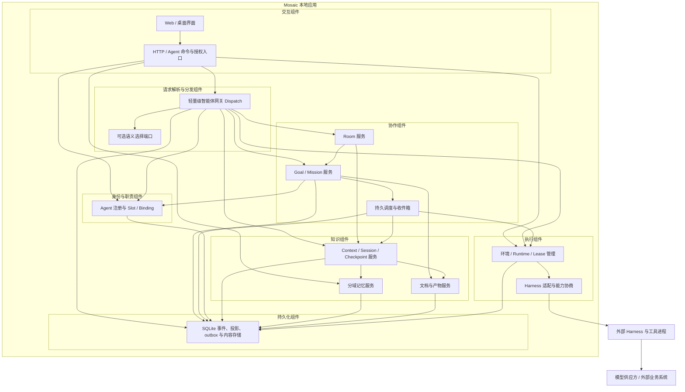
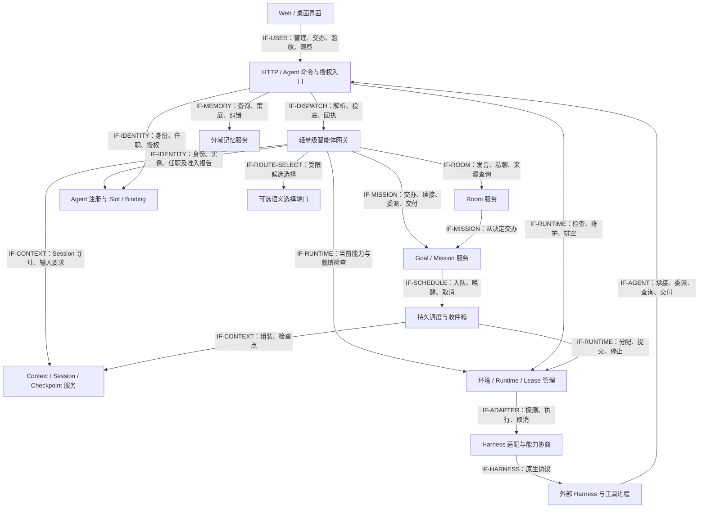
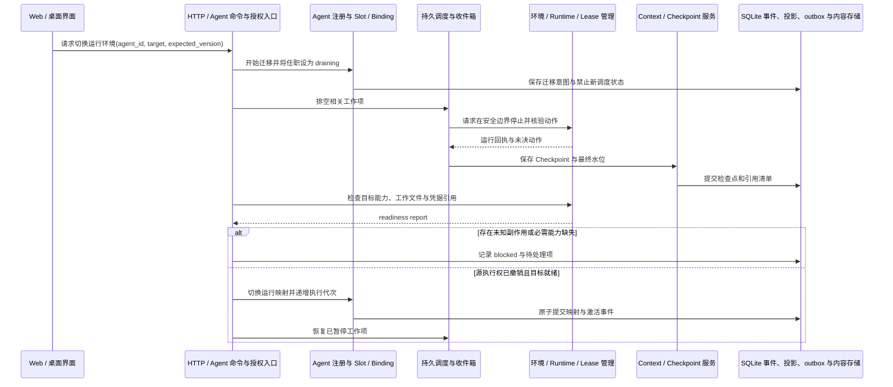
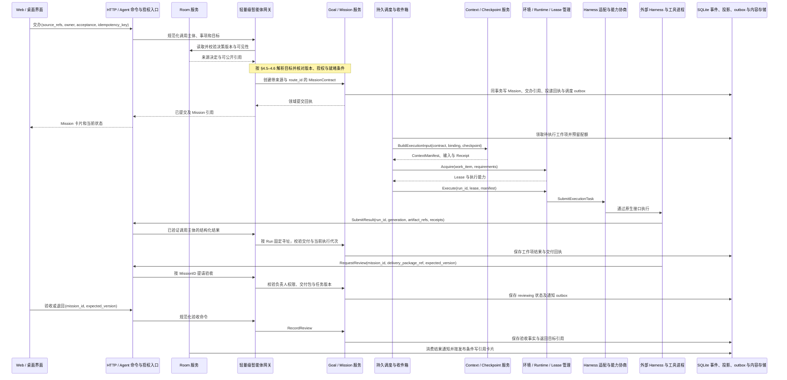
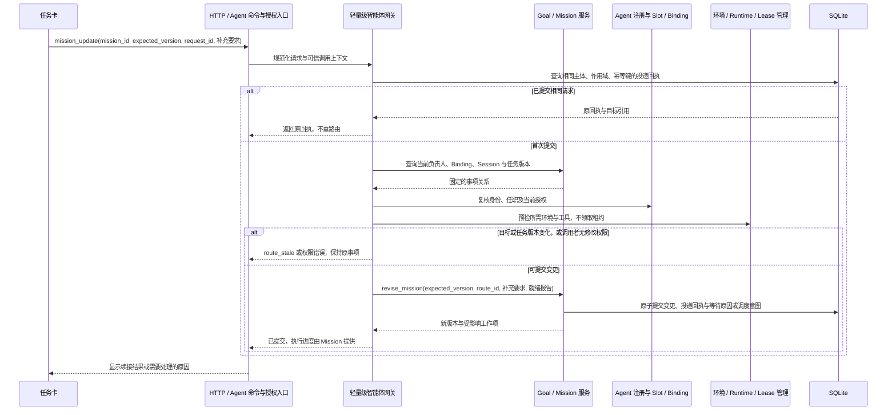

# 特性设计说明书（RFC 提案）：RFC-0018 长期 Agent、Slot 与圆桌到 Swarm 的协作闭环

**状态 (Status):** Approved（2026-10-28 负责人指令："按新的项目计划，设计和测试先行，开发0.5.0版本"——批准本设计为基线；实施范围与顺序按交付计划的现行版本映射分阶段推进，各阶段验收以本文 §13 为准）

**创建日期 (Created):** 2026-10-28

**更新日期 (Updated):** 2026-10-30（v0.6 轻量级智能体网关设计增补）

**作者 (Authors):** Mosaic 项目组 / Codex

**相关 Issue/PR:** 尚未建立

# 0. 文档控制

| 项目 | 内容 |
|---|---|
| 上游输入 | [讨论圆桌与 Swarm 衔接](chatgpt-conversation://6ae16fe6-7a50-83e8-a508-df53e8373021)（ChatGPT 内部引用，普通浏览器或仓库文档查看器可能无法打开）；尤其是用户关于自管 Agent、独立生命周期、可迁移记忆与上下文、Runtime 与 Slot 的四点要求 |
| 输入边界 | 初稿依据引用附带的截断预览；v0.6 于 2026-10-30 通过 `read_thread` 读取上述会话返回的 5 轮可用对话，纳入最新的内嵌智能体网关讨论及个人使用、手动备份合并的约束。§4.4–4.8、§10.3 及相关验收为本次要求的设计增补，接口与默认策略仍为候选，不表示已实现或另行承诺发行版本 |
| 开放问题来源 | 无对应架构 §11.5 清单项；本提案来自上述产品讨论，既有技术类 OQ 已由先前 RFC 承接 |
| 代码基线 | 初稿：v0.4.1，`f9346c3aee790d05b2e09985111dcd740f0828c4`；网关增补复核：`72eda6917f3d951c1ab16299b314b7f1b32cbffb`，已包含 0.5.5 职责准入实现，差异见 §2.1 |
| 范围 | 个人本地版的架构演进、领域契约、迁移策略与分阶段验收；未来远程运行保留接口 |
| 与既有文档关系 | 扩展 RFC-0002、0007、0008、0009、0010、0012，承接 ADR-0013 稳定身份及 ADR-0014 独立资产事件流；具体修订见 §2.2 |
| 生效条件 | 已获批准（见状态行）。各领域版本（0.5–0.9）落地时按 §2.2 同步修订对应基线，并按 §13 分阶段验收；批准不等于已实现，现行实现以各小版本交付为准 |

## 0.1 核心决定

Mosaic 自己管理长期 Agent 的身份、记忆、承诺和运行生命周期。Agent 通过 Slot 承接职责，在 Room 中讨论并形成决策，由 Mission 保存执行契约，负责人按需组织 Swarm，结果回到原讨论及任务中心验收。外部封闭 Personal Agent 的互联不作为前置依赖；已有 CLI、模型和 Harness 继续提供执行能力。

在既有 HTTP / Agent 入口之后内嵌轻量级智能体网关，负责请求寻址、事项续接、就绪核对、分发及返回位置关联。语义选择仅处理缺少明确目标的请求；Room 管讨论，Mission 管任务与责任，负责人组织 Swarm，Runtime 管执行。网关主要由确定性代码组成，复用现有领域服务，不新增常驻“总管 Agent”或独立部署服务。

“即嵌即走”定义为：一个 Agent 可在能力与授权满足时接入版本化 Slot；更换 Agent、Harness 或环境后，可从持久任务状态、授权记忆与交接包恢复工作。它不承诺跨模型保留相同隐式推理、无损搬运 CLI 内部会话，也不承诺零准备时间。

# 1. 目标、边界与用户体验

## 1.1 需求追踪

| 编号 | 明确要求 | 本文落实 | 验收入口 |
|---|---|---|---|
| R1 | 现阶段走 Mosaic 自管长期 Agent 路线 | 身份与协作控制归 Mosaic；模型调用仍可交给 Harness | AT-01、AT-11 |
| R2 | Agent 生命周期跳出 Room | 独立 Agent、Goal、Mission、Binding、Session、Runtime；Room 只保有成员及讨论事实 | AT-01、AT-02、AT-03 |
| R3 | 记忆与上下文可迁移，参考最新实践 | 分域记忆、来源与时效、Context Receipt、Checkpoint、可校验迁移包 | AT-04、AT-05、AT-06 |
| R4 | Runtime 管理、可选环境管理员、职责与工具提炼为 Slot | SlotSpec / Binding / Environment / Runtime 分离；受限环境维护职责 | AT-07、AT-08、AT-09 |
| R5 | 圆桌自然衔接负责人带领的 Swarm | 交办卡、Mission 契约、长期协作者与临时 Worker 两种委派、产物验收 | AT-10、AT-11、AT-12 |
| R6 | 按最新讨论补充个人版轻量级智能体网关 | 内嵌寻址与分发；先保持身份和事项连续性，再按需语义选择；复用调用约束、上下文与回传 | AT-14–AT-20 |

## 1.2 用户可见的闭环

1. 房间里形成一个决定或明确工作请求，选择“交给 Agent”，指定负责人、目标和验收条件。
2. 系统生成交办卡，沿用原讨论、来源与具名异议；缺少关键范围时保留草稿。
3. 负责人独立工作，必要时邀请另一位长期 Agent 或创建临时 Worker；用户仍可在原房间继续讨论。
4. 任务中心持续展示负责人、下一步、等待原因和产物。用户可补充要求、暂停或取消。
5. 负责人提交交付包，授权验收人接受或退回。新证据触及原决定的重开条件时，返回讨论。

长期存在不等于模型持续运行。没有工作时保存身份、队列、记忆和唤醒条件；执行资源按需启动。桌面应用关闭或机器休眠期间不会继续本地执行；重启后恢复调度，离线错过的唤醒按规则合并处理。

## 1.3 非目标

- 等待 Grok Bot、Dots、Duet、Muse 或灵光开放跨产品委派；本文不依赖对这些产品封闭内部机制的推测。
- 重建各家 Harness、代理所有模型调用、统一不同模型的内部上下文窗口。
- 首版引入多租户、分布式共识、跨组织 Agent 市场或强制云端常驻。
- 自动把每次讨论收束变成执行任务，或把 Agent 的口头承诺当作已启动的工作。
- 将全部历史、私有记忆、登录凭据和机器镜像作为一个不可分割对象迁移。
- 为网关新增企业登录、多租户、组织角色、计费或全局常驻 Hub；首版不引入完整 LLM / MCP / A2A 代理基础设施，不让路由器自行拆解任务或组织 Swarm。

# 2. 现有基础与需要改变的边界

## 2.1 已核查的实现

下表保留初稿 v0.4.1 的差距基线，不等于当前实现全貌或本 RFC 的目标能力已具备；网关增补所需的现状另列于表后。

| 当前基础 | 代码 / 规范依据 | 可复用部分与缺口 |
|---|---|---|
| 稳定 BotID 与路径重绑 | [ADR-0013](../adr/ADR-0013-stable-bot-identity.md)、[registry.go](../../../internal/harness/registry.go) | 已分离身份与路径；身份登记仍附着 Executable，需提升为独立 Agent |
| 提出方、负责人分离的任务清单 | [tasklist.go](../../../internal/room/tasklist.go) 的 `TaskItem`、`TasksOf` | 是房间消息的确定性投影；`mosaic-todo` 申报及 delivered 不能代替执行调度和成果验收 |
| 单 Agent 独立 Run | [runs.go](../../../internal/room/runs.go) 的 `runTask`、`executeRun`、`RecoverRuns` | 脱离反应波，但仍按 Room 存储并依赖房间座位；重启转 unknown，不自动重跑副作用 |
| 执行上下文 | 同文件 `runContext` | 只携任务指令、任务 ID 和最近 10 条消息；提交仍为 `agent.KindGenerate` |
| 会话隔离 | [supervisor.go](../../../internal/agent/supervisor.go) 的 `sessionKey` | 当前按 ProfileID × RoomID 隔离；尚无 Mission / Binding 级语义会话 |
| 收束与双平面记忆 | [closure.go](../../../internal/room/closure.go)、[context.go](../../../internal/contextx/context.go)、[RFC-0007](2026-08-25-rfc-0007-context-memory.md) | 已有胶囊、召回、上下文回执与记忆编辑；当前设计将共享记忆归房间，CLI 会话归 Harness |
| 监控唤醒 | [monitor.go](../../../internal/monitor/monitor.go)、[monitorwire.go](../../../internal/app/monitorwire.go) | 可复用变化检测；唤醒入口与 Run 状态仍使用 room_id |
| 外部命令身份门 | [service.go](../../../internal/room/service.go) 的 `ExecuteCommand` | 只允许具名 human/system；新增 Agent 委派须走专用授权入口，不能直接放开 actor 字符串 |
| 独立资产事件流 | [ADR-0014](../adr/ADR-0014-document-event-stream.md) | 文档已脱离 Room 生命周期；可沿用按对象归属权威事实的办法 |

另外，`internal/contextx/context.go` 的 `TasklistProtocol` 仍提示“没有后台执行”。引入 Mission 后须按执行能力与任务类型提供提示词，避免新旧行为互相矛盾。

**2026-10-30 网关增补复核：**独立身份与 SlotSpec / SlotInstance / Binding 已落地。`internal/app/app.go` 已注入 [GrantReadinessChecker](../../../internal/slot/readiness.go)，按 [ADR-0022](../adr/ADR-0022-readiness-admission.md) 对用户授权档案和钉住版本的职责模板求交集；不能沿用讨论时“生产准入检查尚未注入”的旧判断。但该检查尚不代表本机文件、登录态、实时工具能力与执行租约都已就绪，Runtime 实测及 Mission 范围仍需后续接入。`internal/room/runs.go` 的任务仍依赖房间座位和 local 连接，`internal/agent/supervisor.go` 仍按 Profile × Room 隔离会话；拟新增的 `internal/dispatch` 与 Mission / Session 寻址契约不是当前已有接口。

## 2.2 规范兼容与修订清单

| 原约定 | 本提案的变化 | 保留项 / 生效方式 |
|---|---|---|
| Room 为讨论中心，文档另有权威日志 | Agent、Mission、Binding、Runtime、长期记忆也有独立权威状态 | 讨论事实仍归 Room；按对象分流，不把多份镜像当共同权威 |
| RFC-0007 §7.4：Memory 归房间 | 增加 Agent、Workspace、Goal/Mission 和职责实例的记忆域 | 原 Room 记忆不自动变成 Agent 私有记忆；跨域复制须记录授权与来源 |
| RFC-0007 / OQ-16：Session 归 Harness | Mosaic 新增语义 Session 与可移植 Checkpoint；原生线程仅作可选加速 | Harness 继续负责自己的 token 窗口与内部压缩；Mosaic 不读取隐藏推理 |
| RFC-0002：Generate 等讨论任务，Run 仍在 Room | 增加能力协商后的执行任务类型、委派回调和 runtime/session 寻址 | 旧适配器继续讨论；不支持执行时明确报能力缺失 |
| 架构 AR-003：Agent 不能直接调用 Agent | 允许通过 Mission 的授权入口请求委派，系统持久化并调度 | Agent 仍不能直接控制另一 Agent 的进程、身份或私有会话；圆桌发言仍由 Room 协议仲裁 |
| ADR-0013：BotID 附着可执行项 | 独立 AgentID，保留 BotID / ParticipantID / ProfileID 的映射 | 不重写旧事件，不以显示名猜测合并身份 |
| RFC-0012：tasklist 为房间承诺投影 | 显式提升为 Mission 后，由 Mission 管理执行状态 | 旧 tasklist 格式及旧终态保持原义，不自动批量启动 |
| RFC-0008/0009/0010：授权、工具、数据生命周期 | 增加 Binding 权限交集、迁移、派生记忆删除、运行回执 | 沿用 owner 写门、最小权限和删除留痕原则；不导出密钥 |
| Gateway 为 HTTP / Agent 命令入口 | 入口后增加进程内 Dispatch，统一目标解析与投递关联 | 原入口保留协议校验和身份边界；Model Gateway、Tool Gateway 职责不变；普通 Room 发言不进入全局专家筛选 |

原批准基线的架构边界已按领域逐步回填；网关增补同步登记于架构说明书 §6.4.1。后续实现时同步修订相应协议与 Schema，不把本文的候选接口标为已交付。

# 3. 概念、所有权与生命周期

## 3.1 对象边界

| 对象 | 持有的状态 | 生命周期 / 关系 |
|---|---|---|
| Workspace | 用户控制域、政策、资源、共享知识 | 个人版对应本地用户的数据域，先不新增多租户机制 |
| Agent | 稳定 ID、公开人格配置、私有记忆入口、收件箱、责任索引 | Workspace 所有；跨房间、模型、环境存在；责任索引从 Mission / Binding 派生 |
| SlotSpec | 职责、技能引用、工具与环境需求、上下文要求、交付规范 | 不可变版本；可复用模板，不含在办任务与私有凭据 |
| SlotInstance | 某作用域内的一份具体职责、职责知识入口 | Workspace / Goal / Mission 持有；同一模板可实例化多份；换人后实例保留 |
| Binding | Agent 任职 SlotInstance 的版本、实际授权、并发约束、交接状态 | Agent 与职责的任职记录；独立于环境分配；首版每实例最多一位 active 任职者 |
| Goal | 长期目标、衡量方式、负责人、周期、等待策略 | 可含多次 Mission；可无结束日期，但必须有复查或停止条件 |
| Mission | 可验收的一次交办、负责人、范围、预算、工作图、交付与验收 | 可不隶属 Goal；可关联多个 Room；归 Workspace，不能由房间删除级联销毁 |
| WorkItem | Mission 内的子任务、依赖、承接者、进度与结果 | 执行图节点；依赖边必须无环；与旧 Room TaskItem 分开命名 |
| Room / Membership | 共同讨论、来源、决定、成员关系 | Room 只拥有参与关系；退出/关闭房间不删除 Agent，不取消独立 Mission |
| Session | 某 Agent 在某作用域与任职下的语义工作上下文 | 按 Agent × scope × Binding 隔离；可压缩、分支、关闭；原生句柄不作主键 |
| Run / Attempt | 一次具体尝试、输入版本、Runtime、动作与结果回执 | 有限生命周期；每次重试用新 RunID，保留 WorkItemID；本文以 Run 作为 Attempt |
| Environment | 工作目录、依赖、数据卷、工具配置、资源与连接要求 | 可共享或专用；独立持久化；删除前处理所有租用者和需保留文件 |
| Runtime | 一份可执行实例的 Harness、主机、能力与健康状态 | 绑定 Environment，可启动/休眠/排空/重建；一个 Agent 可使用多个实例 |
| RuntimeLease | Run 对 Runtime 的限时占用、租约代次、资源限额 | 续租或到期；围栏令牌用于拒绝旧实例提交，不代表能撤销外部已发生动作 |
| Worker | 为 Mission 临时创建的执行身份与最小上下文 | 不默认拥有长期人格/私有记忆；完成回收；晋升长期 Agent 必须显式创建及转移 |

这里的 Slot 是“职责槽位”，不同于既有架构中讨论发言顺序的 slot。新接口统一使用 `slot_spec_id` / `slot_instance_id`，旧发言槽位不改义。

“主 Agent”是 Mission 的 accountable owner；“子 Agent”可能是长期协作者，也可能是临时 Worker，不设固定身份等级。一个 Agent 可以同时负责 A、协助 B、参与 C 的讨论。跨 Mission 可并行，首版同一 Session 串行，同一可写工作区须独占租约或分出独立工作区。

## 3.2 状态与转移约束

| 对象 | 状态与主要转移 | 关键约束 |
|---|---|---|
| Agent | active ↔ suspended；active/suspended → retiring → retired | active 不代表正在运行；retiring 停止接新任务，处置所有承诺后才能 retired |
| Binding | preparing → ready → active → draining → released；准备失败 → blocked → preparing | 每次换 Agent 创建新 Binding；旧 Binding 留作审计；排空后才能切换职责写入者 |
| Goal | active ↔ paused；active → achieved / canceled | 子 Mission 完成不自动证明长期目标达成；暂停停止新调度并显式处理在途任务 |
| Mission | draft → ready → running；running ↔ waiting；running/waiting → paused → ready；running → reviewing → accepted | reviewing 可退回 ready；非终态可进入 canceling → canceled 或失败处置后 failed；accepted/canceled/failed 不被迟到回调翻转 |
| WorkItem | offered → accepted → queued → running → submitted → accepted_result | offered 可 declined；进行中可 waiting/blocked、取消或失败；submitted 退回后重新排队 |
| Run | queued → starting → running → succeeded / failed / canceled / unknown | 旧房间 requested/completed 通过兼容映射展示，不重写；unknown 先核验副作用，不能直接当失败重试 |
| Runtime | discovered → provisioning → ready ↔ busy；ready/busy → draining → stopped；故障 → unhealthy → provisioning | busy 可表示仍有容量；draining 不接新租约；同一 Runtime 可多 Run，但资源上限与工作区隔离必须满足 |
| Session | open → checkpointed → open；open/checkpointed → closed | checkpointed 表示可恢复边界；是否支持原生恢复另行报告 |

取消和暂停都不能抹去既有动作。暂停以持久状态先阻止新调度，再请求在途 Run 在安全边界停止；无法安全终止或结果不可确认时显示待核验。Mission 只有所有子项停止、交付或已明确处置，才进入 canceled。新要求进入带版本的契约修订；在途 Run 不静默换输入，越过安全边界的修订应停止并重排。

## 3.3 必须保持的不变量

- 每个 Mission 恰有一个 accountable owner 或显式 `unassigned`；退役交接必须记录新负责人及承接回执。
- Room 暂停只暂停讨论及房间发布；Mission 的执行状态独立。要同时暂停任务，使用任务操作。
- 取消发给长期 Agent B 的工作项，只撤销该工作项授权与租约，不关闭 B 的其他任务或身份。
- 同一 WorkItem 的有效执行代次唯一；可存在旧进程，但旧代次结果不更新当前状态。
- 执行成功、成果提交、验收通过是三个事实；模型说“完成”不替代后两者。
- 共享知识、职责知识与 Mission 产物不随 Agent 退役消失；私有记忆不因职责换人自动转交。

# 4. 总体架构与部署

## 4.1 逻辑结构

延续模块化单体、SQLite、本地进程与逐家 Harness 适配。下图是目标结构，节点既包括现有组件，也包括拟新增模块；不要求拆成微服务。



## 4.2 上下文与聚合接口



具体命令见 §11。`IF-ADAPTER` 是 Mosaic 内部统一适配端口，`IF-HARNESS` 是适配器调用外部 Harness 的原生协议边界。Harness 的回调由 Gateway 验证身份与作用域，Dispatch 按已绑定的 Run 路由，不重新做语义选择；Runtime 管理器提供资源与执行事实，Mission 决定工作是否完成。环境管理员通过相同身份边界调用受限维护接口。

`IF-DISPATCH` 聚合 `Resolve / Dispatch / GetReceipt`，调用方不需要了解 CLI 路径。`IF-ROUTE-SELECT` 只接收经过可见性过滤的请求摘要和有限候选，返回候选 ID 或弃权；它没有领域写入、工具执行或直接投递权限。管理类确定命令可继续直接调用既有领域服务，不必经过语义判断。

## 4.3 逻辑元素到代码、构建与部署

| 逻辑元素 | 现有或拟新增代码落点 | 构建、交付与部署 |
|---|---|---|
| UI | `apps/web/src`，扩展 `components/chat/TasksTab.tsx` | 既有 Vite 构建，嵌入服务端与桌面壳 |
| Gateway / Room | `internal/transport/httpapi`、`internal/room` | 既有 Go 服务；Room 保留讨论引擎 |
| Dispatch / Semantic | 拟新增 `internal/dispatch`；选择器为可插拔端口 | 同一 Go 进程，在 HTTP 层后装配；默认确定性路径，无需单独安装或后台守护进程 |
| AgentRegistry | `internal/harness` 保留可执行发现；现有 `internal/personalagent`、`internal/slot` | 同一 Go 进程；复用身份、职责与准入查询，不另建专家名录 |
| Mission / Scheduler | 拟新增 `internal/mission`、`internal/scheduler`；复用 `internal/monitor` | 同一 Go 进程；持久队列恢复依赖 Store |
| Context / Session / Memory / Assets | `internal/contextx`、`internal/agent` 的会话映射、拟新增 `internal/memory`，既有 `internal/doc` | Session 续接元数据扩展至任务作用域；私聊仍复用既有 private Room，不增加一份聊天事实源 |
| Runtime / Adapter | 拟新增 `internal/runtime`；复用 `internal/agent`、`internal/harness` | Go 管理器与现有外部 CLI 子进程；先支持本机 / 已有 WSL 路径 |
| Store | `internal/storage/sqlite` 及本地内容文件 | 沿用现有数据库与备份介质，新增版本化迁移 |
| Harness / Provider | 用户安装的 Harness 及其模型连接、业务工具 | 外部依赖，不打包模型服务或复制用户认证信息 |

装配继续由 `internal/app` 完成，交付仍是 `cmd/mosaic-server` 与 `apps/desktop`。远端连接、容器隔离可作为后续 RuntimeProvider 插件；能力和凭据就绪前不调度到这些环境。

## 4.4 轻量级智能体网关的职责边界

网关回答四件事：请求属于哪个事项、交给哪个对象、怎样送达、结果回到哪里。HTTP / Agent 入口完成协议与调用身份校验后，把规范化请求交给 Dispatch；未来 IM 适配器和事件入口也复用这一端口。个人版沿用本地 owner 与受限 Agent 调用上下文，区分用户交办、Agent 委派及事件唤醒即可，不增加企业鉴权产品。

| 网关负责 | 依赖的权威服务 | 网关不能替代的裁定 |
|---|---|---|
| Agent、Slot、Mission、Session 统一寻址 | AgentRegistry、Slot / Binding、Mission、Session 元数据 | 身份注册、任职变更、负责人转移 |
| 识别新事项或已有事项的后续 | Room 回复关系、Mission / WorkItem、Session 作用域 | 自动新建任务、合并会话或改写任务契约 |
| 核对职责匹配、授权与当前可执行性 | Binding 准入、Runtime 探测、Scheduler 配额 | 扩权、启动进程、领取租约或宣布资源已预留 |
| 提交最小上下文要求和结果返回位置 | Context、Memory、Mission、Room | 复制候选 Agent 的私有记忆、判定交付或验收完成 |
| 携带幂等键、委派链、时限与预算 | 领域命令事务、Scheduler、Runtime | 另建一套任务状态机、无界重试、自行组织 Swarm |
| 保存简短路由理由并支持用户纠正 | RouteDecision、领域命令回执 | 把路由回执当执行事实，或让模型评分覆盖用户指定 |

此处的智能体网关是应用层分发模块。现有 Model Gateway 的 Mosaic 自用模型职责、Tool & Approval Gateway 的工具检查职责不变；Agent 的模型访问仍由 Harness 负责。可选语义选择可复用已配置的自用模型能力或受限 Harness 适配端口，但不因此代理所有 Agent 调用。

## 4.5 寻址优先级与事项连续性

先区分请求类型，再解析目标。入口携带 `room_message / direct_message / mission_create / mission_update / delegation / result / wake` 等类型；结构化操作可直接指定，普通文本只能提出类型建议，不能靠一句模型判断把 Room 发言变成已启动的 Mission。暂停、取消、结果回传及已绑定的唤醒走确定命令路径。

| 顺序 | 判定依据 | 处理规则 |
|---|---|---|
| 1. 显式目标 | UI 选定的 Agent / SlotInstance / Mission / Session，或已解析的具名引用 | 校验目标与当前作用域。目标不可用时保留原目标并说明原因；同名或矛盾引用需要澄清，不能偷偷改派 |
| 2. 明确续接 | 任务卡、回复关系、会话绑定、既有负责人 | 回到同一 Mission / WorkItem / Session；“再加 Windows 和绑核结果”不触发重新选专家。多个可能事项时保持未分配并询问一个必要问题 |
| 3. Room 默认路径 | 仍属于当前房间的普通讨论消息 | 进入 Room 协议；`@Agent` 在房间内表示定向关注，不改变其他参与者资格。网关不先筛掉圆桌成员 |
| 4. 无明确目标的新事项 | 当前项目与事项范围、职责要求、可见候选 | 先做规则与硬条件筛选；仍需选择时才使用 §4.7 的可选语义选择 |

上述优先级不能跨过业务所有权：显式指定 Agent B，同时引用由 A 负责的 Mission，不等于已把责任交给 B；必须明确是协作、向 B 咨询还是责任交接，再进入相应领域命令。文档引用仅提供上下文来源，不能仅凭文档作者推断任务负责人。普通私聊直接解析 Agent 并定位其 private Room / Session，无须强制创建 Slot 或 Mission。

任务型职责寻址使用 `当前 scope → SlotInstance → active Binding → AgentID → 候选 Runtime`。SlotSpec 只作版本化模板，同名模板在不同项目下可有多个实例；禁止跨项目猜选任职者。没有 active Binding 时返回待任职，不能自动激活一个 ready Binding。已分配 Mission 固定其负责人、Binding 与执行代次，职责后来换人不自动转移在途工作；交接沿用 §8、§10.2。

Session 按 Agent × scope × Binding 校验；普通私聊允许 Binding 为空，任务续接必须验证所属 Mission / WorkItem。原生 CLI session ID 只是恢复提示，不能用它越过作用域或直接选择另一身份。用户明确另起事项时新建独立 Session，不把当前对话的私有上下文默认带过去。

## 4.6 就绪检查、投递与交接回传

候选需要分别记录三种判断：**职责适合**（模板描述与请求匹配）、**授权满足**（Binding 的有效权限交集）、**当前可执行**（文件、登录态、工具、Runtime 健康、隔离能力与调度资源）。active Binding 或一次旧的 readiness report 不能代替后两者的实时复核。语义匹配度不能抵消任何必需项缺失。

解析阶段只做预检，不占用执行资源。投递前重读 Agent 状态、Binding、任务版本和授权；调度领取时再按 §11.1 校验并预留预算、领取 Lease。解析后发生任职变更、授权撤销或任务修订时，返回 `route_stale` 及需重新解析的对象，不自动套用新任职者。暂时忙碌可由 Scheduler 排队；缺工具、缺文件或运行面离线时保留目标，显示对应等待原因。

执行就绪检查只阻止启动执行，不阻止有权用户保存草稿、补充任务契约或发出停止 / 取消命令。目标与操作权限合法时，这些变更先由领域服务持久化；缺执行条件记录为等待原因。不能要求环境在线才能记录用户的新要求，也不能把“变更已保存”显示为已开始执行。

目标确定后，网关提交目标、来源决定、验收条件、证据引用、Checkpoint 引用和返回位置给既有服务；由 Context 按 §7.3 形成有版本的 Manifest / Receipt。路由阶段只读取授权的目录与必要事项摘要，不为了选人先组装所有候选的私有记忆。必需输入缺失时保留 draft / blocked，不能发出一个只有最后一句话的空壳交办。

用户状态依次取自对应权威对象：`已确定目标`来自 RouteDecision；`待输入 / 待环境`来自就绪报告与任务等待状态；`已提交`须有领域提交回执；`已接收`须有 offer 承接或调度领取事实；`执行中`须有有效 Run；`已交付 / 待验收`来自 Mission。网关提供关联视图，不维护一条独立的任务推进状态机。没有长期协作者 offer 的单 Agent 任务，不虚构一条 Agent 已承诺承接的记录。

返回位置只允许已授权的 Room / Thread / Mission / WorkItem / Session 对象引用，不接受任意回调 URL。子项交付回到父 WorkItem 与负责人，再由 Mission 统一交付；Room 只接收允许公开的摘要和成果引用。来源房间被暂停或删除时按 §10.2 处理，返回位置失效不触发重跑。结果、错误与取消回执按 RunID / generation 固定回原事项，绝不重新语义分类。

## 4.7 可选语义选择与人工改派

确定性路径可在没有路由模型的情况下完整使用。初版语义模块只为没有明确目标的新事项提供候选，用户沿用现有“交办”动作选定目标；不增加所有请求都必须经过的审批步骤。以后若允许按用户预设规则自动投递，必须另行确定适用范围及误派验收，不能把模型自报置信度直接当授权。

选择过程固定为：过滤可见范围和硬约束 → 提供有限候选的身份、职责、技能与输入输出描述 → 输出候选 ID、简短公开理由或弃权 → 确定性代码复核候选及当前版本。候选资料从现有目录派生，不另存可漂移的“专家名录”；模板说明、请求正文和文档内容都视为数据，不能改变路由规则或授予工具权限。

每次 RouteDecision 最多进行一次语义调用。候选默认上限 20、选择超时默认 5 秒、入口正文上限沿用 256 KiB 并取适配器更小值；这些是待实现基准验证的初始策略参数，不是已测性能。达到候选上限仍有歧义时请求缩小范围，不把截断后的唯一结果当作全局唯一匹配。超时、模型不可用、候选外 ID 或非法结构均保持未分配，保留手动选目标入口；不循环调用其他模型猜测，不阻塞既有 Room 发言与明确目标投递。

| 用户纠正或运行变化 | 处理方式 |
|---|---|
| 尚未提交时改目标 | 产生新版本 RouteDecision，展示新目标与理由；原候选不保留执行权 |
| 已提交后从 A 改为 B | 走 Mission 责任交接或 WorkItem 重新委派，处理在途 Run、Checkpoint 与未知动作；不能只改路由缓存 |
| 同 Agent 使用已配置备用模型 | Harness 按已允许策略处理并记录实际模型；复核能力与上下文兼容性 |
| 同 Agent 更换 Runtime | 走 §8.3 的排空、检查点与执行代次切换，不能因超时同时派发到两处 |

路由回执展示“当前项目的性能验证职责、任职者、沿用任务、目标环境、缺失项”等可核查依据，不展示模型内部推理。人工纠正可作为显式路由偏好保存；首版不自动训练，也不把一次改派泛化为跨项目永久偏好。

## 4.8 本地部署、跨设备与失败语义

每台 Mosaic 内嵌自己的 Dispatch，不依赖一台常驻 Hub。按照 [RFC-0019](2026-10-28-rfc-0019-encrypted-backup-merge.md) 手动导入的数据是历史状态，不能证明另一设备在线，更不自动建立远程调用、续租或结果通道。导入的 RouteDecision、回执与 Runtime 信息只作历史；激活与本机能力检查通过后，才能创建新的本地投递。

尚无受支持的远端传输时，对另一设备的交办保留为待交接，界面显示“待送达”；网关返回 `remote_delivery_unavailable`，Mission 保留相应等待原因，不显示 running。跨设备投递、确认、取消、去重及单执行权交接由后续 Runtime / 同步协议承接，不在本次网关设计中新增网盘任务队列或自动抢占。

请求时限与投递失败不等于没有执行。已有持久提交回执时按同一幂等键查回原结果；可能已产生外部副作用而没有终态时保持 `unknown / reconciliation`，复用 §11.3 的核验流程。网关不因超时重新选 Agent、另开 Mission 或重发一个新的执行键。并发、总 Run 数、重试和委派深度由 Scheduler / Mission 检查，网关携带约束与委派链；父子循环仍由 DAG 规则拒绝。

# 5. Slot：职责模板、任职与装配

## 5.1 SlotSpec 的内容

Slot 描述“承担什么职责、需要什么能力、如何交付”，不绑定某个模型或绝对安装路径。工具写为能力要求与版本约束，实际连接由 Binding 解析。

```yaml
schema_version: 1
slot_spec_id: slot.research-lead
version: 1
name: 研究负责人
responsibility: 汇总证据、组织协作，并对研究交付负责
skills:
  - ref: workspace/skills/evidence-review
    version: 1
tools:
  required: [documents.read, documents.write, memory.search]
  optional: [web.search]
context:
  required: [mission.contract, decision.capsule, slot.knowledge]
  optional: [agent.preferences, room.recent]
deliverables:
  - 结论、来源、具名异议、未知项与可验收产物
delegation:
  allowed: [existing_agent, ephemeral_worker]
  max_depth: 2
runtime:
  required: [execute, cancel, isolated_workspace]
  workspace_access: read_write
handoff:
  required: [checkpoint, artifact_refs, pending_actions]
```

上述是候选语义示例，正式 Schema 在实现阶段加入必填、枚举和大小限制。此模板要求决策胶囊，适用于圆桌交办；无需讨论的任务可选用不要求该项的模板。`skills` 是可审查的版本化工作方法，安装或导入不自动执行其中脚本。

## 5.2 Binding 与准入

Binding 记录 `binding_id、agent_id、slot_instance_id、slot_spec_version、scope、effective_grants、tool_bindings、context_policy_version、concurrency_limit、status`。SlotInstance 单独持有 `knowledge_namespace`，不能把职责知识挂到任职者的私有库。

装配依次完成：解析模板 → 核对工具/运行能力 → 绑定允许的数据域与凭据引用 → 生成上下文清单 → 健康探测 → ready → 激活。输出 readiness report，列出满足项、缺失项、可选降级及不能开展的动作。

有效权限取用户授权、Workspace 政策、职责范围、Mission 范围、Runtime 强制能力的交集。Slot 写了工具名称不等于获得权限；Agent 自己修改职责、扩张资源或要求更高权限均不能自授权。可选工具缺失时按已声明降级执行；必需项缺失则 blocked，不静默换负责人、模型或工具。

同一 SlotSpec 新版本不自动改变在途工作。Binding 固定版本；升级先生成差异与就绪报告，完成排空再切换。换人时保留 SlotInstance 的知识、交付和在办事项，新 Binding 读取交接包并承接，旧 Binding 释放租约与写权限。

# 6. Mission 与 Swarm 的协作契约

## 6.1 MissionContract

交办至少包含：`mission_id、contract_version、requester、owner_agent_id、reviewer、objective、scope、constraints、acceptance_criteria、deliverable_specs、budget、source_refs、decision_ref、context_manifest_ref、return_targets、delegation_policy`。

- `source_refs` 固定房间事件、文档修订与决策版本；没有 Closure Capsule 的直接交办须保存明确请求，不能捏造“已达成共识”。
- `decision_ref` 对应的假设、具名异议、未决问题、反证和重开条件随交接包保留；负责人可提出改计划，不能改写原决定。
- `budget` 至少含并发、总 Run 数、墙钟时长、重试与委派深度；token 只有适配器可测时才作硬门，不依赖费用核算。
- `reviewer` 默认请求人；自动验收必须由事先约定的确定性检查或授权验收角色执行，负责人自述不算验收。

## 6.2 两种委派

| 委派方式 | 接受方式 | 上下文与生命周期 | 取消的范围 |
|---|---|---|---|
| 长期 Agent 协作 | 投递 inbox offer，按已授权任职策略自动承接或明确 accepted/declined | 独立身份、队列和私有记忆；仅授予本工作项上下文 | 当前 offer / WorkItem / 对应授权 |
| 临时 Worker | 调度器在负责人配额内创建 | Mission 专用身份、子 Session 与临时工作区；不默认继承负责人全部记忆 | 当前 Worker 的所有在途工作和租约 |

Swarm 是 Mission 的执行配置与 WorkItem 图，不新建一层万能“主脑”状态。负责人通过结构化动作 `offer_work`、`spawn_worker`、`submit_result`、`request_review` 调度；“@B 帮我做”只有在转成合法命令、通过授权并落库后才形成委派。WorkItem 交付给负责人审查，Mission 交付给契约中的验收人。

首次实现限制工作图为 DAG；新增依赖时检测环，拒绝 A 等 B、B 又等 A。限制扇出、深度、总运行次数与重试次数，额度在调度事务中预留，终止后释放。嵌套委派从父项扣预算；等待子项时释放可复用计算配额，避免父任务占满并发造成死锁。

## 6.3 持续事务与唤醒

Goal 汇总长期责任，Mission 推进一次阶段性交付。等待原因结构化为 `dependency / user_input / approval / external_event / schedule / runtime_unavailable / reconciliation`，同时记录 `wake_condition、next_check_at、deadline、last_observed_version`。

定时与事件触发写入持久 inbox，按触发来源与版本去重；规则需有时区、冷却期、合并策略、到期时间与最大尝试数。离线错过多个 tick 默认合并一次“检查当前状态”，不补跑每个错过时刻的外部写动作。Agent suspended、Mission paused 或 Binding draining 时可收件但不启动执行。默认只通知交付、失败、需要用户行动或有意义的变化，观察结果不变时保持安静。

# 7. 记忆、上下文与可恢复工作状态

## 7.1 数据分层和归属

记忆是可纠错的派生知识，任务状态是权威业务事实，上下文是某次执行实际获得的输入，三者不能互相替代。

| 数据层 | 保存内容 | 所有者与迁移策略 |
|---|---|---|
| 事实与证据 | 事件、明确用户输入、动作回执、文档修订 | 原始领域对象持有；可用版本化引用，删除规则独立 |
| Agent Memory | 长期偏好、经验、经确认的公开人格配置 | Agent 私有域；跨任务使用仍需用途与读取权限过滤 |
| Workspace / Room Memory | 项目知识、房间共识与异议 | 共享域；导出 Agent 不默认复制整个共享库 |
| Goal / Mission Memory | 阶段经验、假设、证据整理 | 随事务保存，换负责人可继续使用 |
| Slot Knowledge | 某职责实例的工作规范、环境说明与积累 | 随 SlotInstance 保存，区别于模板与任职者私有记忆 |
| Working Context | 目标、短期进度、当前证据与待执行动作 | Session 的显式 Checkpoint；随任务恢复，按授权迁移 |
| Native Session | CLI 会话 ID、供应方内部状态 | Harness / Runtime 私有；可选恢复提示，不是便携事实源 |
| 检索索引 | FTS、向量、图索引、摘要缓存 | 可重建派生数据；不作为迁移的唯一载荷 |

记忆类型与权限域正交。`semantic / episodic / procedural` 分别表达知识、经历和方法；方法改进先成为建议，影响工具或执行规则时发布新 SlotSpec / Skill 版本，不允许通过“记忆”绕过授权。episodic 只保存可观察动作、结果与公开理由，不保存隐藏推理链。

## 7.2 MemoryItem 与策展

拟定字段：`memory_id、version、namespace、kind、content_ref、source_refs、derived_from、observed_at、valid_from、valid_to、confidence、status、visibility、sensitivity、retention_policy、extractor_version、supersedes、edit_history`。

每条记忆须能追到已提交事件、文档版本或显式人工记忆操作；不能从未经授权的上下文提炼后转入更宽可见域。抽取 → 候选 proposed → 验证来源、去重、冲突检查 → accepted；高可信明确指令可按预设政策自动接受，其他项保留候选或让用户纠错。

时效同时记录“何时知道”与“何时有效”。新旧矛盾不只按写入时间覆盖：区分纠错、事实随时间变化与并存异议；人工纠错具有明确版本记录；过期、撤回和 superseded 项不默认参与当前召回，历史查询仍能解释当时依据。

策展可在任务完成、明确记忆指令或有界后台批次运行；不能每条消息启动一轮反思。抽取所需模型能力经既有 Harness 或已配置能力提供；首版不新增强制模型账户。观察、归纳与推断须标类型，模型推断不能升级成来源事实。

## 7.3 Context Manifest、Receipt 与 Checkpoint

`ContextManifest` 固定本次输入引用与版本：Agent profile、SlotSpec / Binding、MissionContract、决策胶囊、授权记忆、文档与证据、Checkpoint、工具清单、policy version、各领域水位。跨流用水位向量，不虚构一个全局房间序号。

组装顺序：约束与有效权限 → 当前职责 → 任务契约/验收 → 决策与未决风险 → Checkpoint → 相关证据/记忆 → 近期消息 → 工具接口。必需层必须保留；可选层按独立配额截断并标明遗漏。授权及有效期过滤先于排序、摘要与计数，避免泄漏其他域的内容和存在性。

组装是确定性过程，先提供有限正文及按需查询入口；初始沿用 RFC-0002 的 256 KiB 输入上限，再取适配器声明上限的较小者。必需内容放不下或必需证据已被删除时，进入 blocked 并说明原因，不能静默缺失。这里管理“交付什么”，Harness 仍管理实际 token 窗口、压缩和内部会话。

`ContextReceipt` 记录实际交付和后续查询的 ID、版本、摘要、裁剪与脱敏规则、能力版本及 RunID，不复制完整 Prompt、不采集隐藏推理。它证明 Mosaic 交付了什么，不能证明模型保留或理解了全部内容。

`Checkpoint` 独立于 Receipt，保存可恢复业务状态：`session_id、checkpoint_version、mission_version、work_item_id、completed_steps、pending_steps、artifact_refs、action_receipts、uncertain_actions、waiting_conditions、source_watermarks`，以及简短公开进度摘要。它必须能重新读取权威任务状态；文字摘要不能将 pending 偷换成 completed。正常安全边界、等待与交接时落盘；最后一次动作之后尚未落盘则恢复时核验回执。

## 7.4 检索与技术取舍

首版保留 SQLite + FTS5、结构化 scope / 时间 / 来源过滤及按需查询，先把可迁移性、来源和纠错做实。用真实任务记录漏召回与错误召回，再评估向量或时序图；不得把现有“FTS5 起步、向量推迟”的决定默默改成必须安装新数据库。

MemoryBackend 提供 `Propose / Accept / Revise / Search / Export / Import / Forget` 端口，外部系统可作为候选后端或索引。Mosaic 的 ID、授权、删除语义和便携格式保持自身契约；替换检索引擎不能改变记忆归属。§14 的近期资料只提供机制参考，不构成供应商选型结论。

# 8. 可迁移 Agent 与交接协议

> 个人全量备份扩展：[RFC-0019](2026-10-28-rfc-0019-encrypted-backup-merge.md)（Draft）覆盖整个受管实例的加密导出与导入合并，包含受管文件及可导出第三方凭据；本节的选择性 Agent Bundle 继续用于职责/身份交接，保留不携秘密的边界。两者都不因导入自动获得执行权；RFC-0019 的全量范围及合并规则不应误用本节的范围选择流程。

## 8.1 三种迁移，分别承诺

| 操作 | 必须携带或重新绑定 | 不保证的内容 |
|---|---|---|
| 同 Agent 换 Harness / Runtime | 稳定身份、任务版本、授权记忆、Checkpoint、工作文件、工具能力映射 | 原生会话 ID、隐式推理、模型行为完全相同 |
| 同 Slot 换 Agent | 职责实例知识、Mission / WorkItem 状态、产物与未决动作、承接回执 | 上任 Agent 全部私有记忆；不得复制整个人格冒充原负责人 |
| 跨 Mosaic 实例导出 / 导入 | 版本化便携包、来源与权限元数据、脱敏报告、ID 映射、目标环境校验 | 原账号登录态、原路径可用、原工具授权自动成立 |

恢复成功定义为：新执行者知道目标与验收、已完成和未完成事项、哪些动作结果未知，并能访问继续所需证据。恢复应优先使用结构化任务状态与回执，原生会话可用时仅作辅助。

## 8.2 Portable Agent Bundle v1（候选格式）

包内包含清单与内容摘要，文件路径只允许包内相对路径：

```text
manifest.json                 格式版本、来源实例、身份、导出模式、水位、文件摘要
agent/profile.json            显式人格与偏好配置，不含认证凭据
slots/specs.json              所需 SlotSpec 版本与职责实例说明
memory/items.ndjson           经授权的记忆、来源、时效、纠错及删除标记
work/checkpoints.ndjson       指定任务的检查点、等待条件与动作回执
work/commitments.json          承诺及原对象映射；导入默认暂停
context/manifests.ndjson       上下文引用与可用证据清单
artifacts/                    明确选择携带的工作文件和产物
dependencies.json             工具、技能、环境需求及版本约束
redaction-report.json         省略项、断链项、敏感内容处理及恢复限制
```

包不含访问令牌、环境变量中的秘密、原生会话认证材料；embedding 可省略并重建。内容摘要用于完整性检查，不等同于可信签名。导入先检查格式、大小、压缩展开上限、路径穿越、符号链接与引用闭包；不执行包内代码，不因导入启用 MCP server、工具或自动唤醒。

大资产可保留引用，但报告必须说明目标是否可访问。必要证据缺失就阻止激活；可选证据缺失可降级并展示。新版本消费者不理解的必需字段应拒绝，不能静默丢失约束。首版支持本格式同版本与已定义的前向迁移；不承诺直接加载其他产品的导出包。

## 8.3 导出、移动、复制与恢复

普通备份/导出可在一致水位快照上进行，不停止源 Agent，目标导入默认为 inactive。**移动**必须停接新任务、排空或暂停在途工作、核验未知动作，再取得最终快照。目标校验通过并确认源端已撤销执行权后才激活。

跨实例不引入分布式锁：源不可达且无法证明已停止时，不能自动以同一身份接手对外写入。可导入只读待核验副本，或由用户明确按新身份复制；复制生成新 AgentID、记录 `origin_agent_id`，默认不继承活跃承诺、授权与唤醒规则。不能靠包内一个“已停机”字段证明外部执行者已经停止。

迁移事务记录 `preparing → exported → imported_inactive → activated` 或 `aborted`。目标激活前失败可继续使用源；目标已执行外部动作后回切必须先排空目标、核验并回传新状态，不能直接恢复旧快照制造第二位写入者。绑定的全局任务若不在同一库，需显式承接和对象映射，不能仅复制任务摘要当作责任转移。



# 9. Runtime、环境管理员与运行约束

## 9.1 管理职责

Environment 保存可声明、可重建的环境规格；Runtime 保存具体运行实例；Lease 保存占用。Agent 身份不绑定 PID，Harness 更新也不新建 Agent。

RuntimeProvider 至少提供 `Discover、Probe、Prepare、Acquire、Execute、Cancel、Drain、Release、Inspect`，并声明版本化能力矩阵：执行任务、取消/进程树终止、可检查恢复、原生会话恢复、工具挂载、文件隔离、网络限制、检查点与资源限制。`RestoreNativeSession` 是可选能力，不能把能力缺失解释成成功恢复。

调度前检查 OS/架构、Harness 版本与登录态、工作区、必需工具、剩余配额及强制隔离条件。原生 CLI 的登录、订阅和模型访问继续由原工具管理，Mosaic 只保存连接/凭据引用及可用性，不导出登录目录。执行期固定 Harness 与工具版本；更新先排空对应 Runtime，再探测、切换、允许新工作进入。

租约含 `lease_id、runtime_id、run_id、generation、expires_at、workspace_ref、resource_limits`。心跳失败触发 unhealthy，禁止新调度；有权限强制控制的进程树请求停止，旧代次的回调只记审计。围栏令牌只保护 Mosaic 接收的状态与受控工具调用；CLI 已经发出的邮件、提交或其他远端动作无法由围栏撤销。

## 9.2 环境管理员是可选的任职角色

用户可为 Agent 的专用 Environment，或一组共享环境，指定一个具备“环境管理员”Slot 的 Agent。该管理员负责依赖检查、健康诊断、声明式准备、升级建议、排空与重建，不成为 Runtime 的实际授权根。

- 默认由确定性探测器和管理器维持环境，没有管理员 Agent 也能执行任务。
- 管理员先产出 MaintenancePlan：目标环境、变更项、影响的租用者、回滚点、验证步骤和所需权限。
- 已授权的常规修复可直接执行；超出既有授权、修改共享系统组件或销毁未保存数据时进入相应权限流程。管理员不能批准自己的越权请求。
- 只读取维护所需的状态和已脱敏日志；不默认获得业务记忆、聊天正文和密钥明文。
- 不允许在仍被其他任务使用的共享环境上重装依赖；先排空或创建替代实例。使用环境本身的故障不能阻断其管理员：维护执行在独立的最小可用 Runtime 上进行。
- 每次维护设重试与时间上限，失败后回退或要求处理，避免“维护 Agent 无限修自己”的循环。

## 9.3 本地进程的真实能力边界

只有当能力可被执行环境强制落实时，才能把文件、网络或工具范围声明为隔离保证。普通本地 CLI 可能拥有用户级权限；提示词里的“只允许访问某目录”不是安全边界。需要强隔离的 Slot 必须匹配可强制执行的 Runtime，否则准入失败。首版可以支持用户信任的本地环境，但 UI 必须如实说明其运行范围。

执行资源按独立工作区分配，同一仓库写入可使用分支/工作树，产物汇总时再冲突处理；禁止多个 Worker 无约束同时编辑同一路径。共享只读数据可复用；共享可写文件须有资源级租约，不能只靠“同一 Agent”判断互斥。

# 10. 圆桌到执行再回传的行为协议

## 10.1 决策交办与独立执行



图中 Harness 回调代表结构化结果通道；不支持主动回调的 CLI 由 Adapter 解析结果后通过相同的受校验入口提交，仍不得从自由文本猜测控制动作。执行任务与讨论任务分开提示词和输出 Schema；房间 Floor 只约束讨论发言，不限制已经授权的 Mission 执行。

## 10.2 变更、验收与返回讨论

DeliveryPackage 至少包含成果引用、验收逐项对应、验证证据、未解决项、风险、动作回执和建议记忆变更。负责人不能仅拼接 Worker 回复代替验证；必要时指派独立验收角色。

`submit_result` 保存一次 Run 的工作项结果，不自动将 Mission 送验或结案。负责人汇总交付包后调用 `request_review`，校验通过才使 Mission 从 running 进入 reviewing 并通知契约中的验收人；验收人通过 `review_mission` 接受或退回。执行回执、提请验收与验收裁定各自留痕。

Mission 的结果先持久化，再通知 Room。Room 暂停/归档时保留任务中心结果及待投递通知，不为回传自动恢复讨论；恢复后按来源事件去重发布。Room 已删除时取消该返回目标，保留 Mission 内的来源墓碑与结果，允许用户另选去处。

触及决策的 falsifier / reopen trigger 时，负责人提交 `reopen_request`，标出受影响决定、证据和需停止的工作项；系统暂停依赖该假设的执行，把问题交回 Room。已发生的外部动作保留，不能用新决定覆盖旧回执。不存在可用 Room 时进入任务中心待决，不能借“需要讨论”无限挂起而不展示原因。

## 10.3 网关续接与目标变化

以下以用户在已有任务卡补充“再加 Windows 和绑核结果”为例。请求沿用原 Mission，任务范围变更由 Mission 校验；网关不因出现 Windows 而另选负责人，也不把用户补充直接写入某个 CLI 的私有会话。



调度器随后重新组装受影响工作的输入、核验授权与预算；正在执行的范围变更按任务版本与安全边界处理，不让旧 Run 把新验收条件误标为完成。停止与取消不要求 Runtime 就绪才受理：先持久化停止意图，离线时显示待确认，实际停止仍需执行端回执。

# 11. 数据、接口与一致性

## 11.1 权威存储

在现有 SQLite 库新增版本化的领域流与可重建投影。候选流为 `agent_events、slot_events、binding_events、goal_events、mission_events、memory_events、runtime_events`；WorkItem / Run 的任务事实放在所属 Mission 流，旧 Room Run 留在原流。`sessions/checkpoints、context_manifests/receipts、inbox、outbox、leases、action_receipts` 作为有明确所有者的持久记录；索引和列表缓存可重建。

每条事件携 `event_id、aggregate_type/id、aggregate_version、actor_ref、causation_id、correlation_id、schema_version、occurred_at`。一个对象的状态只有一个权威写入点；关联 Room 只持有引用与公开摘要。新事件格式独立版本化，不能硬塞到必需 room_id 的旧 Envelope 并伪造房间。

同库的“创建 Mission + 源任务映射 + outbox”原子提交；未关联 Room 的任务不写房间事件。跨对象修改在一个事务中校验所有相关版本与权限。读取固定版本的数据、生成 Manifest、保存 Run 请求与 Receipt 后才能开始执行；领取租约时再次验证 Binding、Mission 未暂停及授权未撤销。

外部执行与通知采用至少一次投递、幂等消费；不承诺端到端 exactly-once。SSE 新增按领域订阅及授权后的 opaque cursor，不向客户端暴露其他对象的全局序号或对象存在性；断线后先重取权威状态再续传。

网关新增的候选记录为 `route_decisions` 与 `dispatch_receipts`：前者解释选择，后者关联领域命令，不复制 Mission、Binding 或 Run 的权威状态。已投递的目标命令、幂等回执、路由关联和 outbox 必须同事务提交；Dispatch 经领域应用端口参与事务，不直接写其他模块私有表。未投递候选可按短期保留策略清理，已投递回执随目标命令及其幂等保留期保存；清理正文后保留必要的请求键与摘要墓碑，旧键只可查回或返回已过期，不能变成新执行。

## 11.2 候选命令和回执

下表是拟议契约，尚未加入当前 HTTP / Agent API。正式实现须同步 JSON Schema、OpenAPI、Go / TypeScript 类型、正反夹具与能力协商，不先发未声明的协议字段。

| 命令 / 查询 | 关键输入 | 返回或拒绝条件 |
|---|---|---|
| `resolve_request` | 请求类型、scope、显式目标或续接引用、正文引用、返回位置 | RouteDecision；只解析和预检，不创建任务或启动执行；歧义返回 needs_input |
| `dispatch_request` | route_id、decision_version、目标预期版本、幂等键 | 复核后返回 DispatchReceipt；决策过期或目标变化拒绝，不自动改派；执行条件不足不启动，契约保存与控制命令仍按 §4.6 受理 |
| `get_dispatch_receipt` | request_id 或投递幂等键、当前调用作用域 | 返回原投递结果及领域对象引用；不存在回执不等于外部动作一定未发生 |
| `create_agent / suspend_agent / retire_agent` | profile、预期版本、承诺处置计划 | AgentID、状态；未处置承诺禁止完成退役 |
| `prepare_binding / activate_binding / release_binding` | Agent、SlotInstance、模板版本、scope、授权 | BindingID、readiness report；必需能力缺失或排空未完成则拒绝激活 |
| `create_mission` | 契约、来源、返回目标、幂等键 | MissionID、版本；来源或验收缺失则保留 draft 或拒绝 |
| `revise_mission / pause_mission / cancel_mission` | expected_version、变更或原因、在途处理策略 | 新版本与受影响工作项；版本冲突返回当前版本 |
| `offer_work / accept_work / decline_work` | parent、依赖、接收 Agent、期限、上下文子集 | WorkItemID、承接回执；环、越权、超配额拒绝 |
| `spawn_worker` | parent、SlotSpec、受限预算、上下文 | WorkerID、WorkItemID；不默认复制父私有库 |
| `submit_result` | RunID、generation、产物与证据、工作项版本 | 工作项结果与交付回执；迟到只审计，不自动送验或结案 |
| `request_review` | MissionID、delivery_package_ref、expected_version | 校验负责人权限与交付包后进入 reviewing 并通知验收人；状态不允许、版本冲突或必需交付项缺失则拒绝 |
| `review_mission` | MissionID、expected_version、验收结论、逐项依据与退回原因 | 契约指定验收人作出接受/退回裁定；非 reviewing、版本冲突或验收权限不足拒绝 |
| `reopen_request` | MissionID、expected_version、decision_ref、证据引用、受影响工作项 | 校验负责人权限与来源后记录重开请求，暂停受影响执行并投递 Room；Room 不可用时在任务中心待决；不自动重开 Room 或翻转 Mission 终态 |
| `search_memory / revise_memory / forget_memory` | namespace、查询或版本化变更、来源 | 授权结果或删除影响清单；越权不得暴露命中数量 |
| `checkpoint / inspect_runtime / apply_maintenance` | 当前工作版本、RuntimeID 或维护计划 | 检查点、健康/就绪报告或有界维护任务 |
| `export_agent / import_agent / activate_import` | 导出范围、包、映射、迁移模式 | 完整性/兼容性报告；导入本身不激活 |

写命令共用 `command_id、idempotency_key、expected_version`；服务端从认证会话或有效 Run/Binding 推导 actor，拒绝客户端自称 system。相同主体、作用域、幂等键与相同请求重放原回执；同键不同载荷冲突。受限 Agent token 只允许指定动作、对象、代次与有效期，不把本地 owner token 交给 Worker。

建议错误语义：`version_conflict、capability_missing、grant_required、dependency_cycle、quota_exceeded、source_unavailable、stale_generation、action_outcome_unknown`；网关补充 `target_ambiguous、target_unavailable、route_stale、route_timeout、remote_delivery_unavailable`。每项携可理解说明与可恢复动作；无权访问的对象不能通过错误详情泄露存在性。UI 不以通用“重试”掩盖结果未知。

### 11.2.1 网关请求、决策与回执

| 契约 | 候选字段与约束 |
|---|---|
| RouteRequest | `schema_version、request_id、idempotency_key、entrypoint、kind、scope、target_refs、reply_to、session_id、source_refs、text_ref、return_refs、expected_versions、deadline、budget_ref、delegation_chain`；按请求类型校验必需字段，正文与附件有界。`caller_context` 由入口根据认证或有效 Run 推导，不能由请求正文自称 human / system |
| RouteDecision | `route_id、decision_version、request_digest、status、selection_source、target_refs、observed_versions、readiness_ref、reason_code、reason_summary、policy_version、expires_at`；status 为 resolved / needs_input / blocked，选择来源为 explicit / continuation / room_default / slot_match / semantic / user_override；resolved 仅表示目标确定 |
| DispatchReceipt | `receipt_id、caller_ref、scope、idempotency_key、request_id、request_digest、route_id、decision_version、domain_command_id、target_refs、return_refs、committed_at`；仅表示领域命令已提交，后续执行状态通过目标对象查询；预检拒绝返回决策或命令错误，不生成已提交回执。不得凭该回执伪造 Run 成功或 Agent 承接 |

先验证调用主体与作用域，再查已提交的幂等回执；以 `(caller_ref, scope, idempotency_key)` 唯一约束兜底并发，相同请求返回原目标，不能因 Binding 换人而把重试变成一次新派单。同键异载荷拒绝。首次投递必须核对决策版本、请求摘要、有效期、当前授权和对象版本；新决策只提出新的选择，不获得额外执行权限。版本变化时重做解析，不能静默使用过期缓存。对已提交事项的改派使用独立领域命令及其新幂等键，关联原回执。

时限、预算和委派链来自可信父任务或用户配置，并由 Mission / Scheduler 检查；子请求只能收紧上限。回执保存必要引用和公开理由，不复制完整 Prompt、候选私有记忆或密钥；可见性、撤权与删除传播沿用 §11.4。

## 11.3 崩溃、副作用与恢复

| 故障点 | 恢复动作 |
|---|---|
| 任务落库后未投递 | outbox 重投，调度领取及 Run 创建幂等 |
| 已启动但没有终态回执 | 检查 Runtime、进程与动作日志；无法确认时 Run=unknown，WorkItem 等待 reconciliation |
| 外部写动作成功但本地未确认 | 使用稳定 action_id 查询远端或回读；支持幂等键则复用原键，否则人工/授权核验后决定 |
| 取消或迁移后旧结果到达 | generation / 终态检查；保留 late 回执，不覆盖新任务、不发布重复成果 |
| 产物成功但 Room 通知失败 | 交付保持有效，outbox 有界重试通知；Room 去重，不重跑执行 |
| 环境重建失败 | 任务进入 runtime_unavailable；保留身份、承诺、Checkpoint，显示处理入口 |

受控写动作先登记 ActionIntent，再执行并保存回执。部分 CLI 工具执行不向 Mosaic 暴露动作细节，必须标记 `opaque_execution`；这种运行崩溃后不能自动证明安全重试。读操作与已验证可幂等动作可有界重试，其余沿用现有 Run 的保守 unknown 语义。

## 11.4 删除、授权撤销与备份

删除 Room 不级联独立 Mission 或文档，但撤销对其原文的读取。迁移到任务域的最小决策摘要须在交办时有明确的持有与保留依据；没有该依据就只保留引用，来源删除后标 unavailable。隐私删除可沿 `derived_from/source_refs` 追踪清除摘要、记忆正文、索引、检查点副本及托管导出包；审计仅保留不含正文的墓碑。

撤销授权立即阻止新的上下文交付、查询和工具执行；若原生会话已经包含失效数据，关闭该 Session 并从清理后的输入新建。无法从外部 Harness 保证清除的副本与用户手工下载的包须在删除报告中如实列出，不能宣称全域擦除。

备份覆盖所有权威流、检查点、任务文件与映射，恢复后先加载墓碑和撤销记录，再重建索引；备份恢复与导入均默认禁止自动重放外部动作。删除过的数据不能因旧包导入静默复活，导入须核对已知来源的删除代次，无法核实时作为待确认数据处理。

# 12. 产品界面与可观测性

产品主导航保持“Agent、职责、目标与任务、房间、环境”五个入口。Session、Lease、generation 等细节放执行记录或诊断视图，不让用户为了交办先理解调度实现。

| 入口 | 主要展示与操作 |
|---|---|
| Agent | 当前职责、承担事务、收件箱、记忆、可用环境；暂停接单、迁移、退役 |
| 职责 | 模板版本、任职者、职责知识、工具要求和就绪状态；任职、升级、换人交接 |
| 房间任务卡 | 来源决定、负责人、执行状态、等待原因、成果跳转；交办与返回讨论 |
| 目标与任务 | 跨房间工作、子任务图、负责人/协作者、预算、下一步、验收与历史 |
| 环境 | 健康、运行范围、占用任务、工具能力、管理员与维护历史；排空、修复、替换 |
| 记忆面板 | 分域浏览、来源/有效期、纠错、删除及迁移预览；避免将私有域混进房间公共列表 |
| 现有交办入口与任务卡 | 目标 Agent / 职责、沿用事项、目标环境、选择理由、缺失项及返回位置；未提交时改目标，已提交后进入交接操作，不新增“网关管理”主导航 |

Room 归档/删除页显示仍在继续的独立 Mission，并提供单独处理入口；默认不替用户取消。停止 Agent 时区分“停止接单”“暂停相关任务”“退役并转交责任”，避免一个按钮意外销毁未交付工作。

记录调度延迟、等待原因、工具/环境缺失、重试与 unknown 数、记忆命中/遗漏、输入裁剪、迁移就绪和恢复失败原因。Trace 通过 MissionID / WorkItemID / RunID 关联；公开日志脱敏，诊断不能默认输出完整 Prompt、凭据或跨域正文。

网关诊断增加 RequestID / RouteID / 领域命令回执的关联，分别统计确定性寻址耗时、语义调用耗时、弃权、人工改派、陈旧决策拒绝、重复提交与待送达数量。“已选目标”和“已提交执行”必须分别统计；不记录未授权候选名单或命中数。

# 13. 落地阶段、迁移与验收

## 13.1 渐进交付

本 RFC 使用 P0–P5，避免与既有交付计划的 M0–M4 混淆。发行映射由[交付与进度规划](../../plan/2026-08-25-delivery-plan.md#02-当前-roadmap)统一承载：P0 是 0.5 的开工门槛，不单独占用特性版本；P1 拆为 0.5「长期 Agent 与职责」和 0.6「Mission 与本地执行」；P2、P3、P4 分别对应 0.7、0.8、0.9；0.10「个人数据备份与多设备同步」承接 RFC-0019 S1–S6（0.10.0–0.10.5）及另立的同步 RFC（0.10.6–0.10.13），不属于本 RFC 的 P0–P5 范围；两份设计分别须在 0.10.0、0.10.6 开工前获批。0.11「对话优化」是 1.0.0 前最后一个领域中版本；P5 留作 1.0 后的条件领域。每个领域版本线内的第三段每次只交付一个特性，不另发只用于汇总的中版本。

| 阶段 | 实现范围与依赖 | 退出条件 |
|---|---|---|
| P0 契约与基线 | 批准边界修订；领域 Schema、能力矩阵、现有数据快照与恢复演练 | 完成 §2.2 对齐；迁移 fixture 可重复且旧行为不变；确定评测机器与数据集 |
| P1 独立身份与单人闭环 | AgentRegistry、最小 Slot/Binding、独立 Mission、执行任务类型、上下文来源与本地 Runtime/Lease；能力仅开放单 Agent | Room 关闭后可交付与验收；暂停、取消、unknown 可解释；Slot 必需能力与强制隔离准入、可选降级通过；AT-01/02/03/07/10/13 |
| P2 记忆与可移植恢复 | 分域 Memory、Checkpoint、Bundle、导入预检、Harness 切换 | 换 Harness 续办；权限不扩张、证据不丢失、未知动作不重做；AT-04/05/06 |
| P3 有界 Swarm | 长期协作 offer/accept、临时 Worker、DAG、配额、结果汇总 | 两种委派及取消隔离通过；至少两种真实 Harness 协作；AT-11/12 |
| P4 持续事务与环境维护 | Goal、持久唤醒、离线恢复、可选管理员 Slot、排空升级 | 重启恢复、重复唤醒去重、共享环境维护隔离；AT-08/09，并在环境变更后回归 P1 的 AT-07 |
| P5 按证据扩展 | 根据召回评测选语义/图后端；远端 RuntimeProvider、更多格式适配 | 有可复现收益和平台/安全验收才引入；不阻塞 P1–P4 |

P1 已须有基本执行隔离、租约与身份授权，AT-07 全部准入检查在 P1 验收；强制隔离能力不满足时拒绝激活，不能把安全边界推迟到环境管理员阶段。P4 对维护或替换后的环境重新检查这些条件。P2 之前不可宣传跨 Harness 便携恢复；P4 之前不可宣传长期无人值守管理。

网关按依赖分步接入已有阶段，不在本次设计增补中挪动发行号或把新增能力标为已完成：

| 接入顺序 | 依赖与交付边界 | 网关验收 |
|---|---|---|
| 确定性寻址与分发 | 复用 0.5 身份 / 职责；随 P1 的 Mission、本地 Runtime、投递回执落地；私聊和 Room 继续兼容原路径 | AT-14/15/16/18，恢复后沿用原目标 |
| 上下文交接与续接 | P1 的 Manifest / Receipt 与 P2 的 Session / Checkpoint；阶段未具备的恢复能力明确返回缺失 | AT-20，并回归 AT-04/07/10 |
| 委派及持久唤醒入口 | P3 / P4 固定携带事项、委派链与配额；不因新增入口绕过 DAG 或暂停状态 | 回归 AT-09/11/12/18 |
| 可选语义候选 | 确定性路径稳定后独立启用；模型选型、默认参数及具体小版本在交付计划中另定 | AT-17；关闭模块仍能完成前述确定性场景 |
| 跨设备投递 | 本阶段只兑现 AT-19 的待交接边界；真正传输依赖后续远端 Runtime / 同步协议 | 数据导入不启动执行，不能以文件可见充当送达确认 |

## 13.2 存量升级与回退

1. 备份数据库、Harness 注册表与任务文件；迁移前后保留版本和计数报告。
2. 为每个唯一 durable BotID 建立 Agent 映射，保留旧 ParticipantID / ProfileID / BotID 作为别名。可执行路径只作部署位置；冲突和歧义进入待处理，不按同名或同 adapter 自动合并。旧 API 输出保持旧 ID。
3. 新独立 Agent 注册表成为身份权威，可执行发现表只引用 AgentID；旧注册表作为单向兼容导出，禁止双向同步造成两位权威。
4. 原 tasklist、Room Run、Closure Capsule 和 Room memory 留在原日志。用户选择“交办”为其创建唯一 `(room_id, task_id) → mission_id` 映射；幂等重复交办返回原 Mission。已映射清单项显示 Mission 状态，后续 `mosaic-todo` 的消失/打勾不取消或验收 Mission。
5. legacy Run 的启动与回传继续原路径；新 Mission 走独立执行器，同一工作不可同时走两条路径。非终态旧 Run 先保守恢复为原有 unknown / 已确认结果，不自动转换成可重试新 Run。
6. 旧原生会话仅在匹配原 Harness/环境时复用；新 Session 采用作用域键，保留原键映射但不跨房间串用。迁移默认不复制 Room 记忆到私有域。
7. 新能力由功能开关逐阶段启用，关闭后停止新任务创建并排空新执行器；新数据保留只读。执行过新模式后不支持直接让旧二进制写新库。恢复备份只能用于停机回退，并核验备份之后的外部动作，防止重复执行。

## 13.3 验收矩阵

以下是实现必须通过的验收设计，本次文档交付未运行或宣称通过这些功能测试。

| 编号 | 场景 | 可观察通过条件 |
|---|---|---|
| AT-01 | 无 Room 创建 Agent，并在两个房间参与讨论 | 身份相同，原生/语义 Session 隔离；退出任一房间不删除 Agent |
| AT-02 | 从房间交办后暂停、归档、删除原房间 | Mission 独立继续或按用户操作暂停；结果任务中心可取，删除规则和来源缺失如实展示 |
| AT-03 | Agent 退役且有未交付事务 | 任务逐一转交/取消/显式无人承接；共享知识保留；未处置时退役不能完成 |
| AT-04 | 执行中换 Harness，原生会话完全不可用 | 结构化目标/进度/来源/未决动作可恢复；能力缺失阻止激活，不捏造成功 |
| AT-05 | A 私有记忆、两个不同可见域及过期冲突事实 | 作用域过滤正确、历史时效可解释；共享结果不泄露私有内容或命中数量 |
| AT-06 | 记忆纠错/删除后导出、恢复或导入旧包 | 最新修订与墓碑生效；派生内容可追踪；受管理副本不复活已删正文 |
| AT-07 | Slot 缺必需工具、选配工具或强制隔离能力 | 必需缺失 blocked；可选降级有报告；不得偷偷换执行者或扩大权限 |
| AT-08 | 管理员修复共享环境或申请越权操作 | 活跃租用者先排空/迁移；权限校验生效；失败保留回滚点，不读无关业务记忆 |
| AT-09 | 应用关闭后错过多次唤醒，重启收到重复事件 | 合并/去重符合规则；不重复外部写动作；暂停任务不启动；不变状态不反复通知 |
| AT-10 | 执行“成功”但缺验收证据，之后补证交付 | submit_result 不自动送验；request_review 缺必需项时拒绝，补齐后进入 reviewing；仅授权 review_mission 可裁定接受/退回；任务卡、产物、决定可互相追踪 |
| AT-11 | A 委派长期 B，并创建临时 C；取消 B 的当前子项 | B 的其他任务继续；C 回收；预算/环检测生效，父等待不饿死子任务 |
| AT-12 | 在副作用后、回执前崩溃，旧代次结果迟到 | unknown 可核验；无盲重试；旧结果只审计；重复投递不产生重复交付 |
| AT-13 | 两个并发修订、重复幂等键和导入同身份 | CAS 冲突明确；同键异载荷拒绝；不出现两个 active 任职者/执行代次 |
| AT-14 | 任务卡追加“Windows 和绑核结果”、Agent 私聊、Room 普通发言及房内 @ | 续接同一事项与身份；私聊不强制生成 Mission；Room 不被全局语义选择排除成员；上述路径不调用语义模型 |
| AT-15 | 同模板跨项目多实例、无 active 任职、解析后 Binding 换人、显式 B 与 A 的任务冲突 | 仅在正确 scope 内解析；歧义/无任职需处理；陈旧决策拒绝；不静默改负责人、跨项目投递或自动激活任职 |
| AT-16 | 职责匹配且授权报告 ready，但文件缺失、Runtime 离线、Agent suspended 或授权已撤销 | 分别展示适合/授权/可执行检查；硬条件不满足不执行；有权用户仍可保存任务补充或取消意图，执行等待或停止待确认，不被就绪检查拦住 |
| AT-17 | 无目标新请求；关闭/超时语义模型；候选描述带越权指令；返回候选外 ID | 默认只建议候选；弃权后可手动指定；无私有记忆泄漏，无越权或副作用；既有 Room 与确定性路径可继续使用 |
| AT-18 | 投递响应丢失后重试、同键异载荷、重复回调、执行超时后重选建议 | 原回执和目标稳定；同键异载荷拒绝；只有一次有效调度；未知副作用不自动换人重跑，取消及旧代次规则仍有效 |
| AT-19 | 导入另一 PC 的 Agent、Runtime、路由回执及在途任务 | 历史状态不形成在线连接或新执行；待交接显示待送达；本机激活和能力检查独立执行，不复活旧投递 |
| AT-20 | 投递后人工改派、跨身份交接、返回房间已暂停或删除 | 改派走领域交接，私有记忆不随路由复制；回传先保存 Mission 结果再按可见性投递，返回位置失效不重跑任务 |

测试层次：状态机与权限/版本单测，SQLite/outbox/恢复集成测试，UI 的交办—协作—验收端到端测试，以及真实 Harness 的跨环境续办和取消验证。模拟器通过不能替代后两者。

性能目标沿用 RFC-0007 的检索 P95 < 300ms、上下文组装 P95 < 500ms（不含模型），适用基准暂定 1 万条记忆、10 万条历史事件、20 个活跃 Mission、4 路并发，控制输入在声明上限内。P0 固定硬件、冷/热缓存与中英文查询集并记录基线；目标不是已测成绩。长事务、索引重建和后台策展不得持续阻塞聊天写入，比较启用前后的聊天延迟与队列积压。

记忆质量至少评估有来源支持的召回准确性、必需事实覆盖、时间冲突处理、删除有效性及跨域泄漏（必须为零）。新增向量/图方案需在同一任务集与输入预算下证明收益，并报告延迟、资源和部署代价。

网关评测固定显式目标、续接、同名职责、多候选、无目标、注入文本与撤权竞态样例，分别报告路由正确率、未分配率、人工纠正率及新增延迟；明确目标被静默改派、重复执行和跨域泄漏必须为零。语义模式与关闭模式使用同一批请求比较，记录候选规模和时限；不把语义命中率替代任务成功率，不以新增模型调用拖慢所有聊天入口。

## 13.4 风险与放弃方案

| 方案 / 风险 | 取舍与应对 |
|---|---|
| 只给 Run 加 parent_id | 仍受 Room 生命周期、单一上下文和原生会话约束；选择独立 Mission，但分阶段实现 |
| 把长期 Agent 等同常驻进程 | 重启、休眠会丢失语义连续性；选择持久身份与按需执行，增加调度恢复成本 |
| 一个 Slot 打包身份、记忆、密钥和环境 | 换人就复制权限与隐私；选择 Spec / Instance / Binding / Runtime 分离 |
| 全部聊天复制进 Agent | 体积、误记忆和权限泄漏；采用来源引用、分域记忆与显式交接 |
| 默认采用重型向量/图服务 | 破坏本地交付并增加运维；先 FTS5 与端口，按测量决定扩展 |
| 任意 Agent 都能随意生子/派工 | 无界扇出、循环等待、成本与资源失控；使用有界 DAG、准入和预算预留 |
| 包已导入就直接运行 | 来源不可信、能力不匹配、双活副作用；先 inactive、校验、重新授权与单执行权接管 |
| 多权威流增加复杂度 | 需要跨对象版本、删除追踪与恢复演练；延续同库事务和 outbox，暂不分布式化 |
| 原生 CLI 绕过工具控制 | 无法保证动作审计和强隔离；能力矩阵诚实声明，严格 Slot 拒绝不合格 Runtime |
| 老客户端/旧二进制不认识新对象 | API 能力协商、只读兼容投影、显式迁移版本；不进行危险的无条件降级 |
| 每条消息都由模型重选专家 | 破坏任务连续性和圆桌参与；显式寻址、续接及普通 Room 发言绕过语义选择 |
| 网关复制身份、任务与能力状态 | 形成第二权威与陈旧可用性；查询原领域、投递时重验，只保存决策和命令关联 |
| 模型超时或运行失败后自动改派 | 可能重复外部副作用、混淆身份；可选选择器弃权，已提交任务按原回执与 unknown 核验处理 |

## 13.5 评审待定项与默认提案

以下不阻止设计成文；在对应阶段实现前形成裁定并回填，不通过臆造版本排期解决。

| 待定项 | 默认提案 | 决策时点 |
|---|---|---|
| 跨房间 Agent Memory 的默认采集 | 默认只收显式保存与任务交接；推断型长期偏好需选择启用 | P0 |
| SlotInstance 是否支持多位同时任职 | 首版单 active，协作通过不同实例；未来有真实共享职责需求再扩展 | P0 |
| Goal 是否首版展示 | P1 数据关系预留且可为空，完整用户入口与唤醒 P4 交付 | P0 |
| 便携包大小、保留与加密 | 本地导出可审查、禁止秘密；上限、默认保留和加密方案需结合文件基准确定 | P2 前 |
| 各 Harness 的强制隔离与恢复分级 | 每家逐项实测并公开；原生会话恢复不是最低准入要求 | P1/P2 前 |
| 外部记忆后端与 .af 等格式互通 | 暂不默认引入，仅做显式转换器，输出损失清单 | P5 |
| 远端常驻执行及离线接管 | 本地优先；另立认证、租约、回执协议设计后开放 | P5 |
| 语义选择器、候选上限与时限 | 默认关闭、启用后只建议；先按 20 候选 / 5 秒 / 一次调用测量，按真实误派与延迟调整，不新增必需模型账户 | 可选语义能力实施前 |
| 自动语义投递的适用范围 | 首版使用现有交办动作选定目标；后续依据明确用户策略和独立误派验收裁定 | 不阻塞确定性网关 |

# 14. 近期记忆系统参考与设计依据

下列官方资料在 **2026-10-28** 查阅。仅记录查到的机制，不用产品宣传或榜单分数证明 Mosaic 的实现效果；“借鉴”栏是本 RFC 的设计判断。

| 官方来源 | 可核查机制与限制 | 本提案的借鉴 / 适用边界 |
|---|---|---|
| [Letta AgentFile](https://docs.letta.com/v1-sdk/concepts/agent-file) | 描述 Agent 配置、记忆块、工具及消息的序列化与导入导出；页面位于 V1 SDK legacy 文档，且将 archival passages 标为 planned | 借鉴显式、版本化便携包；不把 .af 视为全行业无损标准，也不声称其导出了全部长期记忆 |
| [LangMem Core Concepts](https://langchain-ai.github.io/langmem/concepts/conceptual_guide/) | 区分 semantic / episodic / procedural，profile / collection，以及运行中与后台形成记忆 | 记忆内容类型与存储/采集时机分开；Mosaic 另行坚持权限域、来源与不采集隐藏推理 |
| [Graphiti 官方仓库](https://github.com/getzep/graphiti) | 时序事实、来源 episode、有效窗口和混合检索；自建方仍需提供存储、模型、接入和权限治理 | 先引入时效及 provenance 字段；时序图作为候选索引，不把图库当作权限或事实权威 |
| [Hindsight 官方仓库](https://github.com/vectorize-io/hindsight) | retain / recall / reflect；bank 内组织事实、经历及归纳，并使用语义、关键词、关系和时间检索 | 将提取、召回、反思分成有界流程；反思结果带证据与类型，不自动覆盖事实或触发执行 |

上述机制支持“记忆管理应覆盖生命周期、来源、时间、权限、纠错与迁移”的设计判断；并不要求采用其中任何整套运行时。封闭 Personal Agent 产品仍是体验参照，Mosaic 的可交付能力以自己掌握的契约和实测结果为准。

## 14.1 仓库内规范入口

- [架构设计说明书](../2026-08-13-mosaic-architecture-design.md)、[设计文档索引](../README.md)。
- [RFC-0002 Agent Protocol](2026-08-25-rfc-0002-agent-protocol.md)、[RFC-0005 收束协议](2026-08-25-rfc-0005-closure-capsule.md)、[RFC-0007 Context 与 Memory](2026-08-25-rfc-0007-context-memory.md)。
- [RFC-0008 身份与授权](2026-08-25-rfc-0008-identity-authz.md)、[RFC-0009 工具与 Artifact](2026-08-25-rfc-0009-tool-artifact.md)、[RFC-0010 数据生命周期](2026-08-25-rfc-0010-data-lifecycle.md)。
- [RFC-0012 群聊模型](2026-09-01-rfc-0012-chat-model.md)、[ADR-0013 稳定身份](../adr/ADR-0013-stable-bot-identity.md)、[ADR-0014 文档事件流](../adr/ADR-0014-document-event-stream.md)、[ADR-0016 Agent 更新通道](../adr/ADR-0016-agent-update-channels.md)。

## 14.2 修订记录

| 版本 | 日期 | 说明 |
|---|---|---|
| v0.1 | 2026-10-28 | 从可见讨论要求及 v0.4.1 代码基线形成设计草案：生命周期、Slot、Mission/Swarm、可迁移记忆与上下文、Runtime 与可选环境管理员、协议一致性、迁移和验收 |
| v0.2 | 2026-10-28 | 吸收 GLM 审校意见：AT-07 归入 P1 并在 P4 回归；补全 request_review / reopen_request 命令及送验时序；标题层级对齐 RFC 系列；区分 IF-ADAPTER / IF-HARNESS，标注内部引用和 OQ 来源，补登交付计划；保持 Draft |
| v0.3 | 2026-10-28 | 按负责人裁定对齐 Roadmap：P0 作为 0.5 开工门槛，P1 拆为 0.5 / 0.6，P2–P4 映射 0.7–0.9，0.10 对话优化为 1.0.0 前最后一个领域；领域内第三段每次只交付一个特性，P5 留作 1.0 后条件扩展；版本规划不代表设计批准或功能实现，保持 Draft |
| v0.4 | 2026-10-28 | 负责人批准（指令见状态行），状态 Draft → Approved；P0 门槛随 0.5.0 开工执行（RFC 批准、契约冻结、基线 fixture 与 §2.2 对齐），实施细节按各领域小版本另立 ADR 登记 |
| v0.5 | 2026-10-29 | 同步交付计划 v2.15 的现行发行映射：0.10 为个人数据备份与多设备同步，分别保留 RFC-0019 与同步 RFC 的开工批准门；对话优化顺移至 0.11，仍是 1.0.0 前最后一个领域。P0–P5 的设计范围与验收保持原裁定。 |
| v0.6 | 2026-10-30 | 根据已读取的最新网关讨论增补内嵌 Dispatch：确定性寻址优先、任务与会话续接、Slot 任职解析、分层就绪检查、可选语义候选、上下文与回传、幂等与人工改派、跨设备待送达边界；补充逻辑/接口/时序视图、候选请求回执、分阶段依赖和 AT-14–AT-20。复核 0.5.5 已注入授权准入检查，区别于实时执行能力；本次为设计增补，未实现、未新增发行承诺。 |
