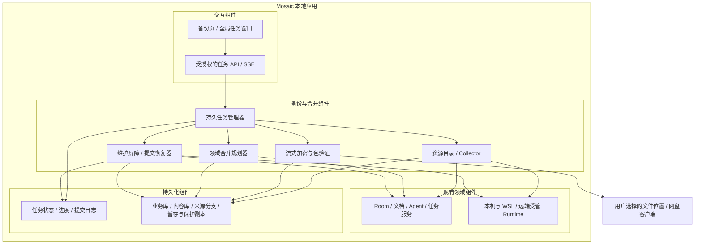
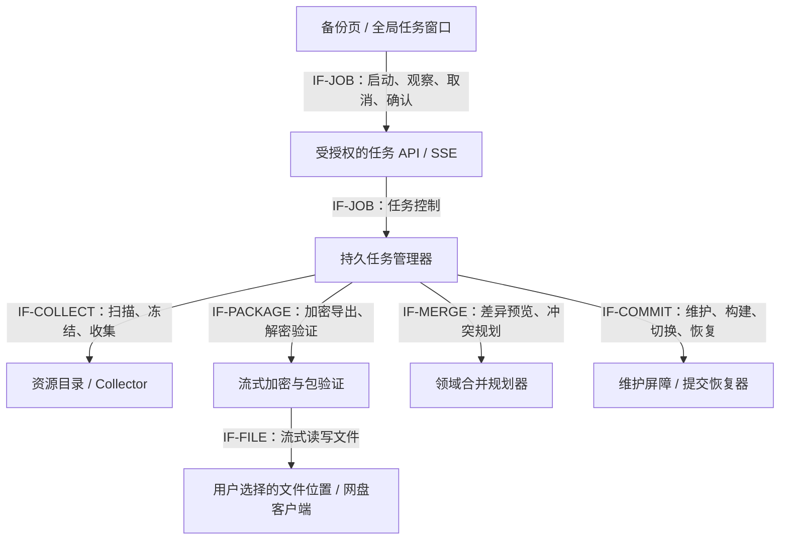
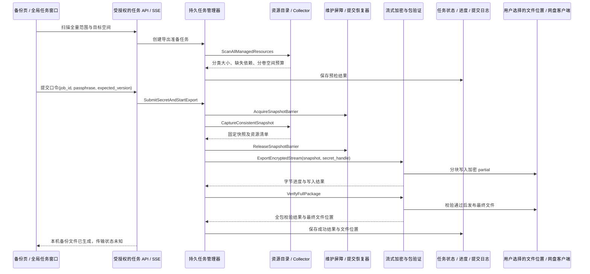
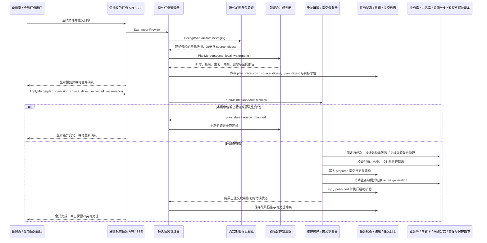

# 特性设计说明书（RFC 提案）：RFC-0019 个人多设备全量加密备份、导入合并与进度反馈

**状态 (Status):** Draft（设计提案，尚未实现）

**创建日期 (Created):** 2026-10-28

**作者 (Authors):** Mosaic 项目组 / Codex

**相关 Issue/PR:** 尚未建立

# 0. 文档控制与核心决定

| 项目 | 内容 |
|---|---|
| 上游输入 | [讨论圆桌与 Swarm 衔接](chatgpt-conversation://6ae16fe6-7a50-83e8-a508-df53e8373021)（ChatGPT 内部引用）；本轮可见预览中的最终要求及“进度条、直观观测窗口、不同状态可感知”的补充 |
| 输入边界 | 未取得完整聊天，采用可见的最新结论；早期的自动同步、选择部分文件夹、随机恢复码、覆盖恢复方案不作为当前要求 |
| 代码基线 | `e0ae107724b6fa90e3fa69116e6788cb1c3625fe`，含独立 Agent 身份注册表；RFC-0018 已批准，后续领域对象尚按版本分期实施 |
| 审校复核基线 | `fae8b7fbcf0022fb5519b3a48dda49613c889c7d`；同时核对 0.5.0 审校修复后的身份认领、启动恢复和持久化代码，不改变本 RFC 的 Draft 状态 |
| 适用范围 | 同一用户的多台 PC 及其受管 Runtime，设备可跨网络、可不同时在线；个人应用，不引入商用租户或自建中心服务 |
| 规范关系 | 扩展 RFC-0010 数据生命周期；与 RFC-0018 的选择性 Agent Bundle 区分；需要修订之处见 §2.2，批准前不改变既有协议 |
| 交付边界 | 文档定义完整首版能力及验收；实现顺序登记于交付计划，不擅自改动已批准小版本编号 |

首版采用 **全量导出、手动传输、导入合并、用户自行输入备份口令**。全量是导出范围，合并是导入语义；两者同时成立。用户不选择待备份文件夹或逐个勾选 Agent，只选择备份文件保存位置和待导入文件。

每台设备仍使用本机数据库。网盘、移动硬盘或其他文件传递方式只承运密文文件，不同步正在使用的 SQLite/WAL，不要求同一局域网、公网 IP、Hub、SSH 隧道或设备配对。导入不能自动触发任务、监控、Agent 发言和外部工具动作。

备份与恢复均为可观察的后台任务：有持久任务卡、阶段进度、数据量、耗时、可取消范围及最终报告。全量方案的传输和磁盘成本首版接受；内存必须从首版有界，不能把整包读入内存。

# 1. 用户需求与操作闭环

## 1.1 需求追踪

| 编号 | 要求 | 设计落点 | 验收 |
|---|---|---|---|
| SR-01 | 个人跨网络使用、无需设备同时在线 | 自包含文件、已有网盘手动传递 | ST-01、ST-02 |
| SR-02 | 自动收集全部受管数据 | 资源目录、受管工作区、凭据、日志、冲突分支全量收集 | ST-03、ST-04 |
| SR-03 | 新设备仅凭文件和用户口令解密 | age 口令模式；不依赖原机账户或在线密钥服务 | ST-05 |
| SR-04 | 导入必须合并，不能覆盖本机数据 | 幂等、祖先关系、分叉保留、墓碑优先处理 | ST-06 至 ST-10 |
| SR-05 | 首版手动，后续可优化 | 全量格式版本化、内容去重、进度与传输端口分离 | ST-02、ST-14 |
| SR-06 | 容量、时间、内存可评估 | 实际扫描、分卷空间预算、流式处理、传输估算 | ST-11、ST-12 |
| SR-07 | 过程直观、状态可感知 | 任务中心、阶段进度条、错误动作、重连与重启恢复 | ST-13 至 ST-16 |

## 1.2 两个主要入口

设置 → “数据与备份”保留两个主要动作：

1. **导出全量备份**：自动扫描 → 展示数据组成和空间要求 → 输入并确认用户自定口令、选择输出位置 → 创建并验证 → 打开所在位置。后台传输由用户已有网盘客户端或手动复制完成。
2. **导入并合并（恢复）**：选择文件 → 输入该包对应口令 → 验证、扫描差异 → 展示新增/接续/重复/冲突/删除影响 → 点击“合并到本机” → 显示结果和待处理冲突。

新设备没有数据时，导入合并自然完成恢复。已有数据时保留本机内容；系统不提供默认“全量覆盖”快捷路径。冲突不要求在合并前逐条处理，可先保存无冲突更新及全部可保留的冲突分支，再进入冲突中心；删除冲突只保留不含正文/摘要的待决信息。

扫描、解密及预览不改业务数据。合并前的一次确认展示真实差异和暂停影响；普通文件不再重复弹窗。关闭进度抽屉只隐藏窗口，任务继续；退出应用则显示当前任务与中断后果，不能把“窗口关了”当作任务已取消。

## 1.3 明确不做的首版内容

- 自动跨设备持续同步、增量传输、远端对象存储协议、多设备在线一致性锁。
- 整机镜像、自动复制整个 WSL、CLI 安装、外部浏览器登录目录或用户的所有项目目录。
- 自动执行导入的脚本、原生会话续接、监控规则，或恢复来源设备的活跃执行权。
- 宣称知道第三方网盘上传进度、宣称所有设备已收到；未来有可验证存储适配器后再增加这些状态。
- 用时间戳更晚、版本数字更大或显示名相同决定覆盖。

# 2. 现状与兼容边界

## 2.1 已核查的实现

| 当前能力 | 代码依据 | 本提案需要补齐的部分 |
|---|---|---|
| `mosaic-backup/1` 只包含 mosaic.db 与 manifest | [backup.go](../../../internal/backup/backup.go) 的 `Create` | 附件、配置、凭据、工作区、日志及冲突数据没有纳入；不能将现有产物称为此 RFC 的全量包 |
| 数据库一致快照 | [store.go](../../../internal/storage/sqlite/store.go) 的 `BackupTo` 使用 `VACUUM INTO` | 能保证数据库快照，不自动保证库外文件与数据库同一水位；当前接口没有页进度 |
| 恢复为启动时换库 | `RequestRestore / ApplyPendingRestore`，旧库进入 restore-safety | 新流程需要逻辑合并及提交保护，不能复用换库作为默认导入语义 |
| HTTP 同步创建与排程恢复 | [system.go](../../../internal/transport/httpapi/system.go) | 创建请求绑定请求上下文；需新增独立后台任务、状态查询及事件通知 |
| 设置页仅 busy 与结果文案 | [SettingsPage.tsx](../../../apps/web/src/pages/SettingsPage.tsx) | 无逐阶段、字节、速度、等待、可取消与重启恢复进度 |
| 受管工作区可能不在数据目录 | [app.go](../../../internal/app/app.go) 的 AgentWork / resolveWorkDir | Native 可在缓存或 `-agent-work` 路径，WSL 在发行版内；需资源收集端口 |
| Room seq 本机分配、追加同时产生 outbox | [store.go](../../../internal/storage/sqlite/store.go) 的 `AppendEvents` | 导入须专用静默写入，不能调用会调度执行的普通追加入口或拼接两端 seq |
| 启动恢复按房间扫描 requested/running | [runs.go](../../../internal/room/runs.go) 的 `RecoverRuns` | 需要本机执行归属判断，避免导入历史自动转 unknown 并制造新分叉 |
| 启动还有多类自动副作用 | [app.go](../../../internal/app/app.go) 启动装配；`RecoverClaims` 重驱动 `engine_claims`，`MarkStaleRunningTransfers` 改写中断交换，监控调度、Harness 扫描与身份同步也会启动或写库 | 隔离不能只排除 outbox；来源恢复声明、交换状态和设备登记必须保持 dormant，普通启动路径不得抢先消费或改写导入历史 |
| 全局 Agent 身份及别名已落地 | [personalagent](../../../internal/personalagent)、[ADR-0017](../adr/ADR-0017-agent-identity-registry.md) | 备份纳入身份；本机执行路径/旧 Bot 别名不等于跨设备身份合并证据 |

## 2.2 与既有规范的关系

| 规范 | 延续 / 拟议修订 |
|---|---|
| RFC-0010 房间导出 | 保留现有 NDJSON 导出；本 RFC 是实例级加密备份，实际二进制必须入包，不能只有短期 signed URL |
| RFC-0010 墓碑最小化 | 保留不存已删正文/内容摘要原则；新增同步因果索引只存随机修订 ID、父关系、对象 ID 与删除操作，不将已删内容 hash 塞回墓碑 |
| RFC-0018 Portable Agent Bundle | 仍适用于选择性职责/身份交接，默认排除秘密；本 RFC 全量个人备份包含 Mosaic 管理的可导出凭据，但不授予导入端执行权 |
| RFC-0018 导入默认 inactive | 沿用：数据可读、工具/监控/任务单独激活；来源设备运行状态是历史，不假装本机正在运行 |
| 既有 backup/restore API | 首版新端点并存；旧入口明确标为“旧版数据库快照/替换恢复”，不能继续以新全量功能名包装 |
| 既有路线图 | 作为独立特性群登记，批准后按单特性拆期；不能将“已能导出 Agent Bundle”等同此全量合并能力 |

本 RFC 在批准前只是扩展提案；不改 RFC-0018 Approved 状态，不重写旧事件、既有墓碑或原生会话。

# 3. 全量范围、一致性与资源目录

## 3.1 全量由系统确定

“全量”是 **当前实例管理的全部持久业务数据及恢复其逻辑状态所需的资源**。界面展示分类与大小供用户理解，不提供默认排除某类业务数据的勾选项。

| 类别 | 导出内容 | 导入处理 |
|---|---|---|
| 数据库 | 一致快照、权威事件、身份、别名、文档、历史、任务、删除与冲突记录 | 读取为来源数据；按领域适配器合并，绝不直接替换目标活动库 |
| 附件/成果 | 所有受管二进制和受管对象引用的实际文件 | 内容去重；引用验证后可读，不丢失历史版本依赖 |
| 设置/定义 | Settings、Agent/Slot、Harness 登记、监控、已实现领域的配置 | 便携语义可合并；路径、启动项、设备配置保留来源记录，重新绑定 |
| 凭据 | Mosaic 管理的第三方 token/连接秘密的便携表示 | 加密包内保存；导入至未启用凭据保管区，本机重新保护、校验后启用 |
| 受管工作区 | Native、WSL、已登记远端 Runtime 的 Mosaic 所有工作目录 | 保存来源快照；默认不覆盖本机活跃目录；独立恢复后显式接管 |
| 上下文/检查点 | 已持久化的 Session、Checkpoint、Receipt 与相关证据 | 保留来源与状态；原生 Harness 隐式会话不保证可迁移 |
| 日志/其他受管数据 | 当前保留日志、审计记录及资源目录登记的数据 | 日志按来源归档；诊断面继续脱敏，不能因此展示秘密 |
| 冲突与导入记录 | 未解决分支、解决记录、来源映射及墓碑 | 必须再次全量导出，重复导入仍幂等 |
| 控制面持久历史 | 已完成/失败/取消的数据任务、最终报告、冲突处理与提交审计记录 | 以来源任务记录合并、按稳定 job/event ID 去重；不得进入本机任务队列或自动续跑 |

明确排除：历史备份、restore-safety、导入暂存区、正在生成的包、锁/PID/socket、WAL/SHM 的直接文件拷贝、可重建缓存及安装包。本机 owner token、device_id、活跃租约和临时执行令牌是本机安全/运行材料：可记录其存在及逻辑作用，目标须生成新值，不恢复为可用凭据。它们与用户托管的第三方凭据区分，排除清单和理由进入报告。

§6.1 的控制存储虽不参与业务代次切换，其**持久历史仍在全量范围内**。包格式必须为其登记独立条目，不能只收 `mosaic.db` 而漏掉最终报告和导入审计。导出时正在运行的任务只保存安全点前的历史快照并标来源中断状态；口令、secret handle、上传句柄、可消费游标、pending 提交意图和活跃恢复锁不导出，导入端也不据其恢复执行。

若这些本机控制秘密位于数据库内，领域 Collector 只在快照副本中清除秘密值，保留必要的来源/历史记录并报告转换，不能原样封装后再寄望导入端忽略。导入的新 device_id 与 manifest 中用于追溯的 source_device_id 是两件事，后者保留来源含义。

系统凭据库中的受管第三方秘密应经授权 API 导出明文至加密流或受保护暂存，不能只复制原机加密后的不可移植字节。若某种秘密不允许导出，界面列为“需要重新登录”，必须在完成报告中披露恢复限制；若缺少业务数据或成果，不能以凭据限制的名义降格为“完整”。不接管外部 CLI/浏览器自己的认证目录。

## 3.2 资源目录与完整性检查

新增 ResourceCatalog，由每个领域注册 `resource_id、owner、kind、locator、portable_path、mutability、required、collector、size/hash、retention`。已知根目录外的 WSL/远端工作区通过 Collector 读取；未知持久字段/目录需报告并补充适配器，不默默遗漏。自动去重嵌套根、同一文件与循环引用，使用逻辑资源 ID 而非绝对路径寻址。

“扫描未知项”本身不能证明完整。首版还须建立**覆盖门禁**：数据目录根、SQLite 表/列及控制存储、库外 JSON/凭据/日志、附件根和各 Runtime 工作根均有唯一 owner；每个持久字段标记为可迁移、转换后迁移、仅来源归档或明确排除。新增表、列、文件根或事件 Schema 未登记时，契约测试与备份能力的启动完整性检查必须失败；不能把静态排除清单误当成对新增数据的自动发现。初版适配清单至少覆盖现有 Room/Doc 事件与 outbox、命令/上下文回执、`engine_claims`、墓碑、FTS、外部共享与表格交换、Agent/别名、Settings、Harness、监控、extdocs 凭据、附件、日志和控制面历史。

受管目录中的大文件、构建产物若当前仍属持久工作数据，就计入全量；不能为了包变小自行删减。可重建缓存的认定必须来自领域登记，不能只凭扩展名猜测。符号链接、Windows junction/reparse point 记录为链接描述且遍历时不自动跟随越界；若任务必需的内容位于链接目标，应独立登记并收集，否则提示缺失。链接身份、文件身份和大小写/Unicode 冲突检查必须按源平台语义执行，不能在 Windows 上因跟随 reparse point 绕出受管根。

远端成果尚未回传、WSL 发行版不可达或必需文件读取失败时进入 waiting/failed，列出资源和重试入口；允许用户取消去处理环境，不允许跳过后仍显示“全量备份完成”。外部服务未被 Mosaic 托管的原始资料仅保存链接，完整性报告明确依赖仍在外部。

## 3.3 一致性边界

全量导出建立 `snapshot_id` 和各领域水位。首版使用应用级写入屏障：暂停新调度与持久写入，等待在途受管写入者到安全点，捕获数据库快照及可变文件副本；对已有内容寻址、不可变资源持有保留引用，后续读取无需长期停写。完成固定快照后释放屏障，流式打包从固定副本读取。

数据库快照可继续复用 `VACUUM INTO`；必须清楚其进度接口不提供百分比。大工作区逐文件复制的首版可能使屏障持续较久，UI 显示“正在保存一致副本，暂不能修改数据”及实际文件进度，不承诺瞬时冻结。不能可靠暂停的 Native/WSL/远端写入者必须等待或阻止备份；不强杀正在产生外部副作用的任务。

日志在固定偏移封存，备份任务自身后续日志不追加入同一快照。收集期间外部程序仍修改了本应固定的文件时，前后尺寸/版本/hash 检查失败，重取或失败，不生成自称一致的包。被固定资源在导出结束前不允许 GC；文件权限和跨设备依赖另入清单。

导出的数据库副本、可变工作区副本和密钥明文缓冲同样属于敏感暂存，必须位于本机专用受保护目录，Unix owner-only / Windows 当前用户 ACL，不得落在网盘或用户选择的导出目录。`.partial` 全程密文并不意味着前置快照可以明文暴露；成功、取消和失败均清理暂存，崩溃残留按有期限的所有权记录回收，清理结果入报告，且不承诺 SSD 的取证级擦除。

# 4. 口令、格式与安全

## 4.1 用户口令及其他设备的解密

用户在导出时输入自己的备份口令并确认；不强制随机长口令，不另发恢复码。另一台设备只需文件和这份备份使用的口令。网盘账号只决定能否下载，不参与解密；源设备无需在线。

允许使用便于记忆的长短语，提供显示/隐藏、粘贴、密码管理器填充与强度提示；短弱口令明确提示离线猜测风险，阈值在安全验收时固定。口令定义为有效 Unicode 字符串的 UTF-8 字节序列：不能无提示地 trim、改大小写或规范化 Unicode，畸形 UTF-8、未配对 surrogate 和超过字节上限的输入必须拒绝，不能由 JSON/桌面通道替换为 U+FFFD 后静默继续。导出和导入使用同一口径。同一口令可用于多包，每包的随机参数由库生成。修改以后使用的口令不会重新加密旧包，UI 必须说明。

“在本机安全保存口令”是可选项，默认关闭；有系统凭据库才启用。口令不得进日志、URL、命令行、任务事件、普通配置或包 manifest。忘记口令无法恢复对应包，应用不承诺后台找回。手动流程不引入设备密钥交换。

## 4.2 候选格式

采用 `filippo.io/age` 的 ScryptRecipient / ScryptIdentity 口令接口，密码学格式交给成熟库；每个文件只使用一个 ScryptRecipient，不与其他 recipient 混用。应用载荷采用流式 tar + gzip，二进制 age 外层，建议扩展名 `.mosaic-backup.age`；名称使用时间与随机 ID，默认不包含用户/项目名称。选择 gzip 是首版 Go 标准库与跨平台维护成本的提案，正式依赖版本和 KDF 参数在实施 ADR 中固定。

```text
age 加密文件（仅格式头、KDF 公开参数与密文体积可见）
  gzip 压缩流
    manifest.json             格式版本、数据谱系、来源、快照水位、总量、必需特性
    catalog.ndjson            资源/修订/引用清单，大小及内容校验值
    database/mosaic.db        一致数据库来源快照
    control/                  数据任务、最终报告与提交审计的便携历史
    config/                   便携设置与设备配置的来源记录
    secrets/                  受管第三方凭据的便携表示
    blobs/<content-id>        附件、成果与工作区文件，包内同内容只存一次
    workspaces/*.ndjson       逻辑路径、内容引用与必要元数据
    conflicts/                来源分支及解决记录（若未包含于数据库）
    reports/completeness.json 包含/排除/依赖限制与采集结果
```

`manifest` 采用有界小对象；大清单逐行读写。字段至少包含 `format=mosaic-personal-backup/1、package_id、source_device_id、source_instance_id、lineage_ids、created_at、app/schema_versions、snapshot_watermarks、required_features、entry_count、uncompressed_bytes、catalog_digest`。这是新格式，与旧 `mosaic-backup/1` 区分；包内 hash 用于校验及去重，不等同可信签名。实施 ADR 在格式冻结前还必须固定内容 hash 算法、content ID 编码、JSON/NDJSON 规范化、摘要作用域和 `catalog_digest` 计算规则；不能由不同实现各选一种规范化方式导致同包不同身份。

业务名称、文件列表、凭据和 lineage 在加密层内。压缩先于加密；使用固定缓冲，不用 whole-file byte buffer。正确关闭 tar、gzip、age writer，检查每层错误、刷新落盘，再发布最终文件。导出从固定快照写入 `.partial`，重读解密至末尾并核验清单后才改名为最终文件；若最终目标需跨卷复制，目标侧也先写 `.partial`、校验/落盘后同目录改名。

完整验证至少读完 age 认证流、gzip 校验和容器结尾，再逐条验证 hash、大小、引用闭包和兼容性；解出前几个文件不能说明整包有效。容器只允许格式声明的条目和显式扩展区，必需条目必须恰好出现一次，条目总数、声明总量和实际解压总量必须相互一致。文件夹模式可能被网盘提前上传 `.partial`，因此它也必须是密文，不能包含明文暂存。

## 4.3 导入不信任包内容

解密只代表知道口令的人可产生该文件，不证明 device_id 的真实身份；来源名称只作标注，不据此授权。拒绝绝对路径、`..`、路径分隔符绕过、重名条目、大小写/Unicode 路径冲突、硬链接/设备节点以及自动跟随符号链接。来源路径只作数据，恢复位置由本机分配。

限制包头、条目数、单项和总解压量、压缩比、JSON 深度、口令字节数、SQLite 查询时间与 KDF 成本；age 接收端通过 `ScryptIdentity.SetMaxWorkFactor` 设置最大工作因子，避免不可信包耗尽资源。超限告知具体限制和处理方式，不能偷偷降低加密强度。SQLite 在隔离暂存中只读检查：禁加载扩展、禁执行来自包的 SQL/触发器，按受支持 Schema 和字段白名单查询，启用驱动可用的 query-only / defensive / trusted-schema 防护，不直接挂载到活动库。目录隔离只约束文件位置，不宣称已经构成进程级安全沙箱；恶意数据库解析所需的独立 helper 进程与 OS 级限制在实施 ADR 中定案。

解密明文暂存于本机专用目录，Unix owner-only / Windows 当前用户 ACL；不得落网盘目录。取消或过期清理暂存，但不保证 SSD 的取证级擦除；建议本机磁盘加密。成功迁出的明文/凭据继续遵守本机原有保护，不能因来自备份降低权限。

# 5. 数据合并：幂等、继承、分叉与删除

## 5.1 身份与修订依据

新增独立 `device_id`（安装设备）、`instance_id`（本机数据实例）和持久 `lineage_id`（数据来源谱系）。新设备恢复生成自己的 device_id；对象保留来源身份及映射。创建新设备身份不能让已有 Agent 换人，也不能照抄源设备租约。

每个可合并对象/事件流有 `revision_id、parent_revision_ids、origin_ref、content_digest（仅活内容）、schema_version`，修订 ID 使用稳定的不含内容信息的标识。按领域记录祖先关系，不能把 `(object_id, version数字)` 当跨设备唯一键。包携带判断所需的祖先索引；断链/未支持版本不得自动接续。

升级前已有的事件流以稳定 event_id 和规范化持久字段建立历史索引，保留原顺序、seq 和来源；两个旧副本只有完整共同前缀内容一致才认定共同祖先。`origin_ref` 必须含领域、来源实例/谱系、流与对象标识，不能只存一个跨领域可能重用的 ID。规范化必须保留全部持久语义字段；不能无损规范化的未知字段按原始字节保守比较，不能靠丢弃未知字段制造“内容一致”。旧的纯快照对象/JSON 配置若没有共同基线，仅能证明相同内容去重，不能推定继承；首次导出建立修订基线，此后每个修改必须记录父关系。

新协议从此要求领域写入和修订索引原子更新，不能只在导出时记录“现在版本号”。不同谱系中的同名 Agent、同名文件夹或同 BotID 不自动合并；Agent alias 碰撞保留来源映射并待处理，不能侵占本机路径别名。ID 相同且内容不同、祖先证据矛盾的情况进入冲突/隔离，不能当重复跳过。

## 5.2 合并决策表

| 情况 | 处理 | 用户反馈 |
|---|---|---|
| 同对象、同修订且内容一致 | no-op，记录来源已见 | 已有，已跳过 |
| 相同 revision/event ID 却不同内容 | 拒绝该依赖组自动合入，隔离并报告 | 数据标识冲突，需要检查来源 |
| 本机没有对象且依赖完整 | 以来源映射新增，执行相关配置 dormant | 新增，尚未启用自动运行 |
| 来源严格延续本机当前祖先 | 自动接续，保留来源历史/引用语义 | 更新 |
| 来源是本机祖先 | 保留本机，不降级 | 旧版本，已跳过 |
| 两端均自共同祖先修改 | 保留两个分支，本机活动版本不被替换 | 已保留冲突，待处理 |
| 无法证明继承关系 | 保留来源副本/分支 | 需要选择，未覆盖 |
| 两边分别完成/取消同一任务 | 保留矛盾终态与动作回执 | 任务状态冲突，不自动继续 |
| 文件内容相同 | 按 hash+大小去重并保持全部引用 | 已复用文件 |
| 同逻辑路径内容不同且两边修改 | 保存来源工作区快照，保留本机文件 | 文件冲突，可比较/另存 |

“新增、接续、重复、冲突、删除影响、环境待绑定”都进入预览与完成报告。自动合入按依赖闭包判断：引用了冲突分支的新任务/文档可先保留，但其相关操作保持待决，不能解析到同名本机对象而改变语义。本表的“保留双方”不覆盖 §5.4 的删除优先规则；删除冲突只保留不含正文/摘要的待决信息。

## 5.3 Room 和文档的事件分叉

例如两台设备共享 1–100，分别产生 A101、B101：不能给 B101 改号 102 拼进 A 的主流。将源流保存为 `origin_stream_id + branch_id` 下的事件序列，保留原 seq、event_id、文档修订与上下文水位；UI 显示“本机记录”“来自某设备的记录”。跨对象引用包含来源流/分支映射，不以 seq 单独寻址。文档版本流采用同样的分支身份，不能只给 Room 建分支而把文档版本重新编号。

现有 `UNIQUE(room_id, seq)` / `UNIQUE(doc_id, version)` 和全局 SSE 位都是本机存储实现，不是跨设备身份。来源分支应存于独立分支记录/表，或由所有读写约束显式包含 stream/branch 键；本机活动流的 seq/version/global cursor 仍由本机分配。搜索、投影、RoomVersion、事件续传、RecoverClaims/RecoverRuns 和上下文水位必须区分本机活动流与来源只读分支，不能让分支事件挤占本机序号、冒充新消息或进入恢复扫描。

同一完整前缀后仅一端扩展时可接续活动流；两端真正分叉时来源分支只读可查看。首版不自动合并两条 Room 因果历史。用户可保留两份，或把选定内容作为**新消息/新文档修订**继续讨论，保留原来源引用。切换/采用某一来源分支是显式冲突处理，不改变旧消息的次序和回执。

分支、来源映射、解决记录和尚未采用的版本均是受管持久数据，进入下一份全量包。通过 `conflict_id + parent revisions` 去重；解决冲突产生引用双方父版本的新修订，重复导入已解决分支不重新制造同一冲突。单纯点“暂不处理”不是解决记录。

## 5.4 墓碑与旧包防复活

导入先合并计算本机与来源的已知墓碑/删除修订及其依赖闭包，再考虑正文，不能只按包内条目顺序碰巧先删后写。删除包含在源包中、本机删除以及两端并发删除/修改均按因果关系处理：

- 已知删除覆盖的旧祖先正文不再入活动数据或可读冲突库；记为“因已删除而跳过”。
- 并发删除/修改默认保持不可见，只记录不含被删正文/摘要的待决信息。确需恢复时由用户显式确认从选定包重新导入为新对象/新修订；系统不以“保留双方”自动保留已要求删除的正文。
- 一端后继删除合入时，按各领域既有删除策略失效其派生记忆、索引和受管副本引用；删除逻辑与业务修改同一合并计划，不遗漏文件删除影响。这里的“派生”不扩大到 RFC-0018 明确独立的 Mission/文档；独立对象只撤销来源读取并按其契约处理，不能借全量合并新增级联删除。
- 因删除而清理的内容 hash 不保存在最小墓碑内；因果索引保留随机修订关系，缺少足够证明时采取不恢复的保守策略。清理祖先索引须保持必要的删除屏障。

本机只知道已导入的删除。离线设备如果只拿到删除前的旧备份，就无法知道后来另一设备发生了删除；UI 提示包的来源/创建时间，不宣称全设备删除已传播。旧网盘包、外部下载副本和恢复保护副本仍可能保有正文，提供清理清单，不能承诺由一次本机删除自动远程擦除。受管日志和审计材料也必须有对应保留/删除适配；不能在业务正文删除后因“全量收集日志”又把正文恢复到可读业务面。

## 5.5 配置、凭据和执行状态

本机设置无分歧可接续，有分歧保留双方；绝对路径、WSL 发行版、代理、工具安装及系统密钥引用不能作为便携设置直接启用。来源 Harness 登记、监控定义和第三方凭据先进入独立的 dormant 来源区，不放入本机活动发现/凭据路径；只有便携定义完成合并且用户显式重绑后才进入本机活动配置。启动扫描、身份同步或 provider 初始化不得抢占这一步并自动生成活动身份/连接。同一服务的两份凭据只显示账号/有效性摘要供选择，不在冲突中心暴露 token 内容；用户选择启用时再绑定本机连接。

导入的 Room/Doc outbox、`engine_claims`、调度 inbox、触发器投递队列、自动监控游标、运行租约和未完成的表格交换恢复状态只作为来源记录归档，不进入本机待消费队列。命令回执和幂等键保留来源命名空间，不能直接充当本机已执行证明或吞掉本机新命令。`MarkStaleRunningTransfers`、RecoverClaims、监控调度及其他启动恢复器同样只处理本机拥有的记录，不得把来源 running/requested 自动改写或续跑。

导入追加必须通过专用领域入口并记录 `source=import`、`import_id` 与 `origin_ref`，生成独立 UI/投影刷新而不生成业务 outbox/执行通知；普通 Room 反应波和主动扫描也不得把导入消息当新刺激。该 `source` 是专用导入元数据，不能假定现有 Room Envelope 已有同名字段。

为每个执行记录保留 `origin_device_id、executor_device_id、run_id、generation、observed_at` 及本机接管记录。`RecoverRuns` 仅处理能证明由本机持有执行权、且重启后失联的尝试；来源设备备份时的 running/requested 只展示“来源设备当时仍在运行，待核对”。对没有归属信息的旧记录标为待核对，不自动写 unknown。

导入结束提供独立“检查并启用本机运行”入口：探测 Harness/工具、绑定目录、核验副作用及源设备执行权，再显式继续。没有源设备停止的证据时不能自动接管写任务。查看资料不要求启用运行；本机原有未受合并影响的任务可在维护结束后恢复，受影响的任务须依据新状态检查。

# 6. 结构、执行流程与原子提交

## 6.1 逻辑架构

延续单进程应用和 SQLite，新增逻辑模块而非独立服务。任务记录与提交恢复日志位于不随业务代次切换的控制存储；包和工作数据使用本机磁盘。



## 6.2 接口边界与实现落点



| 元素 | 代码落点提案 | 构建与部署 |
|---|---|---|
| UI / API | 设置页扩展与独立任务面板；`internal/transport/httpapi`、OpenAPI / TS 类型 | 既有 Web 构建嵌入服务端与 Wails；无新增客户端框架 |
| Jobs / Catalog / Codec | `internal/backup` 分模块扩展；Collector 可复用 harness runner | Go 服务内部，age 作为库依赖；不要求用户装命令行加密工具 |
| Merge | 拟新增 `internal/datamerge`，领域提供导出/静默导入端口 | 同一 Go 二进制；分页查询和临时 SQLite 索引 |
| Commit | `internal/backup` 与 `internal/app` 启动恢复装配 | 控制面在业务库恢复前可启动，避免黑屏等待 |
| Services / Runtime | 既有 room、doc、personalagent、monitor、harness，未来接 RFC-0018 对象 | 在服务层实施维护屏障、执行归属和导入不触发动作 |
| Control / Data | 本机控制存储、业务 SQLite、文件/内容目录 | 同一安装的数据域；备份包传输由用户既有方式承担 |

## 6.3 导出流程



HTTP 入口请求只启动任务，不持有整个任务生命周期。导出任务先执行扫描，预检就绪后等待口令；提交口令同时确认当前预检版本，才进入快照与加密。口令以短生命周期 secret handle 注入进程内，不写进任务持久记录；进程退出后需重新输入。

## 6.4 导入与提交流程



完整验证后计算 `source_digest`：以版本化、域分隔的摘要覆盖规范化 manifest、原始 catalog 及其引用的全部内容 hash；`package_id` 只是包内声明，不能单独充当安全绑定。`plan_digest` 覆盖规范化合并决策、删除影响、来源映射和全部业务水位。预览、用户确认和 apply 必须绑定同一 `job_id + plan_id + plan_version + source_digest + plan_digest`；计划单次消费，重算递增版本并使旧确认失效。控制存储保存这些根值，不能只保存可被替换的暂存路径。

进入维护屏障后同时复核本机水位、来源根和计划版本。构建候选时按已认证清单逐条校验实际读取内容，摘要或暂存所有权记录不符即停止，不能把预览后替换的文件合入。解密/验证与候选构建之间若复用暂存，控制记录还须绑定本机 staging ID、有效期和清理代次；网络盘上的原始文件可以在验证后被替换，因此不得绕过已验证暂存重新读取原路径。

首版合并在维护屏障内构建候选代次，允许耗时较长，但旧数据保持可读，进度控制面持续在线。需要资源较多的解密、完整性验证和初步比较在进入屏障前完成。计划过期释放屏障，不长时间占锁等待用户；重算后重新确认变化，不沿用旧预览授权删除新数据。

## 6.5 全局可见性与中断恢复

不以跨目录逐个替换文件假装事务。候选代次包含合并后的数据库、便携设置与受管内容引用；来源设备登记、凭据和工作区保持独立 dormant，不进入本机活动路径。新增大文件先写不可变内容存储，未发布引用对用户不可见。本机活跃 Native/WSL 工作目录不在本次提交中覆盖，来源工作区作为独立快照纳入候选代次，后续接管另行操作。

在同一文件系统内通过可恢复的 active-generation 指针切换发布逻辑状态。发布前关闭旧业务数据库句柄、停写配置、刷盘候选数据、指针父目录和提交日志；Windows 不能替换打开的数据库，不能只切路径而让旧连接继续写。现有布局需提供 legacy generation 解析和首次升级适配，不允许未经迁移就搬动数据根。

控制日志记录 `job_id、plan_id、plan_digest、old_generation、new_generation、prepared、published、verified`，不随业务代次替换。**持久 active-generation 指针是唯一提交点**：指针仍指旧代次时，只有 prepared 日志不得让恢复器直接应用合并；指针已指新代次且候选完整时，即使尚未写 published，也按已发生切换恢复核验，不能重新执行计划。回退必须在维护写屏障内另写 `rolled_back(from,to,reason)` 记录；若日志、指针和回退记录出现未定义组合，保持业务停止并请求恢复，不能猜测一个代次继续写。published/verified 是审计与阶段状态，不是第二个提交权威。

启动先由最小控制面恢复提交，再开启 Room/Doc 分发、Room 引擎、监控、Harness 扫描与身份同步、表格交换收敛及其他恢复扫描：

- 发布前失败/取消：移除候选与未被引用的内容，旧代次继续使用。
- 已进入最终切换：暂不允许取消，显示“正在应用，完成后恢复操作”；不能强制中断造成半套配置。
- 切换后崩溃：依据唯一提交点和回退记录完成新代次核验，或按已落盘的回退记录恢复完整旧代次；不能重复应用合并。
- 尚未放开写入时验证失败可记录并执行回退；放开后已有新业务写入，不能自动整体回滚丢掉这些新写入，应生成补偿计划或新的导入预览。

保护副本是旧代次及其必要内容引用，自动排除于下次全量导出。按用户设置保留并显示占用，清理时先确认恢复已验证和引用不再需要；不得为腾空间悄悄删掉唯一可恢复副本。来源包保持原样。

# 7. 可用性与进度窗口

## 7.1 主窗口与持续可见入口

开始后立即出现任务卡；切换页面仍可从全局任务入口查看，刷新后按 job_id 恢复。详情至少包含：任务类型、来源/目标、状态、当前阶段、阶段进度条、文件数/数据量、已用时间、速度与可信的剩余时间、最近活动、可操作按钮及错误摘要。

下例只示意布局，数值不是性能承诺：

```text
导出全量备份                         正在处理
① 检查数据 ✓  ② 保存一致副本 ✓  ③ 压缩与加密  ④ 验证文件  ⑤ 完成

压缩与加密   [████████████░░░░░░░░]  62%
已处理 3.1 GiB / 5.0 GiB · 8,420 / 12,600 个文件
已用 02:18 · 24 MiB/s · 本阶段预计剩余约 1 分钟
当前：受管工作区（可展开查看脱敏后的文件名）
输出文件已写入 1.8 GiB；网盘传输状态未知

[收起窗口]                         [取消导出]
```

导入使用“验证文件 → 比较数据 → 等待确认 → 准备合并 → 应用更新 → 检查结果”，完成后展示“新增 120、更新 18、已有 3,600、保留冲突 4、因已删除而跳过 2、待绑定环境 1”等分类，并提供“查看冲突”“检查运行环境”“查看报告”。即使有冲突，也不能只弹一个“恢复成功”提示掩盖待处理项。

桌面端以系统文件选择器得到受限句柄；Web 端支持流式上传/下载和浏览器传输进度，不在 JS 中读取整文件再 base64 上传。Web 上传、服务器端解密/合并、浏览器下载是不同阶段：服务端文件完成不代表浏览器已经保存；无法观测落盘时显示“下载已发起”，用户可再次下载。

## 7.2 进度口径：诚实、稳定、可解释

| 阶段 | 显示方式 | 计量与限制 |
|---|---|---|
| 扫描 | 不定进度条 + 已发现文件/字节 | 总量未知时不显示伪百分比 |
| 等待任务结束/设备可达 | 等待图标、对象、原因、时长、重试/取消 | 不滚动增长百分比，不只显示“处理中” |
| 数据库快照/KDF | 不定进度条 + 阶段名、耗时、心跳 | 当前 VACUUM INTO 无页进度；未来逐页 backup API 可换为真实页数 |
| 可变文件快照/解密/打包/验证 | 确定进度条 + processed/total bytes、items | 标清分母是输入明文、输入密文或校验总量；不能拿压缩输出除以未压缩输入 |
| 合并比较/候选构建 | 已处理对象/事件/文件数及阶段进度 | 总量完成预扫描后固定；依赖验证另列阶段 |
| 应用更新/启动核验 | 短暂不定条 + 明确说明暂不能取消 | 数据写入完成还不等于结果通过核验 |
| 完成 | 阶段全部完成 + 结果摘要 | 仅最终文件发布/合并结果验证完成后到达成功终态 |

首版默认提供**步骤轨道 + 当前阶段百分比**，不伪造一个全局 0–100%。各阶段百分比单调，进入新阶段进度归零时清楚更换标题；总量变更显示“重新扫描/比较”，不用无解释地倒退。若未来提供总体估计，必须标“估计”且区别于实际阶段数据。

速度采用平滑窗口；等待、KDF、短样本和目标吞吐未知时隐藏 ETA 或显示“正在估算”，不显示 0 秒长时间不动。进度节流默认最多 2 次/秒，阶段切换、等待、错误和完成即时通知；控制面默认每 5 秒心跳，超过 15 秒未更新显示“连接中断，正在重新连接”，不能据此把后台任务判失败。

目标可达时状态查询/取消受理 P95 < 1 秒，长计算不阻塞任务控制线程；不可中断的库调用接受取消请求后展示“取消中，等待当前步骤结束”，心跳仍更新。实际取消延迟纳入平台测试，不虚构即时完成。

## 7.3 状态反馈与按钮

| 状态 | 用户文案 / 含义 | 可用操作 |
|---|---|---|
| queued | 已排队，前面有其他数据任务 | 查看队列、取消 |
| running | 正在扫描/加密/验证/比较等具体阶段 | 收起；can_cancel 时取消 |
| waiting_for_resource | 等待某 Runtime、文件解锁或剩余空间 | 重试检查、取消、查看处理说明 |
| waiting_for_passphrase | 需要输入此备份的口令 | 输入/重输、取消 |
| waiting_for_confirmation | 差异预览已就绪，尚未修改本机 | 合并到本机、返回、取消 |
| cancel_requested | 正在取消，等待当前安全点 | 查看进度，不重复提交取消 |
| committing | 正在应用更新，请等待 | 仅查看，暂不能取消 |
| interrupted | 上次操作被中断 | 重新验证后继续/重新开始、清理临时文件 |
| recovering | 正在检查上次提交结果 | 仅查看，恢复决策完成前不开业务写入 |
| succeeded | 本机备份文件已生成 / 合并完成 | 打开位置、查看报告、检查环境 |
| completed_with_conflicts | 无冲突数据已合并；可保留的冲突版本/分支已保留，删除冲突仅有最小待决信息 | 查看冲突、稍后处理、查看报告 |
| failed | 操作未完成，明确是否改动本机 | 查看原因、针对性重试、清理 |
| canceled | 已取消；说明保留的原数据和清理结果 | 重新开始、查看报告 |

任务状态与网盘传输状态分别展示。本地文件完成仅能证明“本机文件已生成”；写入已知同步文件夹最多显示“已写入所选文件夹，上传由网盘客户端处理”。手工勾选“我已上传”只作用户备注。只有拿到远端适配器回执才可显示“已上传”，只有目标设备的导入报告才可显示“该设备已导入”，首版不推断这些状态。

## 7.4 错误与冲突处理

| 情况 | 反馈与恢复动作 |
|---|---|
| 口令不匹配/加密头异常 | “口令不匹配或文件无法验证”，允许重输；不能始终断言用户输错 |
| 包被截断/内容校验失败 | “备份文件不完整或已损坏，本机数据未修改”；重新下载/选择来源文件 |
| 必需资源不可达 | 列出受管工作区/附件与原因，提供重试；不静默跳过 |
| 空间不足 | 显示具体磁盘、还需空间、可清理暂存/保护副本；源文件和当前业务数据不删除 |
| 预览后本机或已验证来源变化 | 重新验证、比较并显示变化项，重新确认；不暗中扩大覆盖或删除范围 |
| 不支持的格式/Schema/特性 | 指出所需应用版本或兼容限制；保留原文件，不进行部分猜测恢复 |
| UI 断线 | 保留最后已知阶段和时间，自动重连并查任务状态，不把重新点击当新任务 |
| 提交后校验失败 | 显示已退回旧数据，或需继续恢复；报告真实 active generation，不能只报网络错误 |

冲突中心支持按对象类型/来源设备筛选、并排比较、跳转来源历史、保留两份、采用某一版本或建立合并后的新修订。密码只显示元信息；批量处理不能无预览地套用“全部取较新”。删除冲突不提供默认“保留两份”，需按 §5.4 单独明确恢复为新对象/新修订的意图。进度与结果同时用文字和图标表达，键盘可达、屏幕阅读器读状态，不能只靠颜色；长列表分页/虚拟化。

# 8. 任务协议与进度持久化

## 8.1 候选 API

本节所有任务、进度、报告、冲突和文件端点（包括 GET/SSE）都要求 owner 认证与跨源防护，不能沿用普通房间只读端点“无 owner 门”的口径。Web 新 SSE 使用可携 `X-Owner-Token` 的 fetch 流或等效受认证通道，不把 owner token/口令放进 URL query 来迁就原生 EventSource；桌面使用等权限的受保护通道。口令端点仅在本机回环/桌面受保护通道开放，首版不得经非回环明文 HTTP 暴露。文件句柄、上传和结果引用绑定 owner、job、用途与有效期。以下是提案，正式实现同步 OpenAPI、Go/TS 类型及正反夹具。

| 接口 | 输入 / 返回 | 语义 |
|---|---|---|
| `POST /v1/data-jobs` | `kind=export/import_preview`、destination_handle 或 upload_id、幂等键 → 202 + job_id | 创建后台任务；来源与目标不得是任意服务端绝对路径 |
| `POST /v1/data-jobs/{id}/secret` | 口令、expected_version → 接收回执 | 只在上述受保护请求体/桌面通道传入，限制字节数，不回显，不写业务日志 |
| `GET /v1/data-jobs/{id}` | 当前快照、result_ref、allowed_actions | 重连与刷新恢复的权威状态 |
| `GET /v1/data-jobs/{id}/events` | Last-Event-ID → SSE 状态/进度 | 游标过期时要求重取快照，不丢终态 |
| `POST /v1/data-jobs/{id}/apply` | plan_id/version、source_digest、预期业务水位、幂等键 | 服务端复核 plan_digest；确认合并，来源或水位过期返回可解释冲突 |
| `POST /v1/data-jobs/{id}/cancel` | 幂等键 | 取消请求与实际已取消分开；commit 阶段明确拒绝 |
| `POST /v1/data-jobs/{id}/resume` | 恢复动作、预期版本、幂等键 | 重验来源根与暂存后继续；需要口令时进入等待 |
| `GET /v1/data-jobs/{id}/report` | 分页摘要/明细 | 校验、容量、合并、冲突、环境、排除项与副本清理报告 |
| `POST /v1/data-conflicts/{id}/resolve` | 选择/新修订、双方预期版本、幂等键 | 只解决已确认版本，新增冲突时拒绝陈旧选择 |

创建、apply、cancel、resume 和冲突解决的幂等键均在 owner + 操作类型 + 对象作用域内持久去重：同键同规范化载荷重放原回执，同键不同载荷返回冲突。首次执行 apply 前必须复核来源/水位；已提交请求的重放只返回原回执、不重新执行，也不能借重放把未执行或已作废的旧计划重新激活。终态回执可重建，崩溃后客户端能凭同一幂等键查询原结果，不能靠新生成 job_id 猜测是否已提交。

文件选择、分块上传和下载由受限 file handle / upload_id / result_ref 配套接口承载；首版 Web 上传至少流式落盘并暴露已接收字节，断线允许重传文件。断点续传传输是后续能力，不作为首版必需；禁止借此把进度省略。

## 8.2 JobSnapshot 示例

```json
{
  "job_id": "dj_example",
  "kind": "export",
  "version": 37,
  "state": "running",
  "phase": "compress_encrypt",
  "phase_index": 3,
  "phase_count": 5,
  "progress": {
    "mode": "determinate",
    "basis": "plaintext_input_bytes",
    "completed": 3328599654,
    "total": 5368709120,
    "percent": 62.0,
    "items_completed": 8420,
    "items_total": 12600,
    "output_bytes": 1932735283,
    "rate_bytes_per_second": 25165824,
    "phase_eta_seconds": 81
  },
  "elapsed_seconds": 138,
  "message_code": "export.encrypting",
  "wait_reason": null,
  "last_activity_at": "2026-10-28T18:00:00Z",
  "can_cancel": true,
  "transport_state": "unknown",
  "result_ref": null
}
```

快照中的 `version` 即事件的 `state_version`；`phase_index` 从 1 开始。determinate 进度必须满足 `0 ≤ completed ≤ total`，percent 由服务端按同一分子/分母计算，客户端不得另选一个分母。事件包含 job_id、单调 seq、state_version、时间与类型：`job.phase_changed、job.progress、job.waiting、job.cancel_requested、job.completed、job.failed、job.canceled`。状态转移与结果报告必须持久化；高频进度只周期保存快照并有界缓存，不能每个字节写事件。重启后快照显示上次观测，重新核验才能继续，不能将旧的 99% 直接改成成功。

取消、重试与重复提交幂等；终态不被迟到进度覆盖。进度日志存类别和计数，路径默认脱敏，错误不输出口令、token 或内容正文。为防引用过大的源包耗尽内存，报告也分页。

## 8.3 进程退出后的承诺

首版加密流不承诺从任意字节断点续写。导出中断后固定快照仍有效时可重输口令重新生成密文；否则重新扫描，不复用未完成包。解密/验证中断时需重新验证整包，再利用已校验的暂存内容避免重复复制；未经完整认证的暂存不得变成可提交计划。

预览已就绪可持久保留有期限的本机暂存；恢复时按 §6.4 校验 `source_digest + plan_digest`、暂存所有权和目标水位，不能只校验文件是否仍存在。提交中断按 §6.5 日志恢复，控制面在业务库初始化前展示恢复阶段。关窗、断网、应用退出、机器崩溃分别有清楚结果，不能统一显示“任务失败，请重试”并冒险重复提交。

# 9. 数据量、传输成本与资源预算

## 9.1 先测本机，再估算

不能仅凭消息条数给用户一个固定包大小。扫描展示数据库、附件/成果、工作区、日志/配置、冲突历史的逻辑大小、可复用内容和预期新增磁盘空间；压缩后大小首次只给估计，完成后记录实际值用于下一次估算。

估算公式：`受管总量 B ≈ 数据库 D + 唯一附件/成果 F + 唯一工作区文件 W + 配置/日志 L + 未包含在前项中的冲突内容 X`。文件去重按内容计算，不能把多路径同一内容重复计入传输量。数据库中的派生索引仍计入实际快照体积，不能把“可重建”当作已不占包空间。

举例仅作容量规划，**不是对当前用户数据的测量**：10 万条记录平均持久正文/元数据 4 KiB 约 0.38 GiB，索引和其他事件另外计；2,000 个平均 2 MiB 附件约 3.9 GiB；5 个 2 GiB 受管工作区约 10 GiB。媒体与工作区很容易超过聊天文本，压缩率须实际测量。备份页按占用排序，提供跳转原模块管理数据的入口，不在导出时悄悄排除大文件。

## 9.2 传输时间示例

`单程理论时间 = 实际密文包字节 × 8 / 有效吞吐 bit/s`。下表用二进制 GiB、十进制 Mbps，忽略协议/排队开销，实际通常更长。

| 密文包大小 | 10 Mbps 单程 | 100 Mbps 单程 |
|---|---|---|
| 1 GiB | 约 14 分 19 秒 | 约 1 分 26 秒 |
| 10 GiB | 约 2 小时 23 分 | 约 14 分 19 秒 |
| 50 GiB | 约 11 小时 56 分 | 约 1 小时 12 分 |

A 上传与 B 下载分别计费/耗时，不能把单程数字当接力总时间。10 GiB 包、A 上行 10 Mbps、B 下行 100 Mbps，纯传输约 2 小时 37 分，再加快照、压缩、完整验证和合并。文件夹模式没有可靠网盘吞吐时不展示上传 ETA；可让用户填写估计带宽，明确标为规划估计。

保留 N 份全量包的网盘占用约为各包 C 的总和；age 每包随机化，不能依赖网盘对密文跨包去重。首版只做包内去重，历史保留由用户管理并显示已知本地包占用；未知远端副本不计为已清理。

## 9.3 磁盘、内存与 I/O

每个阶段按磁盘/卷检查空间，而非只查总空闲：

- 导出峰值新增空间包含固定快照/可变文件副本 S、密文包 C、SQLite/压缩临时开销 T；跨卷发布可能同时有两个 C。原始数据占用另计；不能把写往网盘文件夹视为“不占本地磁盘”。
- 导入峰值包含解密来源 B、候选业务库 D'、新增内容 ΔF、临时索引/日志 T，以及必须保留的旧代次。来源密文 C 如在同盘也计入。内容转入正式库优先同卷移动，不能假设跨卷 move 不复制。
- 若压缩比未知，按不可压缩内容保守估计；预留安全余量并在每个阶段重查。可用 reflink/快照是优化项，不能作为所有 Windows/macOS/Linux 环境的前提。

内存目标：批处理数据缓冲、去重缓存和清单窗口有固定上限；候选索引放临时 SQLite，数据库逐批读取，禁止全历史装载 map、ReadAll 整包或 JS Blob 全量展开。验收以 1/10/50 GiB 输入验证峰值额外 RSS 不随包大小线性增长；目标流水线工作内存 ≤128 MiB，另计并实测 KDF、SQLite 缓存和库运行开销，目标额外峰值 ≤512 MiB。若所选安全 KDF 参数不满足，应明确调整最低设备规格/实现方案，不能无提示降级参数。

全量导出可能读取源、写快照、再读快照、写密文并回读完整校验；导入还需解压、比较、候选库与验证。磁盘 I/O 常是瓶颈，流式仅降低内存，不会消除这些成本。首版同一实例只运行一个重数据任务，设置有界 CPU/IO 并发，任务控制和聊天读取保持响应；多实例访问同一数据根必须拿同一维护锁。

# 10. 演进、兼容与交付拆分

## 10.1 旧数据与旧包

新方案需要引入修订谱系、来源分支、资源目录、任务持久化和维护屏障。已有 e0ae107 数据升级时建立稳定基线及映射，不重写既有业务事件；未经适配的领域阻止完整能力发布，不能只支持 Room 就称“全量”。未来新增领域必须实现相同的导出/合并/删除端口并通过 §3.2 覆盖门禁，否则格式声明 incompatible。读取扩展字段时，未理解的必需字段一律拒绝；声明为可选的扩展只有在能够无损保存原文并再次导出、且不被活动逻辑解释时才可继续，否则同样拒绝，不能严格解码丢字段后仍称全量。

旧 `mosaic-backup/1` 可被识别为“旧版数据库快照，不含附件与环境”，在只读暂存验证后通过受支持的旧库适配器导入；没有父关系的内容只作去重/新增/冲突保留，不猜测覆盖。旧 manifest 和文件名也是不可信输入：适配器只接受格式声明的精确相对路径与预期数据库条目，拒绝穿越、重名、未声明文件和清单外引用，并使用流式 hash/复制。不得把现有 `Verify/hashFile/copyFile` 原样用于外部旧包——它们面向本机生成产物，缺少通用路径约束且会整文件读入内存。无法安全适配则提示用兼容版本读取，不能直接退回换库恢复。

旧替换恢复入口与新合并任务互斥。存在 pending-restore 标记时必须先明确完成或取消旧恢复，再允许新合并；启动不能先执行旧换库再误用新任务日志。新格式备份不被旧版软件接受时明确提示，禁止改扩展名绕过版本检查。

## 10.2 可独立开发的特性单元

| 单元 | 唯一交付特性 | 前置与出口 |
|---|---|---|
| S1 | 持久数据任务和进度窗口 | 状态/SSE/重连/取消可验证，ST-13/14/15；不能只有后端任务表 |
| S2 | 全量资源目录与一致快照 | Native/WSL/受管远端的收集、缺失报告与空间预检，ST-03/04/11 |
| S3 | 用户口令加密全量文件 | 流式封装、全包验证及自包含解密，ST-01/02/05/12 |
| S4 | 修订谱系与只读合并预览 | 幂等、分叉、墓碑、别名和引用分析，ST-06/07/08/10 |
| S5 | 可恢复的合并提交 | 候选代次、静默导入、执行归属、故障恢复，ST-09/14/15 |
| S6 | 冲突中心与恢复后就绪报告 | 冲突可处理、可再导出，环境可重绑，ST-10/16 |

这些是开发拆分，不是允许对用户删减初版范围：S1–S6 全部验收后才能宣布“个人多设备全量备份与合并”可用。只交付加密导出时必须准确标明尚不支持合并。发布编号待路线图裁定，不挤占已有 0.7.5–0.7.7 的选择性 Bundle 定义。

## 10.3 后续优化保留点

- `manifest.required_features`、领域适配器与内容 ID 保留未来增量包/基线包、分块传输与去重空间；首版仍是自包含全量包，不依赖历史包才能解密恢复。
- Codec、FileTransport、MergePlanner、JobProgress 分离，后续可增 WebDAV/网盘 API 与可验证传输回执，仍沿用同一任务窗口。
- 逐页 SQLite backup、文件系统快照/COW、增量工作区快照可缩短维护屏障，但必须重新证明跨数据库与文件的一致性。
- 自动同步必须另行设计设备信任、删除传播、重试/冲突循环及执行权；不能简单把手动导入挂定时器。

# 11. 验收、风险与待定项

## 11.1 验收矩阵

以下为实现验收设计，本次文档交付不代表这些功能已运行通过。

| 编号 | 场景 | 通过条件 |
|---|---|---|
| ST-01 | A 生成包关机，异地 B 使用不同系统账户导入 | 仅文件+用户口令可读取完整数据，无需 A 在线；B 有自己的设备身份 |
| ST-02 | 保存到普通/网盘目录，复制被中断 | partial 不被当成有效包，最终包完成后可手动传递；UI 不谎报已上传/对端收到 |
| ST-03 | 附件、配置、凭据、日志、控制面历史、Native 与 WSL 工作区在不同目录；新增未登记持久字段 | 全部收集或明确阻止完整成功；未登记项触发覆盖门禁；历史备份/暂存不递归入包；凭据恢复限制披露 |
| ST-04 | 数据库与工作文件正在修改，远端不可达 | 固定快照水位可验证；等待原因可见；不产生逻辑不一致“成功包” |
| ST-05 | 错口令/畸形 Unicode、篡改/截断、恶意新包与旧 manifest 路径、解压炸弹、高 KDF | 拒绝且本机业务不变；资源受限；秘密不进日志/URL；明文快照与导入暂存权限合规；失败可重新选文件/输口令 |
| ST-06 | 同包重复导入、相同内容不同包、同 ID 不同内容 | 重复零新增业务事件/动作；相同内容去重，身份冲突不吞掉 |
| ST-07 | A101/B101 分叉，文档引用其各自修订 | 保留两个分支及正确引用；不重编号拼接；分支不占本机版本/SSE 位、不进恢复扫描；严格后继可正常接续 |
| ST-08 | 本机删除后导入旧包、并发删除/修改、离线未知删除 | 已知墓碑不复活正文/派生内容；独立 Mission/文档不被误级联；未知远端删除限制如实提示 |
| ST-09 | 导入 running、requested、monitor、Room/Doc outbox、engine_claims、表格交换、Harness 登记并重启 | 零历史任务重放/自动发言/监控/外部动作；RecoverRuns、RecoverClaims、交换收敛和身份同步不改写或激活来源记录；显式接管后才可运行 |
| ST-10 | 文件/任务/配置冲突处理后再导出再导入 | 双方历史及解决记录均保留且幂等；同路径本机活跃文件不被覆盖 |
| ST-11 | 源/暂存/目标分卷低空间，备份目标处于受管目录 | 每卷预检，排除正在生成的包；磁盘满时原数据完整，有具体可操作提示 |
| ST-12 | 1/10/50 GiB 包，大量小文件与少量大文件 | 记录包大小、耗时、吞吐、峰值内存/磁盘；内存符合 §9.3，不能随包大小线性增长 |
| ST-13 | 页面切换、收起、刷新、SSE 断线重连、无凭据读取与幂等键重放 | 同一 job 延续，阶段/进度/终态准确；GET/SSE/报告/下载均鉴权；同键同载荷回原回执、异载荷拒绝；键盘/读屏可用 |
| ST-14 | 预览后替换暂存/原文件，伪造或重放 plan，在解密末尾、prepared、指针切换、published、回退各点崩溃 | 来源/计划摘要不符即拒绝；陈旧计划重算；唯一提交点与回退记录收敛到完整旧/新代次，无半合并、无重复动作 |
| ST-15 | 等待/KDF/复制/commit 时取消或退出 | allowed_actions 正确；取消有受理及最终回执；commit 不危险中断，重启可观察恢复 |
| ST-16 | 4 个冲突（含删除/修改）、1 个待登录、2 个因删除跳过后完成 | 显示 completed_with_conflicts 与分类结果；不声称已保留被删正文；所有未完成项有入口，不能只弹成功提示 |

UT 覆盖谱系、删除、权限、状态机和进度分母；IT 覆盖真实 SQLite/文件/崩溃注入与跨卷；端到端覆盖桌面及 Web 上传下载、真实 Native/WSL、两台设备接力与 UI 状态。Windows 与 macOS 均须实际执行句柄关闭、指针/回退、掉电恢复、路径冲突和 ACL 关键用例，Windows 另跑真实 WSL；交叉编译和 Linux 演练不能替代。使用合成凭据，故障测试不得向真实外部服务重放动作。固定硬件/系统、冷暖缓存、压缩内容组成，报告实测而非仅断言最终文件存在。

## 11.2 风险与取舍

| 风险 | 首版处理 |
|---|---|
| 全量包大、磁盘与传输慢 | 实际扫描、透明成本、流式与包内去重；接受全量传输，后续再增量 |
| 加密口令可被离线猜测或遗失 | 长短语提示、成熟 KDF、可选系统凭据库；不承诺找回，不能以服务器限速代替离线防护 |
| 合并逻辑遗漏引用/删除/未来字段 | 域适配器、引用闭包、格式能力门、冲突保留与恢复演练 |
| 两台设备同时执行同一任务 | 数据合并不迁移执行权，来源状态 dormant，继续执行必须明确核验 |
| 维护屏障影响编辑 | 可观察等待、可取消准备阶段、旧数据读取；后续以快照技术缩短停写 |
| 明文暂存/旧备份持有已删内容 | 本机访问控制、保留期限与清理报告；明确第三方副本与取证擦除边界 |
| UI 展示了假的完成/同步 | 阶段与传输分离，完整验证后才成功，冲突终态单独展示 |

## 11.3 实现前待定

| 项目 | 默认提案 / 裁定门槛 |
|---|---|
| age 版本、KDF 参数与口令提示阈值 | 固定成熟库版本和工作因子档位，以目标最低配置实测安全成本与峰值；接收端有限上限 |
| 口令与格式规范化 | 固定口令 UTF-8 字节上限、内容 hash/content ID、JSON/NDJSON 规范化、source/plan/catalog digest 作用域；格式冻结前完成跨实现 golden |
| 不可信 SQLite 的进程隔离 | 验证 modernc 驱动只读/authorizer/defensive 能力；目录隔离不足时在独立低权限 helper 中解析并限制进程资源 |
| 快照/提交代次的 Windows/macOS 细节 | 先做句柄关闭、原子指针更新、掉电恢复验证；不能以 Linux 演练替代 |
| 任务/暂存/保护副本保留期 | 提供清晰默认值与可见占用，过期提示和安全清理；不自动删唯一恢复点 |
| 单包与条目数量上限 | 以 50 GiB、大量小文件验收定档；超限明确拒绝，不能内存失控后再报错 |
| 旧库未版本化对象的适配清单 | 所有当前持久域逐项登记，无法证明继承的只保留冲突；不阻塞已支持领域的研究但阻止虚假全量发布 |
| 发布版本映射 | 依据交付计划单特性规则另行裁定；本次仅登记设计及 S1–S6 依赖 |

# 12. 参考资料与修订记录

截至 2026-10-28 核查以下官方资料，机制用于设计参考，不直接证明 Mosaic 已具备这些能力：

- [age Go API](https://pkg.go.dev/filippo.io/age)：流式加解密、口令接口及接收端工作因子限制；加密 writer 需正确 Close。本方案只使用成熟高层接口，不自行设计密钥封装。
- [CouchDB 冲突与修订树](https://docs.couchdb.org/en/stable/replication/conflicts.html)：离线修改可形成并存分支。借鉴修订继承与可见冲突，不引入 CouchDB，也不采用隐藏一个“获胜者”的默认 UI。
- [SQLite VACUUM INTO](https://www.sqlite.org/lang_vacuum.html)：一致快照与中断风险；只解决数据库层，不包办外部工作文件。
- [SQLite Online Backup API](https://www.sqlite.org/backup.html)：可逐步备份与剩余页/总页观测；作为未来替换当前快照进度的候选，需验证 Go 驱动可用性。
- [RFC-0010](2026-08-25-rfc-0010-data-lifecycle.md)、[RFC-0018](2026-10-28-rfc-0018-personal-agent-swarm.md)、[交付计划](../../plan/2026-08-25-delivery-plan.md)。

| 版本 | 日期 | 说明 |
|---|---|---|
| v0.2 | 2026-10-28 | 对照 fae8b7f 审校修订：合并计划绑定 source/plan digest 与版本并校验暂存；隔离 engine_claims、Doc outbox、表格交换、监控和身份同步等启动副作用；明确 active-generation 指针为唯一提交点及回退记录；补控制面历史与持久字段覆盖门禁、导出明文暂存保护、全端点 owner 鉴权、旧包路径/流式校验、Room/Doc 分支序号边界、删除冲突文案和双平台故障验收。范围、Draft 状态与 S1–S6 边界不变 |
| v0.1 | 2026-10-28 | 将最新个人多设备讨论落为全量加密导出、手动传输与导入合并设计；补齐一致性、墓碑、执行归属、容量成本、进度窗口、状态反馈及恢复验收 |
